# Renkay · WRO 2026 Future Engineers

<p align="center">
  
</p>

[](https://www.instagram.com/robotekperu/)
[](https://www.youtube.com/@Robotekperu)
[](https://www.facebook.com/p/Robotek-Per%C3%BA-61566493439700/)

**Welcome!** We are **Renkay**, a team of three students from Peru (Robotek Perú) competing in the **World Robot Olympiad 2026, Future Engineers**. This repository contains the documentation, the source code and the engineering journey of our autonomous vehicle, **Sami**: a 4-wheel, rear-drive car with Ackermann steering, driven by a Raspberry Pi 5 running ROS 2 and a Hiwonder RRC Lite controller, that perceives the field with a LiDAR, a wide-angle camera, a gyroscope and a rear distance sensor.

> [!NOTE]
> 🤔 Why is our team named *Renkay*?<br><br>
> The name *Renkay* is inspired by three words that define our team: resilience, minka, and wiñay. "**Resilience**" represents our determination to never give up; "**minka**", an ancestral tradition of working together for a common purpose, reflects our belief that the best ideas are built through collaboration; and wiñay, which means "to grow", symbolizes our commitment to continuous learning and improvement. Together, these words represent who we are as a team, and guide every step of our robotics journey.

## The car at a glance

| | |
| --- | --- |
| Name | **Sami**, version 12 of our car (2024-2026) |
| Drive | Rear wheels, one Hiwonder JGA27-310R encoder motor on the RRC Lite board, 1:1 gearing |
| Steering | Ackermann linkage, one 15 kg·cm servo, real wheel angle limited to 17.6° |
| Computer | Raspberry Pi 5 (Ubuntu 24.04, ROS 2 Jazzy) and Hiwonder RRC Lite (STM32F407) |
| Sensors | LDROBOT LD19 LiDAR, Pi camera with a wide lens, IMU of the RRC Lite, VL53L0X rear distance sensor |
| Power | One 2S LiPo battery; the RRC Lite board feeds the motor, the servo and the Raspberry Pi |
| Size | About 233 mm long and 147.6 mm wide (limits 300 × 200 mm). Mass and height: see [rules compliance](#11-rules-compliance) |
| Code | Python, ROS 2 Jazzy. One state machine per challenge; the same code runs on the car and in our simulator ([try it](#try-the-simulation)) |
| Best Obstacle round on the car | 3 laps, leaving the lot and a partial parallel park in 105.9 s, all 19 signs passed on the right side |

| Front | Left | Right |
| :--: | :--: | :--: | 
|  |  |   |

| Back  | Top  | Bottom |
| :--: | :--: |:--: |  
|  |  |   |

More photos of the car and of its earlier versions are in [`v-photos`](v-photos) and in [chapter 12](#12-history-of-the-car-and-engineering-journal).

## Contents

* [How this repository is organised](#how-this-repository-is-organised)
* [1. The team](#1-the-team)
* [2. Vehicle overview and versions](#2-vehicle-overview-and-versions)
  * [Version 12 in pictures](#version-12-in-pictures)
  * [Versions of the car](#versions-of-the-car)
* [3. Mechanics: chassis, steering and drive](#3-mechanics-chassis-steering-and-drive)
  * [Layout and dimensions](#layout-and-dimensions)
  * [Steering: why a Hiwonder Ackermann linkage](#steering-why-a-hiwonder-ackermann-linkage)
  * [Drive train: motor, gears, speed](#drive-train-motor-gears-speed)
  * [Torque and speed, worked out](#torque-and-speed-worked-out)
  * [Mechanical stability](#mechanical-stability)
  * [Printed parts and other pieces](#printed-parts-and-other-pieces)
  * [Assembly instructions](#assembly-instructions)
* [4. Power, sensors and wiring](#4-power-sensors-and-wiring)
  * [Block diagram (power and data)](#block-diagram-power-and-data)
  * [Why one battery: measured evidence](#why-one-battery-measured-evidence)
  * [Power budget](#power-budget)
  * [Sensors: selection and placement](#sensors-selection-and-placement)
  * [USB topology (measured on 9 Oct 2026)](#usb-topology-measured-on-9-oct-2026)
  * [Calibration methods](#calibration-methods)
  * [Failure points and mitigations](#failure-points-and-mitigations)
  * [Bill of materials](#bill-of-materials)
* [5. Software architecture](#5-software-architecture)
  * [Code structure](#code-structure)
  * [ROS 2 nodes and topics](#ros-2-nodes-and-topics)
  * [Testing and tuning process, with metrics](#testing-and-tuning-process-with-metrics)
* [6. Obstacle Challenge](#6-obstacle-challenge)
  * [6.1 Overview](#61-overview)
  * [6.2 States](#62-states)
    * [SETUP](#setup)
    * [LOT_EXIT: leaving the parking lot](#lot_exit-leaving-the-parking-lot)
    * [RUN: three laps with signs](#run-three-laps-with-signs)
    * [PARK: parking in parallel](#park-parking-in-parallel)
    * [WAIT_SENSOR, FAULT and STOP](#wait_sensor-fault-and-stop)
  * [6.3 Results and validation](#63-results-and-validation)
  * [6.4 Surprise rule (in progress)](#64-surprise-rule-in-progress)
* [7. Open Challenge](#7-open-challenge)
  * [7.1 Overview](#71-overview)
  * [7.2 States](#72-states)
  * [7.3 Results and validation](#73-results-and-validation)
  * [7.4 Other details](#74-other-details)
* [8. Systems thinking and engineering decisions](#8-systems-thinking-and-engineering-decisions)
  * [How the subsystems interact](#how-the-subsystems-interact)
  * [Constraints](#constraints)
  * [Decisions with data ("we chose X instead of Y because…")](#decisions-with-data-we-chose-x-instead-of-y-because)
  * [Iteration cycles](#iteration-cycles)
  * [Risk table](#risk-table)
* [9. Build, run and test it yourself](#9-build-run-and-test-it-yourself)
  * [Install the software (Raspberry Pi 5)](#install-the-software-raspberry-pi-5)
  * [Running the challenges](#running-the-challenges)
  * [Start by itself when the Pi is switched on](#start-by-itself-when-the-pi-is-switched-on)
  * [Driving the car with the keyboard](#driving-the-car-with-the-keyboard)
  * [Seeing what the car does](#seeing-what-the-car-does)
  * [Try the simulation](#try-the-simulation)
  * [Tests without the car](#tests-without-the-car)
  * [Round records](#round-records)
  * [Test plan before the final](#test-plan-before-the-final)
  * [Versioning](#versioning)
* [10. Results and videos](#10-results-and-videos)
* [11. Rules compliance](#11-rules-compliance)
* [12. History of the car and engineering journal](#12-history-of-the-car-and-engineering-journal)
* [13. Licence and third-party code](#13-licence-and-third-party-code)

## How this repository is organised

Everything is in this one README. The folders hold the material that a text cannot carry.

| Folder | What is inside |
| --- | --- |
| [`src`](src) | **The code of the vehicle**, a ROS 2 workspace. [`src/README.md`](src/README.md) says what each package and each file does, in reading order |
| [`tools`](tools) | Scripts to set up the Raspberry Pi, start a round, clean leftovers and calibrate the steering. [`tools/README.md`](tools/README.md) explains each one |
| [`schemes`](schemes) | The diagrams: wiring, power, ROS nodes, the flow of each challenge and the outline of the car |
| [`models`](models) | 3D-printed parts of the chassis and housings (STL and previews) |
| [`v-photos`](v-photos) | Photos of the car, every side, top and bottom, and of its earlier versions |
| [`t-photos`](t-photos) | Team photos |
| [`videos`](videos) | Links to the demonstration videos |
| [`other`](other) | Extra material |

**Reading the code.** Start with [`src/README.md`](src/README.md). The two files that hold the decisions of each challenge are `src/robotek_obstacle_v3/robotek_obstacle_v3/mission.py` (Obstacle) and `src/robotek_open/robotek_open/v5/mission.py` (Open). Everything else either feeds them sensor data or turns their speed and steering command into motor and servo signals.

## 1. The team

<table width="100%">
  <tr>
    <td width="75%" style="padding: 20px;">
      <h3><strong>Isabella Gonzales 🌟</strong></h3>
      <b>🔧 Role: </b>Team Member<br>
      <b>💬 About me:</b> Hello! My name is Isabella, I'm 17 years old, and I love robotics. I founded Robotek Perú, a club where students can learn robotics and join competitions, and this is my second time at the WRO. My favorite hobbies are singing with my choir, practicing taekwondo, and art.<br>
      <b>🌐 Contact:</b> isabellamilagros842@gmail.com
    </td>
    <td align="center" width="25%" style="padding: 20px;">
      
    </td>
  </tr>

  <tr>
    <td width="75%" style="padding: 20px;">
      <h3><strong>Rodrigo Osorio 6️⃣7️⃣</strong></h3>
      <b>🔧 Role: </b>Team Member<br>
      <b>💬 About me:</b> Hi. I'm Rodrigo, a 16-year-old teenager passionate about many kinds of knowledge across a wide variety of fields. This is my third time taking part of the World Robot Olympiad however, in the past I'd taken part of Robo Mission: Junior through the 2024 and 2025 seasons. Besides robotics, I'm thrilled about humanities, specially philosophy, a field where curiosity can be flow naturally. I'm excited to take part in this year's WRO season!!<br>
      <b>🌐 Contact:</b> rod10peru@gmail.com
    </td>
    <td align="center" width="25%" style="padding: 20px;">
      
    </td>
  </tr>

  <tr>
    <td width="75%" style="padding: 20px;">
      <h3><strong>Valeria Hurtado 🎷🐛</strong></h3>
      <b>🔧 Role: </b>Team Member<br>
      <b>💬 About me:</b> Hellooo! My name is Valeria and I’m 17 years old. I’m curious about science, technology, and how things work, which is what got me into robotics. This is my first time participating in the WRO, and I’m excited to figure things out along the way. Outside robotics, I enjoy baking, cycling, and designing things on Canva.<br>
      <b>🌐 Contact:</b> valeria.hurtado.delarosa@outlook.com
    </td>
    <td align="center" width="25%" style="padding: 20px;">
      
    </td>
  </tr>

  <tr>
    <td width="75%" style="padding: 20px;">
      <h3><strong>Anthony Valladolid 🤓</strong></h3>
      <b>🔧 Role: </b>Coach<br>
      <b>💬 About me:</b> Hi, I am Anthony Valladolid, a Mechatronics Engineering graduate from Pontificia Universidad Católica del Perú, passionate about developing and researching emerging technologies. My main areas of interest are embedded systems, robotics, and applied artificial intelligence.<br>
      <b>🌐 Contact:</b> anthony.valladolid@pucp.edu.pe
    </td>
    <td align="center" width="25%" style="padding: 20px;">
      
    </td>
  </tr>
</table>

## 2. Vehicle overview and versions

This is our car, **Sami**. It is the result of many versions and modifications since 2024. We have been studying, learning and testing different methods to improve it, and it has been an interesting and challenging journey in robotics.

<p align="center">
  
</p>

### General description

Our autonomous vehicle is built to take on both the Open and Obstacle Challenges at the Future Engineers competition. Running on Ubuntu with ROS 2, it can process information and make decisions in real time. The car uses an Ackermann steering system and a custom-built chassis to move smoothly through turns and straight paths. A LiDAR sensor helps it detect the field walls, while the camera identifies the colour of the signs. Everything is controlled by a Raspberry Pi 5 and an RRC Lite board.

### Version 12 in pictures

| Bottom | Steering linkage | Camera housing |
| :--: | :--: | :--: |
| 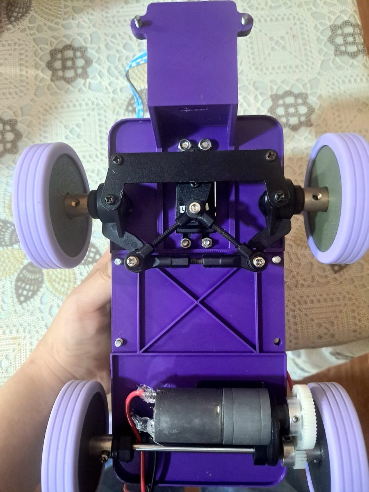 | 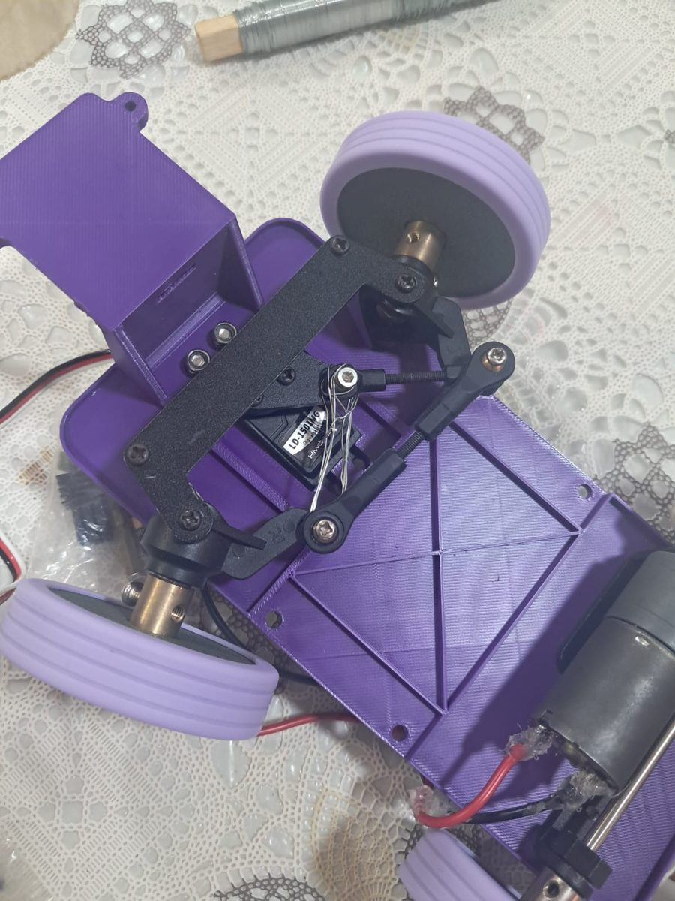 | 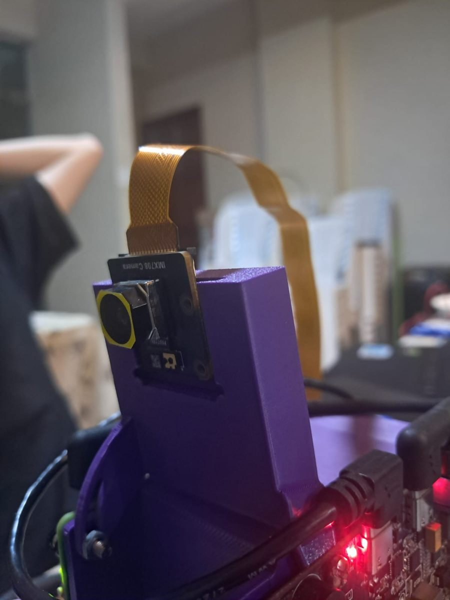 |

| LiDAR on its printed tab | Parts before assembly | Battery and Pi housing |
| :--: | :--: | :--: |
| 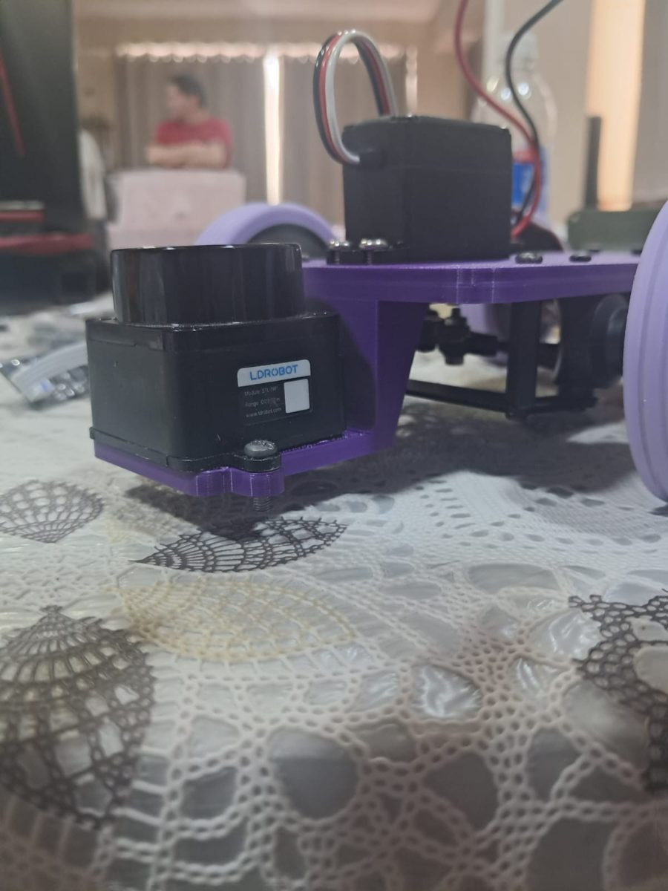 | 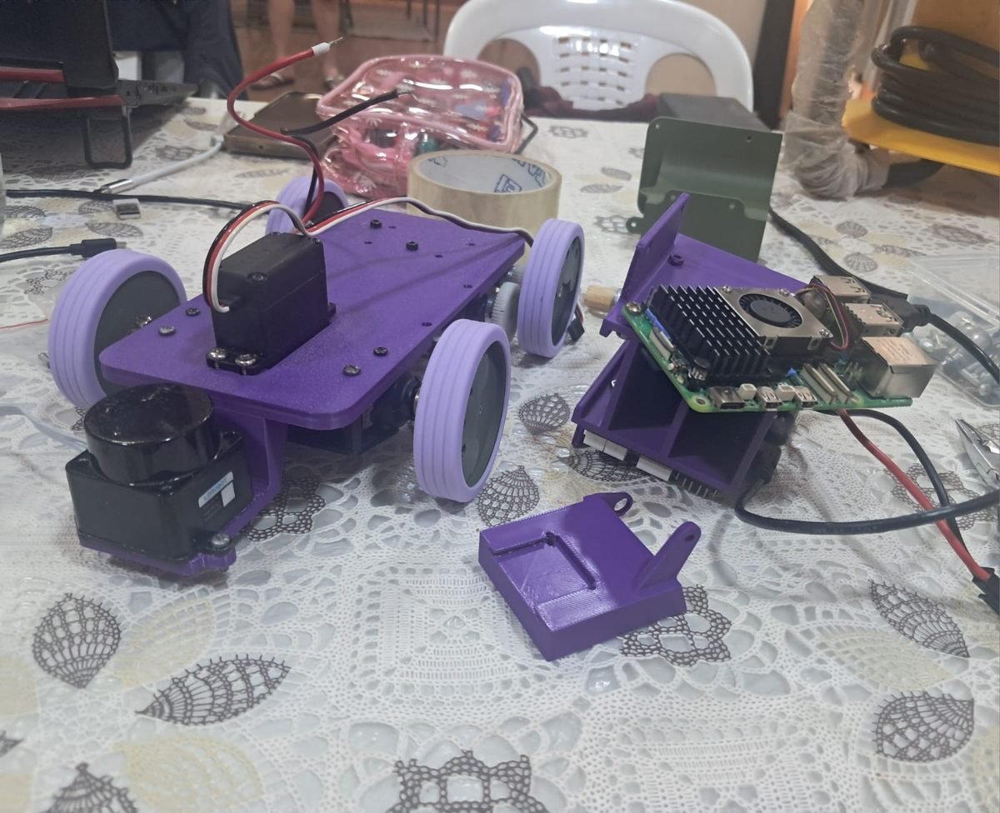 | 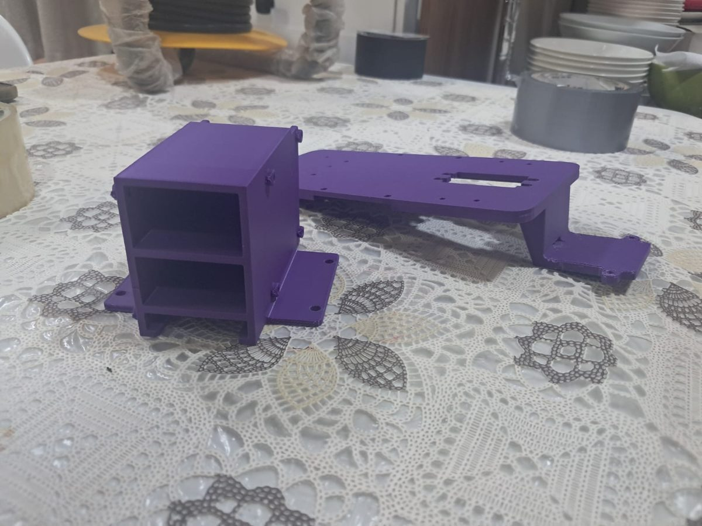 |

### Versions of the car

Our vehicle has gone through **twelve versions** and we keep improving it. Versions 1 to 11 are the ones we described in our national documentation; version 12 is the car for the international final. It all started with a cardboard prototype, then moved on to acrylic and metal chassis designs, and later, we made personalized adjustments to a HiWonder kit. Along the way, we also experimented with different wheel designs, repositioned components, tested sensors like LiDAR, and finally adopted a new operating environment with ROS and Ubuntu.

<table>  
  <tr>
    <th width="10%">Version</th>
    <th width="40%">Car Photo</th>
    <th width="50%">Description</th>
  </tr>
  
  <!-- Version 1 -->
  <tr>
    <td align="center"><i>Version N°1</i></td>
    <td align="center">
      
    </td>
    <td>
      We built a cardboard prototype to test and understand the Ackermann steering system and wheel movement. This served as a reference to learn about the placement of components and systems.<br><br>
      <a href="v-photos/vehicle-versions/README.md#version-1">➡️ See more photos 🚗</a>
    </td>
  </tr>

  <!-- Version 2 -->
  <tr>
    <td align="center"><i>Version N°2</i></td>
    <td align="center">
    </td>
    <td>
      <br>We cut and incorporated an acrylic chassis and designed/3D-printed housing pieces for the camera, Ackermann system, and other components. The Ackermann used a stepper motor, and to perceive its surroundings, the car relied on infrared sensors and a webcam. 
      <br><br>The main controllers were a Raspberry Pi 4 and an Arduino Nano, powered by a power bank and lithium batteries. The car’s movement was driven by a single motor.<br><br> 
      <a href="v-photos/vehicle-versions/README.md#version-2">➡️ See more photos 🚗</a><br><br>
    </td>
  </tr>

  <!-- Version 3 -->
  <tr>
    <td align="center"><i>Version N°3</i></td>
    <td align="center">
    </td>
    <td>
      <br> We replaced the power bank with a smaller one, adjusted component placement into a two-level car system, and installed new wheels. Lithium batteries were replaced with higher-current ones, and the infrared sensors were moved to the front, so the vehicle could make more precise turns.<br><br>
      <a href="v-photos/vehicle-versions/README.md#version-3">➡️ See more photos 🚗</a><br><br>
    </td>
  </tr>

  <!-- Version 4 -->
  <tr>
    <td align="center"><i>Version N°4</i></td>
    <td align="center">
    </td>
    <td>
    <br> We upgraded the chassis to a modified HiWonder Kit and replaced the infrared sensors with a LiDAR for more accurate obstacle detection. The webcam was also switched to a monocular camera. The original car motor was replaced by two encoder motors, adapted with gears to drive a single wheel in compliance with competition guidelines.<br><br>

For the Ackermann steering, we replaced the stepper motor with a servomotor. On top of that, we moved away from the Arduino Nano and began implementing the ROS framework.<br><br>
<a href="v-photos/vehicle-versions/README.md#version-4">➡️ See more photos 🚗</a><br><br>
    </td>
  </tr>

  <!-- Version 5 -->
  <tr>
    <td align="center"><i>Version N°5</i></td>
    <td align="center">
    </td>
    <td>
      <br>Our main improvement was the chassis. We joined the two bases by drilling them together and carefully organized the components with the Raspberry Pi inside. The LiDAR was placed on top so nothing would block its view, and we also completed and installed the camera housing.<br><br>
      <a href="v-photos/vehicle-versions/README.md#version-5">➡️ See more photos 🚗</a><br><br>
    </td>
  </tr>

  <!-- Version 6 -->
  <tr>
    <td align="center"><i>Version N°6</i></td>
    <td align="center">
    </td>
    <td>
      <br> Wheels were changed to adjust the car’s height so the Lidar could detect walls within the 10 cm range (previously it was too high and failed). The housing material was upgraded from PLA to polycarbonate for greater resistance, and the Open Challenge (autonomous 3 rounds driving) was completed.<br><br>
      <a href="v-photos/vehicle-versions/README.md#version-6">➡️ See more photos 🚗</a><br><br>
    </td>
  </tr>

  <!-- Version 7 -->
  <tr>
    <td align="center"><i>Version N°7</i></td>
    <td align="center">
    </td>
    <td>
      <br> Using our HiWonder kit as the base, we designed and cut a completely new, smaller chassis with personalized mounting holes for all components, new housing pieces were created, and the two-motor system was replaced by a single motor in a gear system.<br><br>
    We also moved from a two-level structure to a single-level layout, placing all the components on the same surface to give the Raspberry Pi better airflow and easier access. The car successfully detected and avoided the first traffic signs.<br><br>
      <a href="v-photos/vehicle-versions/README.md#version-7">➡️ See more photos 🚗</a><br><br>
    </td>
  </tr>

  <!-- Version 8 -->
  <tr>
    <td align="center"><i>Version N°8</i></td>
    <td align="center">
    </td>
    <td>
      <br> <b>Car dimensions:</b> 15 x 23 cm <br><br>
      We 3D-printed new, slimmer front wheels because the original ones stuck out too much from the chassis. A custom housing was also printed for the batteries, and most importantly, the Ackermann steering servo was mounted vertically to save space and allow for a wider turning angle.<br><br>
During previous testing, we realized the LiDAR was struggling to properly detect the walls of the field, so we 3D-printed and implemented a small angled mount to give it a slight tilt.<br><br>
      <a href="v-photos/vehicle-versions/README.md#version-8">➡️ See more photos 🚗</a><br><br>
    </td>
  </tr>

<!-- Version 9 -->
  <tr>
    <td align="center"><i>Version N°9</i></td>
    <td align="center">
    </td>
    <td>
      <br> <b>Car dimensions:</b> 15 x 20 cm <br><br>
In this version, the components were arranged more efficiently to save space. We added a custom housing for the batteries, placed the Pi5 controller on top, and mounted the Raspberry above it, creating a layered system.<br><br> 
A new chassis base was printed in MDF, and the Ackermann was moved slightly because, in the previous version, the rack was colliding with the servo. To improve traction, we added a groove to the wheels and printed small cylinders between them to prevent contact with the screws. With these adjustments, the robot managed to complete a lap in <b>20 seconds</b>.<br><br>
      <a href="v-photos/vehicle-versions/README.md#version-9">➡️ See more photos 🚗</a><br><br>
    </td>
  </tr>

  <!-- Version 10 -->
  <tr>
    <td align="center"><i>Version N°10</i></td>
    <td align="center">
    </td>
    <td>
      <br> <b>Car dimensions:</b> 15 x 18 x 16 cm <br><br> 
We removed the LiDAR housing because, after testing the robot multiple times, we found that vision worked better without it. We also printed the rear wheels, so now all wheels are the same. We modified the gear system, which allowed the robot to complete the 3 laps faster. It now takes less than 10 seconds to complete an entire lap, and it manages to complete the 3 laps in 28 seconds. The small and big gears were interchanged so that the big gear is directly attached to the motor shaft
<br><br>
  <a href="v-photos/vehicle-versions/README.md#version-10">➡️ See more photos 🚗</a><br><br>
    </td>
  </tr>

  <!-- Version 11 -->
  <tr>
    <td align="center"><i>Version N°11</i></td>
    <td align="center">
    </td>
    <td>
      <br> <b>Car dimensions:</b> N x N x N cm <br><br> 
We noticed that the room lights were affecting our color detection, so we added a 16-LED WS2812 RGB ring light (5V) to keep the lighting consistent. We also moved the LiDAR again. We printed a new housing and placed it at the front, right under the chassis, an adjustment that significantly improved wall detection.
Finally, we replaced the old L298N motor driver with a TB6612FNG. This made a big difference because we can now control the speed more smoothly, starting at around 35%, and we have much better control when reversing and stopping.
<br><br>
  <a href="v-photos/vehicle-versions/README.md#version-10">➡️ See more photos 🚗</a><br><br>
    </td>
  </tr>
  

  <!-- Version 12 -->
  <tr>
    <td align="center"><i>Version N°12</i><br><b>(current)</b></td>
    <td align="center">
      
    </td>
    <td>
      The car we take to the international final. The motor and the steering servo moved from the Raspberry Pi GPIO and the TB6612FNG driver to the Hiwonder RRC Lite board, which closes the speed loop with the motor encoder. A single battery now feeds everything, the gears are 1:1 (printed by us), the Hiwonder motor has a thicker shaft, the steering linkage got one more rod, and the car carries a LD19 LiDAR, a Pi camera with a wide lens and a VL53L0X distance sensor at the rear. Its software is ROS 2 Jazzy with one state machine per challenge.<br><br>
      <a href="v-photos/version-12/">➡️ See more photos 🚗</a><br><br>
    </td>
  </tr>
</table>

<br>

> [!NOTE]
> 🌱 Visit our [`vehicle-versions`](v-photos/vehicle-versions/README.md) folder to see photos and videos of our car evolution.

<br>

#### What changed in version 12

* **Drive.** The motor and the servo moved from the Raspberry Pi GPIO and the TB6612FNG driver to the **Hiwonder RRC Lite** board: the board closes the speed loop with the motor encoder, and the steering servo is on port J4.
* **Power.** One battery for everything: the second (motor) battery of version 11 was removed. The board feeds the motor, the servo and the Raspberry Pi.
* **Gears.** 1:1 instead of 54:30 (12 Nov 2026), printed by us in 3D.
* **Motor shaft.** The original shaft of the Hiwonder motor was replaced by a thicker one.
* **Sensors.** LD19 LiDAR, Pi camera with a wide lens on the CSI ribbon, the IMU of the board and a VL53L0X distance sensor at the rear.
* **Steering servo.** Mounted vertically, with one more rod in the linkage, and re-mounted on 18 Nov 2026 after steering faults.
* **Small things.** Sponge around the battery so that it fits its printed housing, and a printed piece with our koala logo that places the car in the parking lot at the start.
* **Software.** ROS 2 Jazzy on Ubuntu 24.04, one state machine per challenge (chapter 6 for the Obstacle, chapter 7 for the Open).

## 3. Mechanics: chassis, steering and drive

How the car is built, why each part was chosen and which tests changed the design. The dimensions of the car and the angle of its wheels are drawn below.

### Layout and dimensions

| Item | Value | Source |
| --- | --- | --- |
| Layout | Four wheels, **rear-wheel drive** (one driven axle), **Ackermann steering** on the front axle | rules 11.3 |
| Wheelbase | 118.83 mm (front kingpins to rear axle) | STEP model + caliper, `robotek_obstacle_v3/car.py` |
| Rear track / outer width | 123.5 mm / 138.0 mm (caliper); 147.6 mm over the front wheels | caliper, 21 Oct 2026 |
| Chassis plate | 189 mm long, 90 mm wide | STEP model |
| Outline used by the planners | 147.0 mm ahead of the reference point (LiDAR tab) and 85.9 mm behind it: about 233 mm long | `car.py` |
| Wheels | 3D-printed rims with a 61.0 mm silicone tyre (suitcase wheel protector), 14.5 mm wide, same on all four wheels since version 10 | [chapter 12](#12-history-of-the-car-and-engineering-journal) |
| Limits of the rules | 300 × 200 mm, 300 mm high, 1.5 kg | rules 11.1 and 11.2, see [rules compliance](#11-rules-compliance) |

The reference point of the software (`base_link`) is midway between the axles, on the floor. Every sensor offset (LiDAR 127.3 mm ahead, camera 55.8 mm ahead) is measured from it and must match the URDF in `src/robotek_description`.

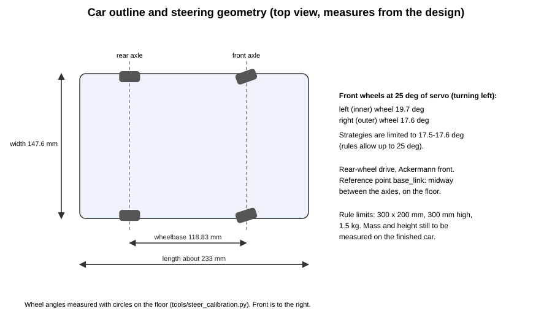

### Steering: why a Hiwonder Ackermann linkage

**Choice.** A linkage Ackermann from the Hiwonder kit driven by one 15 kg·cm digital servo.

**Why.** Our first versions used a stepper motor with a 3D-printed gear and rack. Small printed teeth were imprecise and the rack collided with the servo in version 8–9, so we replaced it by the kit linkage, adapted to our chassis. Ackermann geometry makes all wheels roll around a common centre, which cuts tyre slip in the tight corners of the field (inner lane radius of about 0.4 m).

**What testing changed.**

1. *Servo position.* With the servo horizontal under the linkage the car turned worse to the left than to the right (limited servo angle). Moving the servo to a vertical position fixed the asymmetry (photos in [chapter 12](#12-history-of-the-car-and-engineering-journal)).
2. *Servo placement, again, on 18 Nov 2026.* After the Obstacle rounds of that day showed full-lock commands with almost no turn (gyro 0.01–0.2 rad/s where 0.5–1.2 rad/s was expected), the servo mounting was found to be wrong on the car. It was re-mounted and the number of steering faults per round dropped (9 in the worst round before, 0–3 after), although not to zero, so the check stays on. The software now watches for this failure (`steer_watch.py`): full lock asked while driving forward and the gyroscope shows less than 30 % of the expected turn.
3. *Real wheel angle.* We measured the wheel angle with circles on the floor (`tools/steer_calibration.py`, 8 Oct and 1 Nov 2026): at the servo limit of 25° the wheels reach about **19.7° to the left and 17.6° to the right**. `base_adapter` converts the commanded wheel angle to servo microseconds through a measured table (centre 1403 µs, 20 µs per servo degree, `src/robotek_hardware/config/robot.yaml`) and the strategies are limited to **17.5°** of wheel angle, so a command is never beyond what the car can do. The servo itself is also limited to 25° (the limit the team set for the software).

**Trade-off.** More steering angle would give tighter corners but the linkage binds beyond 25° of servo, so the minimum turning radius is fixed by geometry (about 0.38 m at 17.5°). Our corner planner (`corner.py`) is written around that radius instead of assuming ideal steering.

**How the steering design evolved.** The first versions used a stepper motor with a printed gear and rack; the printed teeth were imprecise and the design took too much room, so we moved to the Hiwonder kit linkage. Photos of that history, from our national documentation:

<p align="center">
  
  
  
</p>

The position of the servo made the difference between a car that turned well to one side only and one that turned well to both:

<table>
  <tr>
    <th width="30%">Initial position</th>
    <th width="30%">Idea</th>
    <th width="30%">Final position</th>
  </tr>
  <tr>
    <td align="center"></td>
    <td align="center"></td>
    <td align="center"></td>
  </tr>
  <tr>
    <td align="center">Servo mounted horizontally (limited angle to the left)</td>
    <td align="center">Servo repositioned vertically</td>
    <td align="center">Final placement with improved steering</td>
  </tr>
</table>

**One more rod in version 12.** For this version we added one more rod to the linkage that the servo moves. The two photos show the servo with its rods under the chassis, and the short video [steering-linkage.mp4](videos/steering-linkage.mp4) shows the linkage moving.

| Servo and rods | Another view |
| :--: | :--: |
| 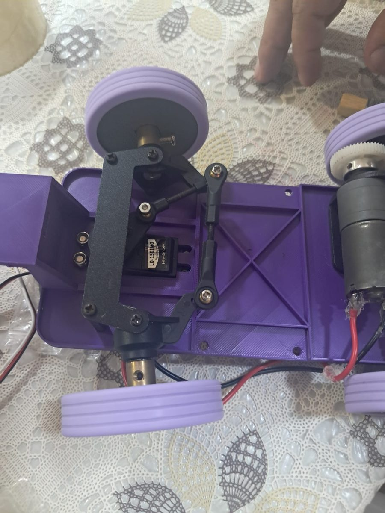 | 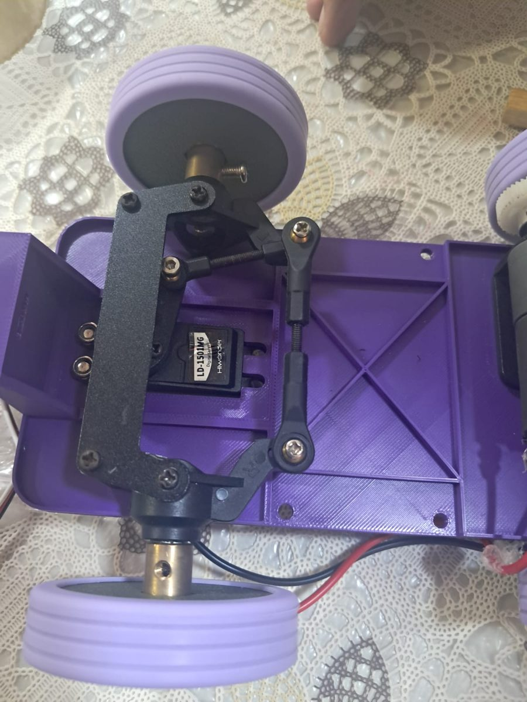 |

### Drive train: motor, gears, speed

**Motor.** One Hiwonder JGA27-310R encoder motor (20:1 gearbox, 450 rpm) on port M2 of the RRC Lite board. The board runs the speed loop with the encoder, so the software commands m/s (converted to board rps) and the speed no longer depends on battery voltage.

**Torque and speed reasoning.**

* The board's speed loop cuts the PWM below 25 %, which is about 0.2 m/s with no load for this fast motor: it cannot hold 0.15–0.30 m/s by itself. On the floor it either does not start or runs at 0.35–0.4 m/s. We therefore set a minimum command (`motor_min_rps: 2`, about 0.25 m/s) and plan the Obstacle at 0.28–0.30 m/s, the lowest speed at which the motor starts the car reliably with full steering lock.
* Above about 2 board rps the motor cannot turn faster, the board only pushes more current (a frontal crash at full push stalled and overheated it). `motor_max_rps` is limited accordingly (about 0.49 m/s).
* Measured by LiDAR runs: 1 board rps = 0.209 m/s with the first gearing, about 0.45 m/s mean and 0.65–0.69 m/s peak forward at 1.9 rps, 0.40–0.44 m/s backwards.

**Gear ratio: 54:30 against 1:1.** The first Obstacle rounds used a 54:30 reduction (`motor_rps_per_mps` 4.4). After rounds with several ratios on 11–12 Nov the coach chose **1:1** (`motor_rps_per_mps` 7.0–8.0): the car starts at lower speeds with full lock and the speed command is better aligned with the speed on the floor. Result on the same field: complete rounds of 107.1 s from Start (laps 36.2 / 33.1 / 33.8 s) with no recovery manoeuvre, and 105.9 s with the partial park. See the table in [05 Reproducibility and tests](#obstacle-rounds-on-the-car).

**Motor driver history.** L298N → TB6612FNG → RRC Lite closed loop (summary in [chapter 12](#motor-driver-history)).

**Changes we made to the motor and the gears in version 12.**

* **A thicker motor shaft.** We replaced the original shaft of the Hiwonder motor by a thicker one. The photo on the left compares the original motor, with its encoder, and the modified one; the photo on the right shows the motor with the new shaft.
* **Gears printed in 3D.** The gears of the drive train are printed by us (purple parts below). Version 12 runs them 1:1.
* **The motor on the chassis.** The motor sits in the printed base and its shaft carries the gear to the rear axle.

| Original and modified motor | Motor with the thicker shaft | Gears printed in 3D |
| :--: | :--: | :--: |
| 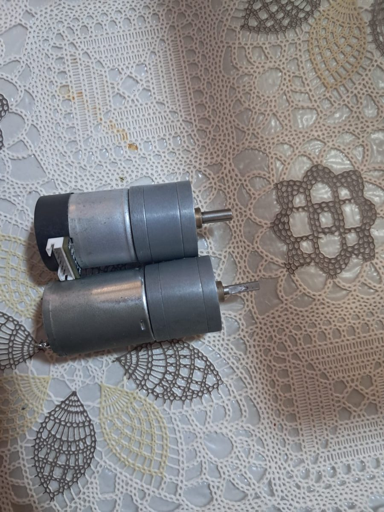 | 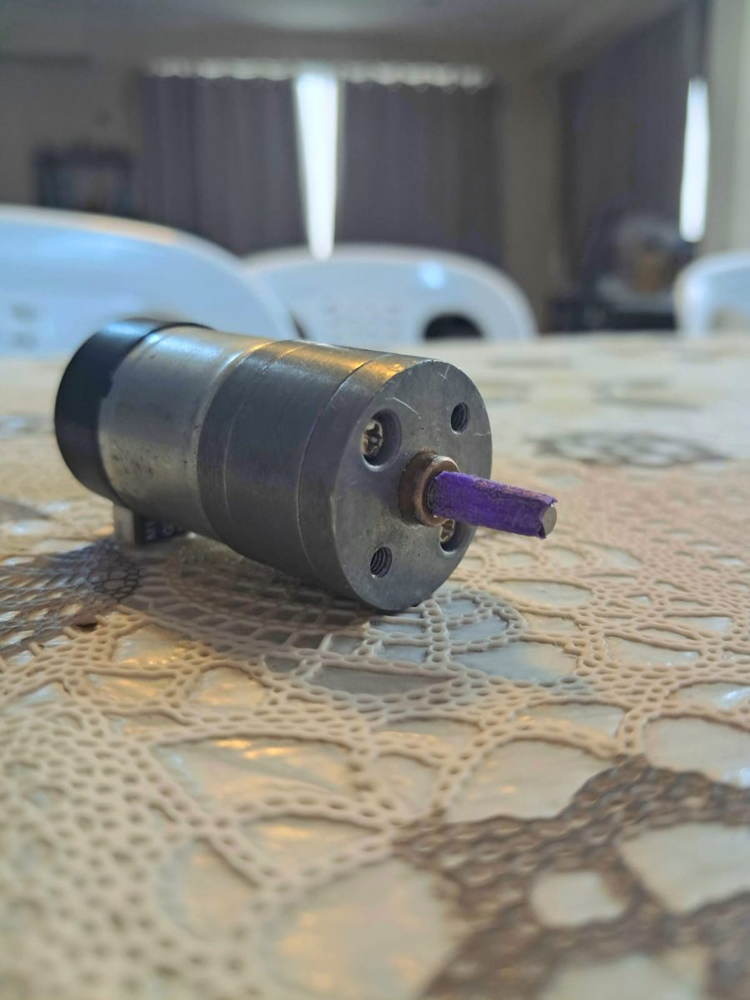 | 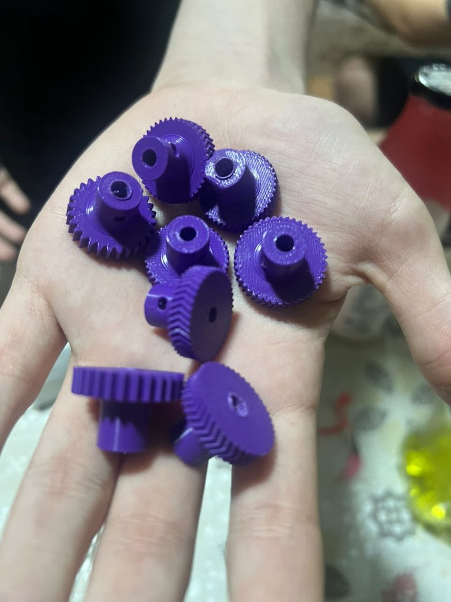 |

| Original and modified motor (another view) | Motors in the printed base |
| :--: | :--: |
| 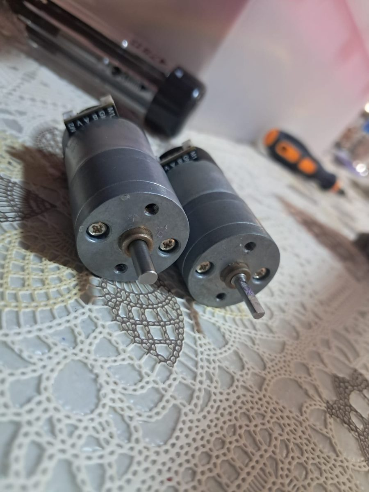 | 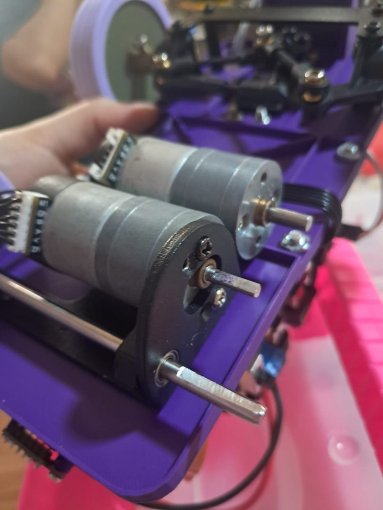 |

The drive axle history, with the earlier gear system, from our national documentation:

<p align="center">
  
  
</p>

### Torque and speed, worked out

The tyres are 61 mm in diameter, so one wheel turn moves the car 0.1916 m. The speeds we use correspond to these wheel speeds:

| Speed | Where we use it | Wheel speed |
| --- | --- | --- |
| 0.25 m/s | Slowest the motor holds (the motor floor) | 78 rpm |
| 0.28–0.30 m/s | Obstacle lane following | 88–94 rpm |
| 0.64 m/s | Open corners | 200 rpm |
| 0.85 m/s | Open straights | 266 rpm |

**How much torque does the car need?** Take the worst case allowed by the rules, 1.5 kg, a rolling resistance coefficient of 0.03 for silicone on the mat (an assumption, to be checked with a pull test) and a hard acceleration of 1 m/s². The force at the tyres is 0.03 × 1.5 × 9.81 + 1.5 × 1 = 1.94 N, which at a wheel radius of 30.5 mm is **0.059 N·m (0.6 kg·cm)** at the axle. That is small, and the motor has plenty of margin; the limit of our car was never torque, it was the **minimum speed at which the motor and its driver start moving** (see section 3), and the electrical limits of the board when the motor is blocked. This is why the gearing was chosen by what happened on the track (starting at full lock, speed at 0.28 m/s) and not by a torque calculation.

**Why the steering lock matters for speed.** At 17.6° of wheel angle and a wheelbase of 118.83 mm the turning radius of the rear axle is 0.118 83 / tan 17.6° = **0.375 m**. At 0.28 m/s the car then turns at 0.75 rad/s (43°/s). The corner planner and the steering watch use exactly this relation: if the gyroscope reads much less than speed × tan(wheel angle) / wheelbase, the wheels did not turn.

### Mechanical stability

* Version 9 stacked the electronics in two levels (batteries and the board below, the Raspberry Pi above) and printed a new base: lower centre of gravity and no more collision between rack and servo.
* A gap between the metal chassis part and the axle supports made the drive train wobble; we designed 3D-printed cylindrical spacers that fill it.
* A groove in the wheels plus small printed cylinders improved traction. The silicone tyres give the grip that the printed plastic did not.
* The LiDAR was moved lower (it looked over the walls at its first height) and mounted on a printed tab in front of the car (`models/lidar_housing`).

**What we would change next.** The wheel encoder of the drive motor is not read by the software yet; using it would remove the drift of the dead reckoning after the lot exit (the estimated pose ends up to 0.2 m away from the LiDAR localisation).

### Printed parts and other pieces

| Part | Folder | Purpose |
| --- | --- | --- |
| Vehicle base | [`models/vehicle_base`](models/vehicle_base) | Chassis plate with the mounting holes of every housing |
| Raspberry Pi housing | [`models/raspberry_housing`](models/raspberry_housing) | Holds the Pi above the servo |
| Camera housing | [`models/camara_housing`](models/camara_housing) | Fixed inclination of the camera (see [chapter 4](#sensors-selection-and-placement)) |
| LiDAR housing | [`models/lidar_housing`](models/lidar_housing) | Puts the LD19 at the front with a free field of view |
| Wheels | [`models/vehicle_wheels`](models/vehicle_wheels) | Rims that take the silicone tyre |

Each folder has an STL and a preview image. The kit parts (Ackermann linkage, hubs, motor, servo) are listed in the bill of materials in [chapter 4](#bill-of-materials). The assembly sequence is in the next section.

**Photos of the parts.**

| Base seen from above | Base in the CAD program | Printing a part |
| :--: | :--: | :--: |
| 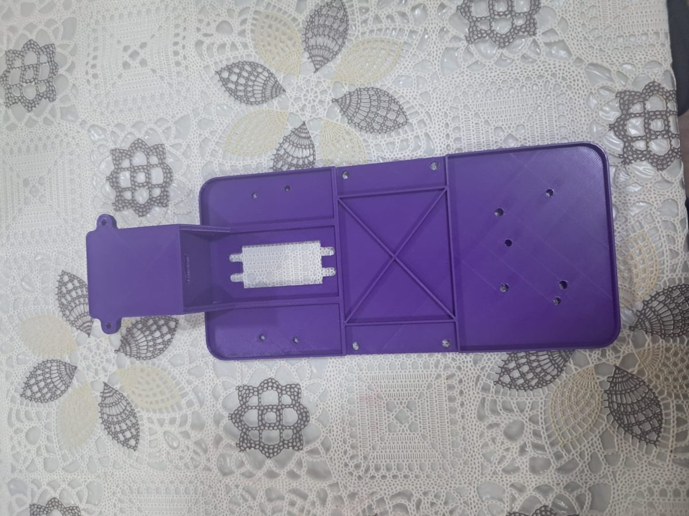 | 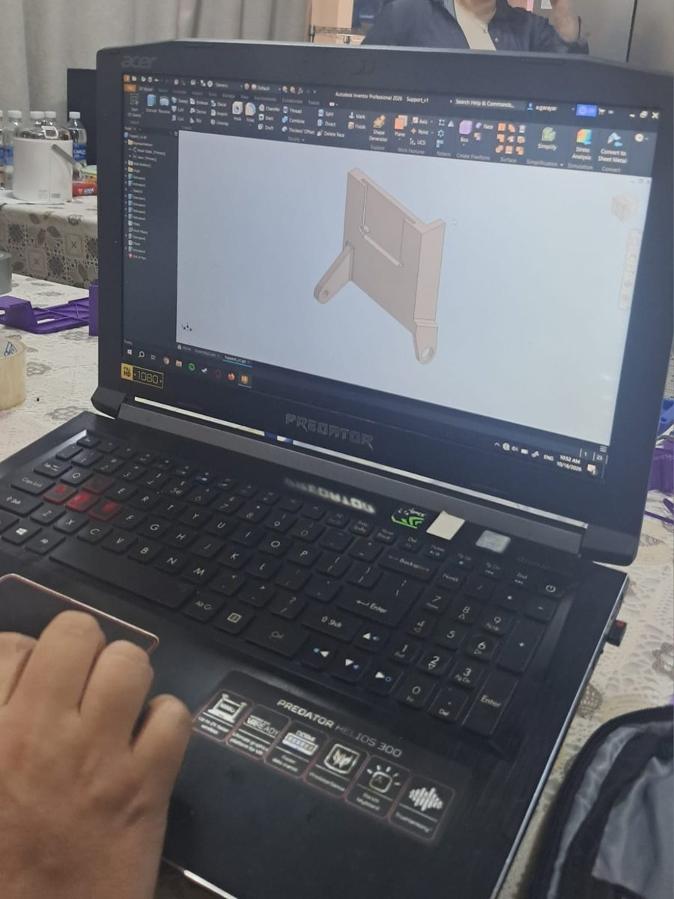 | 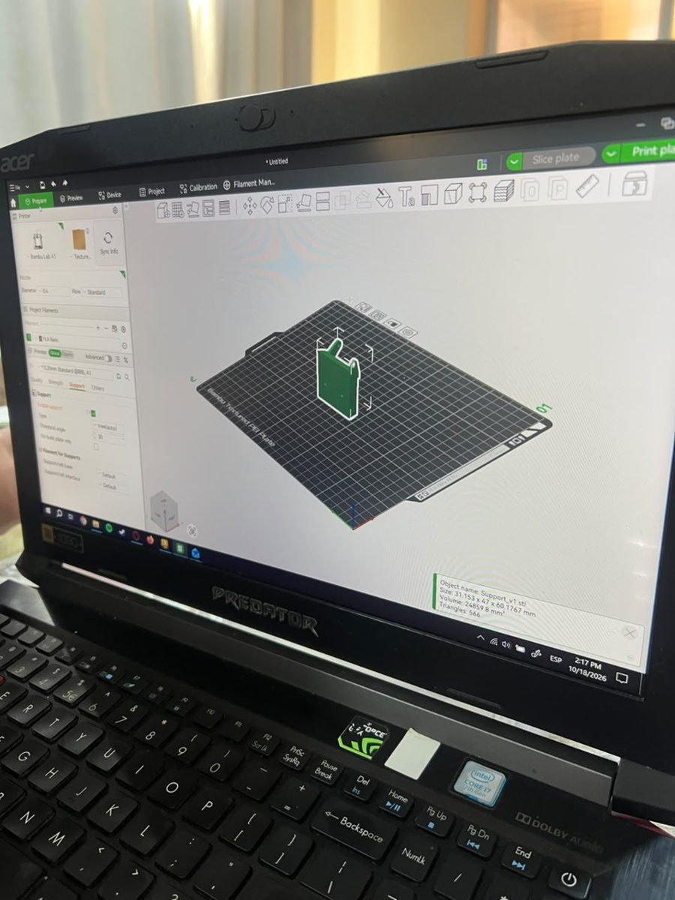 |

The video [3d-printing-parts.mp4](videos/3d-printing-parts.mp4) shows one of the parts being printed.

**The placement piece for the parking lot.** We also printed a flat piece with the Robotek name and our koala logo. It is shaped to fit the parking lot, so that at the start of a round the car is put in the lot in the same place every time, quickly and without nudging it around. The photo shows it in the slicer, and in the video [parking-piece-in-the-lot.mp4](videos/parking-piece-in-the-lot.mp4) it can be seen lying in the lot of our field.

| In the slicer | In the lot of our field |
| :--: | :--: |
| 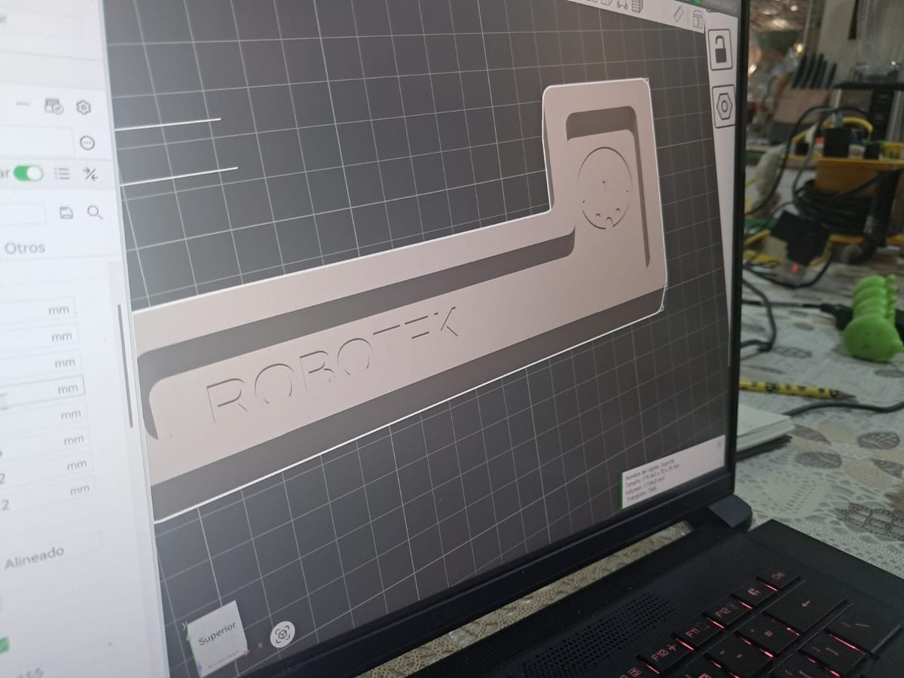 | 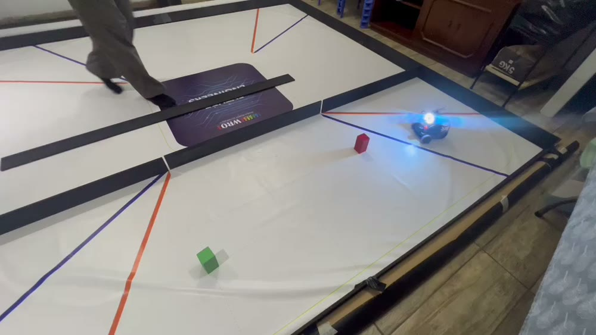 |

**Batteries.** The battery fits its printed housing with a layer of sponge around it, which also holds it in place.

<p align="center">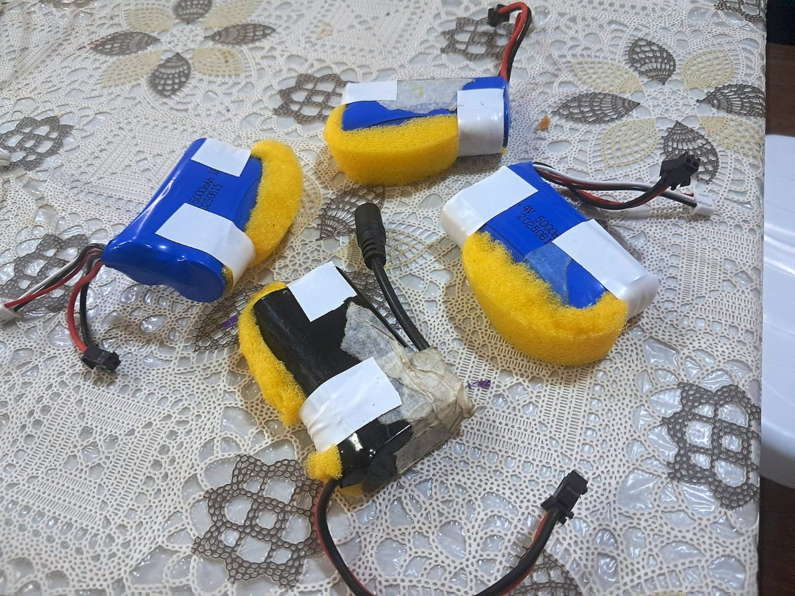</p>

**Something we tried and did not keep.** We tried to fit the old TB6612FNG motor-driver board on the base, next to the motor. In the end it was not used: version 12 drives the motor from the RRC Lite board.

| Driver on the base | Another attempt |
| :--: | :--: |
| 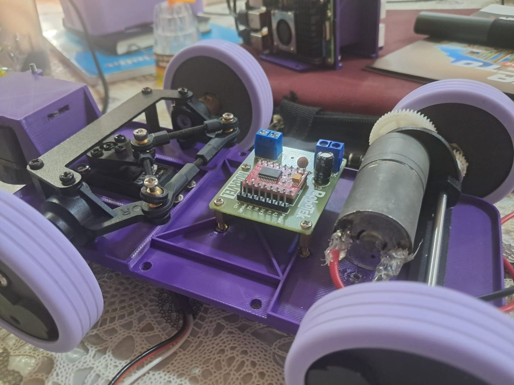 | 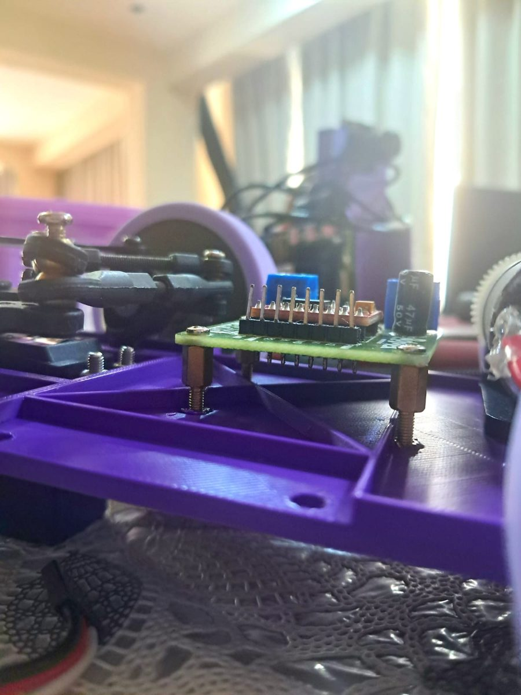 |

### Assembly instructions

This is the order in which we build the car. The STL files are in [`models`](models) and the photos of the finished car are in [`v-photos`](v-photos).

#### 1. Ackermann steering

1. Screw the fixed part of the Ackermann system to the base.
2. Fit the two movable pieces that steer the wheels on the sides of the fixed part. They must still turn freely. Each has two holes: use the one closer to the wheels for the long linkage.
3. Join the two wheel pieces with the long linkage, which has a bearing at each end. The bearings are screwed into the holes of the wheel pieces, so the whole forms a half-rectangle that can move.
4. Fit the shorter linkage on one side of the system, on one of the holes already used by the long linkage. This is the linkage that the servo moves, so it connects to the servo horn.
5. The servo's output shaft and the side where the short linkage is fixed must be on **opposite sides**.
6. Mount the servo **vertically**. A horizontal servo limited the angle to the left (see chapter 3).
7. Fit the wheel hubs, which hold the wheels, on the movable pieces with bearings, so the wheels spin freely.

| Base and steering linkage | Servo and rods |
| :--: | :--: |
|  |  |

#### 2. Motor and drive axle

1. Screw the motor mount to the base, then the motor to the mount. If there is a gap between the metal chassis part and the axle supports, fit the printed spacer cylinders first: a loose axle makes the drive train wobble.
2. Put the axle through the two openings of the mount. It rests on two bearings that keep it centred and two locking rings that stop it from sliding sideways.
3. Join the motor shaft and the axle with the spacers, keeping them clear of the motor screws (gears 1:1 in version 12).
4. Put the rear wheels on the hubs, with the silicone tyres.

| Motor, gear and axle in the base | The gears we print |
| :--: | :--: |
|  |  |

#### 3. Housings

With both systems in place, fit the housings on the top of the base, following the model:

* The **LiDAR housing** goes at the front, so nothing blocks its view.
* The **camera housing** goes right behind it. It is taller, so the camera sees over the LiDAR, and it tilts the camera down about 8°.
* The **battery and Raspberry Pi housings** go behind, forming a ceiling over the servo that sticks out of the base.

| All the printed parts | Camera housing | LiDAR on its tab |
| :--: | :--: | :--: |
|  |  |  |

#### 4. Electronics

1. Fix the Raspberry Pi 5 and the RRC Lite board in their housings and join them with a USB cable. The board is the most critical USB device: keep it on its own USB controller.
2. Plug the LiDAR into the other USB controller and the camera ribbon into the CSI port of the Pi.
3. Connect the steering servo to **PWM port J4** of the RRC Lite and the drive motor to **port M2**.
4. Connect the battery (2S LiPo) to the board's power input. The board gives the motor and the servo their power and sends 5 V to the Raspberry Pi over its USB-C port. There is only one battery.
5. Wire the rear VL53L0X to the Pi: VIN to 3.3 V (pin 1), SDA to pin 3, SCL to pin 5, GND.
6. Wire the extra push button between GPIO 16 and GND.
7. Run `bash tools/setup-pi.sh` to install the software and the udev rules (see chapter 9).

The rear distance sensor sits in a small printed mount on the back of the base:

<p align="center">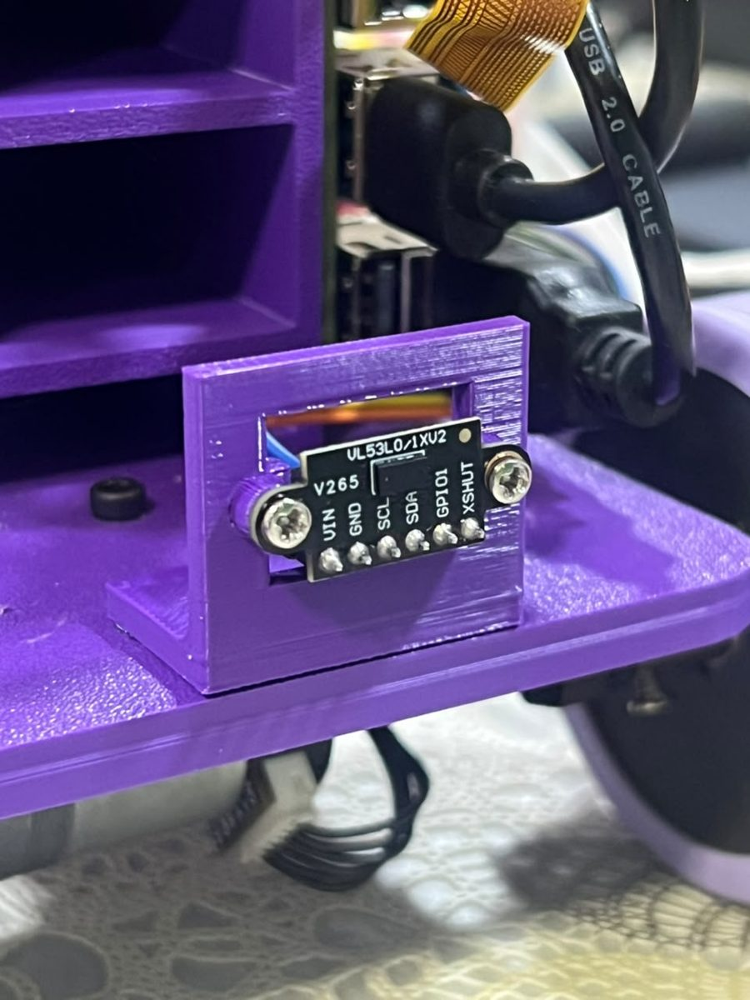</p>

#### 5. First checks

* **The first time, put the car on supports with the wheels in the air.** Neither the script nor the launch moves the motor by itself, but you want to see the wheels follow the steering before the car touches the floor.
* **Centre the steering.** Send 1403 µs to the servo and tighten the horn so that the wheels point straight. Then check the limits with `tools/steer_calibration.py`: about 19.7° left and 17.6° right at 25° of servo.
* **Weigh and measure** the finished car against the limits of the rules (see [rules compliance](#11-rules-compliance)).

## 4. Power, sensors and wiring

Where the energy comes from, what each sensor is for and why it sits where it does, how everything is connected, how we calibrate it and what can fail. Numbers marked *measured* come from logs of our own tests; numbers marked *rated* are datasheet maxima.

### Block diagram (power and data)

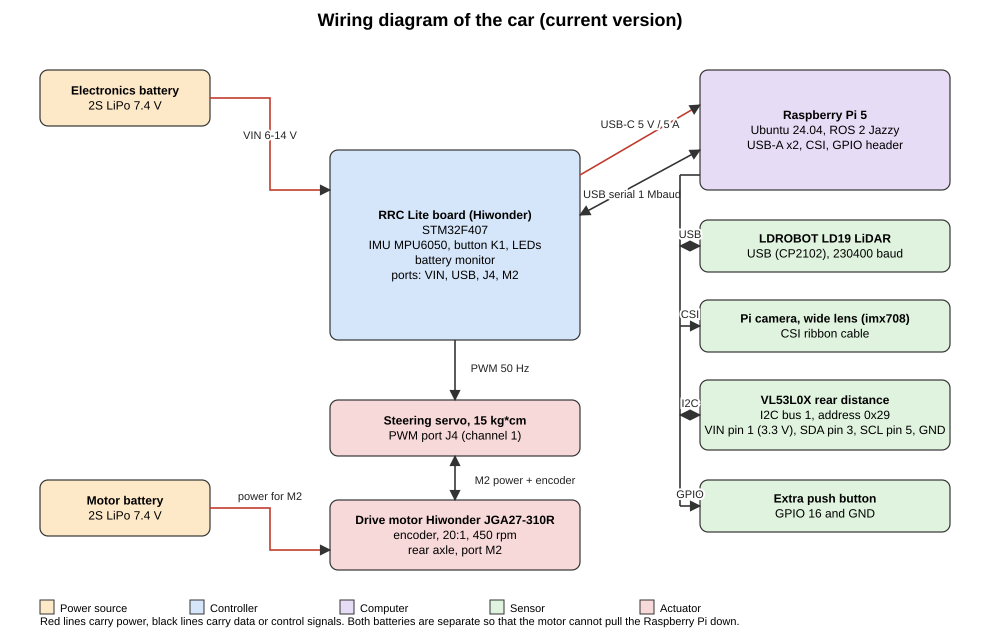

One 2S LiPo battery feeds the RRC Lite board. The board powers the motor (port M2) and the steering servo (port J4) and sends 5 V / 5 A over USB-C to the Raspberry Pi; the sensors take their power from the Pi.

### Why one battery: measured evidence

On 8 Oct 2026, with a **single** battery feeding both motor and Pi, we logged the 5 V rail of the Pi (`vcgencmd pmic_read_adc EXT5V_V`, about 75 Hz) together with the battery voltage the board reports and the Pi's throttling flags:

| Situation (measured, 8 Oct 2026) | Pi 5 V input | Battery | Under-voltage |
| --- | --- | --- | --- |
| Idle | 5.00-5.03 V | - | no |
| Servo ±10° and ±25° | minimum 4.835 V (when the nodes start, not from the servo) | 7.84-7.86 V | no |
| Motor pulses at 50 / 100 / 100 % | drop ≤ 83 mV, minimum 4.914 V | 7.57-7.69 V | no |

The Pi stays well above its under-voltage threshold (about 4.63 V). Version 11 still carried a second battery for the motor; version 12 drops it: it is one battery less to charge, wire and keep an eye on, and the measured dips are small.

What we have **not** measured is a hard motor stall with the Pi on the same battery. To keep that case safe, the software limits the motor (`motor_max_rps`), ends the reversing moves by distance, and `battery_guard` reads `/rrc/battery` (about 1 Hz) and, after 5 readings in a row under **6.8 V** (3.4 V per cell), blinks both board LEDs red. It deliberately does not stop the car (team decision, 9 Oct).

### Power budget

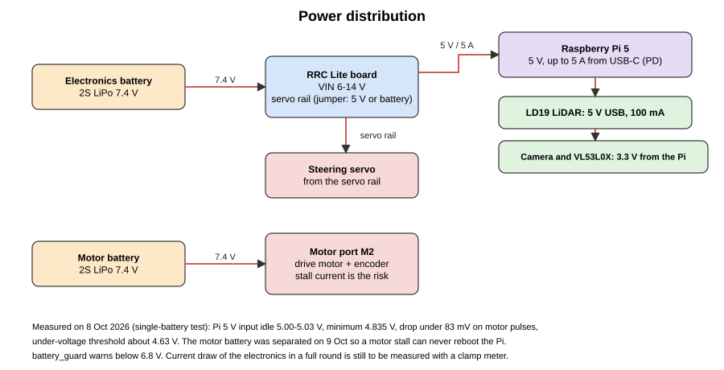

| Consumer | Rail | Rated / measured | Note |
| --- | --- | --- | --- |
| Raspberry Pi 5 | 5 V | rated up to 5 A (25 W); negotiated source: 5 A | dominant electronics load; 4 cores busy during rounds |
| LDROBOT LD19 | 5 V USB | 100 mA reported on the USB bus (measured, 9 Oct) | motor rotates continuously |
| RRC Lite board | 5 V USB data + battery input | 136 mA reported on the USB bus (measured) | IMU, LEDs, button, servo and motor control |
| Pi camera (imx708) | 3.3 V via CSI | from the Pi rail | small |
| VL53L0X | 3.3 V | from the Pi rail | a few mA |
| Steering servo | board servo rail (5 V or battery, jumper) | stall current from the servo datasheet | brief peaks only |
| Drive motor | battery 7.4 V through port M2 | not measured | stall current is the risk, see "Why one battery" |

The 5 V / 5 A output of the RRC Lite is sized for the Pi and the USB sensors together. We did **not** yet record the Pi's typical current during a complete Obstacle round with a clamp meter; that measurement is the first item of the test plan in [chapter 9](#test-plan-before-the-final), and the table above will be updated with it.

### Sensors: selection and placement

| Sensor | Why this one | Placement and why there |
| --- | --- | --- |
| LDROBOT LD19 LiDAR (STL-19P) | 360° ranging at 10–12 Hz, 0.03–12 m, ±45 mm. One sensor gives the walls, the lane position, the signs (as 5 cm clusters) and the lot limits | At the front, on a printed tab, **lowered** from our earlier height: higher it looked over the 100 mm walls and missed the boundaries. Its zero points backwards, so `scan_adapter` rotates it by π and keeps only ±110°, because the chassis blocks the rest. Returns nearer than about 0.12 m are dropped by the sensor |
| Pi camera, wide lens (imx708) | Colour of the signs (red = pass on the right, green = on the left); the wide lens (HFOV 1.78 rad, about 102°) keeps a sign in view while the car turns | Behind the LiDAR, 142 mm above the floor, tilted down about 8° (pitch 0.14 rad) so that a 100 mm sign is seen from about 1.5 m to 0.3 m; yaw 0.054 rad toward the left of the LiDAR axis, measured with a sign on each side |
| IMU of the RRC Lite (MPU6050) | Heading from the integrated gyro z: LiDAR scans are too slow (10 Hz) to hold heading inside a corner | On the board; axes remapped by `imu_adapter` (x forward, y left, z up) and checked with `imu_axes` |
| VL53L0X rear distance sensor | The LiDAR is blind behind the car; reversing out of the lot and parking need the distance to the lot limit | Rear of the car, on I²C bus 1 (address 0x29). Wiring: VIN to 3.3 V (pin 1), SDA pin 3, SCL pin 5, GND |
| Board button K1 | The rules require a single Start action | The first press publishes `/start`, the second `/robotek/stop` |

**Camera against LiDAR.** The camera alone gives colour but poor distance; the LiDAR gives distance but no colour. We **pair** each coloured blob with the LiDAR cluster at the same bearing (and, when the blob's foot is visible, at the same ground position) so that a sign behind another one on the same bearing is not mixed up. See [chapter 6](#6-obstacle-challenge).

**Sensor trade-offs we decided with data**
* *USB camera (640×480, 66° HFOV) → Pi camera (1024×576, 102° HFOV).* The USB camera delivered 6–16 fps depending on the light, and its 66° field of view did not show an inner sign just after a corner before the car had to commit to a side.
* *Raw frames → JPEG.* With the Pi's 3 cores busy, only 0.2 of 27.6 raw frames per second (691 KB each) reached the strategy; the camera's own JPEG at quality 90 (82 KB) delivers all of them (12 Nov 2026).

### USB topology (measured on 9 Oct 2026)

| Device | Controller / port | Rate | Priority |
| --- | --- | --- | --- |
| RRC Lite (USB 1a86:55d4) | second controller | 12 Mbit/s, 136 mA | 1, the most critical: servo, button, IMU |
| LD19 (CP2102, 10c4:ea60) | first controller, black port | 12 Mbit/s, 100 mA, < 0.3 Mbit/s of traffic | 2 |

The camera is on the CSI ribbon, not on USB. In a stress test the LiDAR did not lose a single message. Stable names for each device come from udev rules (`tools/99-robotek.rules`) so a different port order cannot swap the board and the LiDAR.

### Calibration methods

| What | Method | Where it is stored |
| --- | --- | --- |
| Gyro bias | Measured **after Start**, 0.3 s in both challenges: the rules forbid calibrating before Start (9.9) and require the car to wait for the button only | `mission.py` (`CALIBRATE_SECONDS`) |
| Wheel angle against servo µs | Circles on the floor (`tools/steer_calibration.py`): radius gives the real wheel angle for each servo angle | `wheel_table_*` in `robot.yaml` |
| Speed against board rps | Runs along the wall measured with the LiDAR | `motor_rps_per_mps` in `robot.yaml` |
| Camera yaw, pitch, height | A sign on each side of the car and the LiDAR clusters (8 Oct); height from the STEP model (26 Oct) | `car.py` and `car_picam*.yaml` |
| Sign colours | HSV bands tuned on the real field: red 170–6, green 40–85; the orange field lines are excluded with a minimum value | `red_hsv`, `green_hsv` in the profile |
| Rear distance sensor | Readings against a ruler from the wall: raw 10, 20, 30, 40, 50, 85, 170, 420 mm read 70, 75, 77, 83, 96, 138, 231, 476 mm. The node maps raw to mm by interpolation; between 1 and 4 cm it is good to ±1 cm, from 5 cm to about ±5 mm | `rear_range.py` |
| LiDAR mounting offsets | STEP model and caliper | `car.py` |

### Failure points and mitigations

| Failure | What we saw | Mitigation |
| --- | --- | --- |
| USB hub disabled by electromagnetic noise | The board node died mid-run (4 Nov 2026, "disabled by hub (EMI?)") | Stable udev names, relaunch procedure, board node retries every 3 s |
| Camera frames late | 0.35–0.43 s late 48 times in one run (9 Nov) = 48 stops | Camera age limit 0.8 s; the round continues with remembered colours if the camera is lost for 1.5 s (`CAMERA_LOST`) |
| Camera stopped at 14.5 s and never came back (12 Nov 01:05) | The car waited 18 s | Same `CAMERA_LOST` rule |
| Servo that does not follow the command | Full lock with almost no turn (11 Nov, corner 6; 18 Nov) | `steer_watch.py` stops the car for 0.6 s with the wheels centred, and the mounting was corrected |
| Motor stall | Full push into a wall stalled and overheated the motor | `motor_max_rps`, short recover moves, rear and front distance checks |
| Close returns missing | LiDAR drops returns under 0.12 m | The strategy treats "no returns on the side" as "close wall" with the nominal gap in the lot exit |
| Light on the field | Room lights changed the colours | HSV bands with a minimum value; re-tune them at the venue |
| Battery sags when the motor stalls (Pi brown-out) | Not seen on the car; a hard stall with one battery has not been tested | `motor_max_rps`, short recover moves, `battery_guard` warning at 6.8 V |

### Bill of materials

| Component | Qty | Function |
| --- | --- | --- |
| Raspberry Pi 5 | 1 | Main computer: ROS 2 nodes, vision, planning |
| Hiwonder RRC Lite controller (v1.0 board) | 1 | Motor closed loop, servo, IMU, button, LEDs, battery monitoring |
| LDROBOT STL-19P (LD19) LiDAR and adapter board | 1 | Ranging |
| Pi camera, wide lens | 1 | Colour of the signs |
| VL53L0X distance sensor | 1 | Rear distance |
| 15 kg·cm digital servo | 1 | Steering |
| Hiwonder JGA27-310R encoder motor (20:1 gearbox, 450 rpm) | 1 | Drive |
| 2S LiPo 7.4 V battery | 1 | Powers everything through the RRC Lite board |
| 3D-printed base, housings and wheels; silicone tyres | – | See [chapter 3](#3-mechanics-chassis-steering-and-drive) |
| Push button (GPIO 16) | 1 | Spare input |

### Wiring diagrams

The pictures of this chapter live in [`schemes`](schemes): [`wiring-diagram.svg`](schemes/wiring-diagram.svg) (every connection of the car), [`power-distribution.svg`](schemes/power-distribution.svg) (batteries and rails), [`ros-nodes.svg`](schemes/ros-nodes.svg) (the software side), [`obstacle-flowchart.svg`](schemes/obstacle-flowchart.svg), [`open-flowchart.svg`](schemes/open-flowchart.svg) and [`car-dimensions.svg`](schemes/car-dimensions.svg). They are drawn for the current car (RRC Lite board, servo on J4, motor on M2).

## 5. Software architecture

How the code is organised and how the pieces talk to each other. The decisions of each challenge are explained in chapter 6 (Obstacle) and chapter 7 (Open); the file-by-file guide to the code is [`src/README.md`](src/README.md).

### Code structure

The car runs **ROS 2 Jazzy** on Ubuntu 24.04 (Raspberry Pi 5). The workspace is in [`src`](src):

| Package | Role |
| --- | --- |
| `robotek_obstacle_v3` | **The Obstacle Challenge strategy** (mission, planning, perception glue, lot exit, parking, ROS node `drive.py`) |
| `robotek_open` | The Open Challenge strategy (v5): wall following with a LiDAR corner detector |
| `robotek_hardware` | Nodes between the strategies and the hardware: `base_adapter` (m/s and wheel angle to motor rps and servo µs), `scan_adapter`, `imu_adapter`, `start_button`, `rear_range`, `status_leds`, `battery_guard`, camera publisher |
| `rrc_lite_driver`, `rrc_lite_msgs` | Driver of the Hiwonder RRC Lite board (IMU, button, servo, motor) with our patches |
| `ldlidar_stl_ros2` | LiDAR driver (LDROBOT, MIT licence) |
| `robotek_course` | Launch files (`car.launch.py`), shared perception (`obstacle_vision.py`), base classes |
| `robotek_common` | Vehicle measurements shared by everything |
| `robotek_description`, `robotek_gazebo`, `robotek_evaluation` | URDF, simulator and the judge/lab tools used to test without the car |

Inside `robotek_obstacle_v3/robotek_obstacle_v3` each file has one job:

| File | Job |
| --- | --- |
| `drive.py` | ROS node: subscribes to the scan, IMU, camera and rear sensor; publishes `/cmd_vel_raw`; records every round |
| `strategy.py` | Wires the sensors to the mission; stops the mission while a sensor is stale (`WAIT_SENSOR`) and ends the round at 180 s |
| `mission.py` | **The state machine** and all decisions |
| `scene.py`, `field.py` | The known lane geometry in *track units* and helpers to map a LiDAR point to the lane |
| `localizer.py` | Pose from the walls (LiDAR odometry) with the gyro for heading |
| `perception.py` | LiDAR clusters the size of a sign |
| `corner.py`, `corner_table.py` | Planner of the line through each corner |
| `lot_exit.py`, `park.py`, `park_fixed.py`, `parking_search.py` | Leaving and entering the parking lot |
| `steer_watch.py` | Detects a servo that does not follow |
| `settings.py` | All tunable parameters in one dataclass |
| `recording.py` | Telemetry, events and LiDAR scans of every round |

### ROS 2 nodes and topics

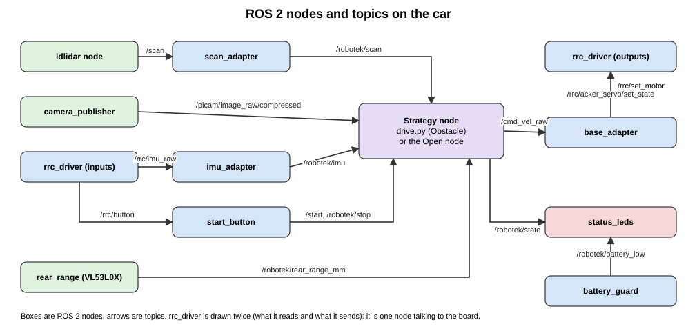

### Testing and tuning process, with metrics

* **Unit tests** per package (`pytest`): the strategy checks, `steer_watch`, the lot exit, the parking planner and the corner planner. At this version `robotek_obstacle_v3` passes 45 tests on the Pi (40 plus 1 skipped on a PC without ROS).
* **Honest simulation.** Rounds in Gazebo and in a fast kinematic **lab** use only what the real car has: LiDAR, gyroscope and camera, with noise. No odometry, no pose of the pillars. The true pose is recorded only to audit. The judge module scores a round with the rules (sections, laps, signs, parking), flagging what is estimated.
* **Metrics.** Estimated points, total round time from Start (laps as partial times), contacts, faults. Comparison rule: points first, then time. Every round on the car and in simulation writes `round.json`, `events.jsonl`, telemetry and scans, see [chapter 9](#9-build-run-and-test-it-yourself).
* **Tuning evidence.** The steering faults and corner crashes of 11 Nov (`23:56`, `23:59`) led to `steer_watch`; the camera stalls led to `CAMERA_MAX_AGE` / `CAMERA_LOST`; the lot exit pulses were tuned until the heading grew about 10° per pair of pulses. Details in [chapter 8](#8-systems-thinking-and-engineering-decisions) and the [journal](#12-history-of-the-car-and-engineering-journal).
* **Simulation result (3 Nov 2026, not the car).** Gazebo standard set with parking: 7 of 10 rounds valid, 46.5 estimated points mean; the later fixes were validated round by round on the car.

## 6. Obstacle Challenge

Three laps of the field with red and green signs, then a parallel park in the parking lot where the car started. The rules are simple: pass a red sign on its right and a green sign on its left, do not move a sign, and finish parked in the lot. This chapter has the same shape as the one of the Open Challenge: an overview, then each state with what the car does in it, then the results.

### 6.1 Overview

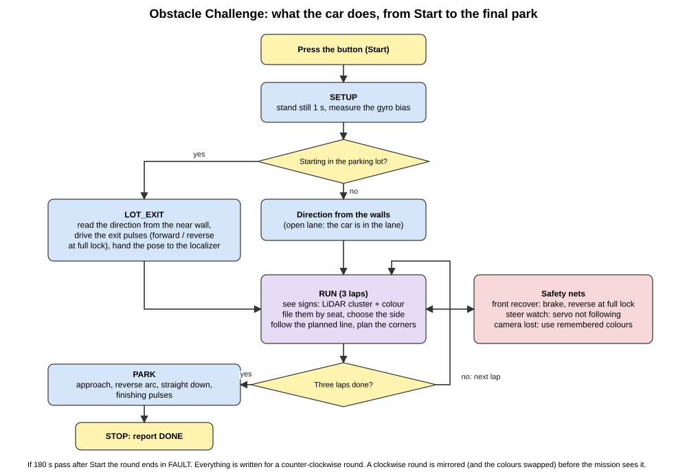

The track is a rounded square: four 1 m straights joined by quarter circles of 0.5 m radius, with the lane running between an inner island and the outer walls. On every straight there can be up to three signs, 5 × 5 cm and 10 cm tall, red or green. Red must be passed on the **right**, green on the **left**. The car has to do three laps in under 180 s without touching a sign, and it must do it from a start where it has seen nothing yet. The signs change position and colour in every round.

Two facts shaped the whole design:

* The LiDAR sees a sign from 2 m away but cannot tell its colour.
* The camera tells the colour but not how far the sign is, and in practice it only gives a reliable colour once the sign is closer than about 1.5 m.

So we need both sensors, and we need a memory, because the colour often arrives late and from a bad angle.

The mission is written for a counter-clockwise round. A clockwise round is mirrored (and the colours swapped) before the mission sees it, so the code never needs to know the direction.

**Why a planned line, and not just wall following.** A wall-following PID (what the Open uses) is fine without signs, but it cannot hold a side offset around a sign or plan a corner with signs at both ends. An earlier version that searched many manoeuvres was replaced because fixing each sign's side as soon as its colour is known makes the path predictable and testable.

**The states.** The mission is one state machine. The next section explains each state, and the parts of the problem that belong to it (the signs inside RUN, the parking lot inside LOT_EXIT and PARK).

| State | What the car does | Where it is explained |
| --- | --- | --- |
| SETUP | Stands still, measures the gyro bias, decides the direction | [SETUP](#setup) |
| LOT_EXIT | Leaves the parking lot with a sequence of pulses | [LOT_EXIT](#lot_exit-leaving-the-parking-lot) |
| RUN | Three laps along a planned line, passing every sign on its side | [RUN](#run-three-laps-with-signs) |
| PARK | Parks in parallel in the lot | [PARK](#park-parking-in-parallel) |
| WAIT_SENSOR, FAULT, STOP | Safety holds and the end of the round | [Safety](#wait_sensor-fault-and-stop) |

### 6.2 States

#### SETUP

For 0.3 s after Start the car stands still and averages the gyroscope. That average is the **gyro bias**, which is subtracted from then on. The rules require calibrating after Start and not before it (rule 9.9).

Then it decides the driving direction. It fits the scan to the walls twice, once as counter-clockwise and once as clockwise, and takes the direction that fits better by a margin of 0.10 (0.03 after waiting 1 s, so a difficult case still ends in a decision). When the car starts in the lot, the direction is read from the wall on the near side instead (see LOT_EXIT). A direction can also be given by hand (`direction:=ccw` or `cw`), which we use in parking tests.

#### LOT_EXIT: leaving the parking lot

##### The space we have

* The lot is on the start straight, against the outer wall. Its **depth** is always 20 cm. Its **length** is 1.5 × the length of the robot. We measured the car with its LiDAR tab as 0.245 m long, so our team field uses a lot **0.3675 m** long, with the far limit 0.31 m along the start straight (`park_lot_length`, `park_lot_end` in `config/car_picam_park_round.yaml`).
* The car is about 0.233 m long in the planners' outline and 0.148 m wide. Inside the lot there are about 12 cm of room along the car and only about 2.6 cm on each side across it. Everything below follows from those numbers.
* The LiDAR cannot see anything closer than about 12 cm, so the limits and the wall next to the car are invisible to it most of the time. That is why a rear distance sensor was added and why most steps end on the gyroscope heading rather than on the LiDAR.

##### Which way do we drive?

Nobody tells the car the direction, and the rules do not allow a switch for it. At the start the car sits parallel to the outer wall, about 1 cm from the rear limit and 1 cm from the wall, facing the driving direction. So **the wall that is close is the outer wall**: wall on the right means counter-clockwise, wall on the left means clockwise (`direction_in_lot`). We take the median distance in a 12° window around each side. Because the LiDAR drops returns under 12 cm, a side with no returns at all counts as "the near one", at its nominal distance (1 cm gap plus half the car).

##### Why a sequence of pulses

A forward arc at full lock from the starting position hits the far limit after about 11 cm, at about 17° of heading. The car has to go out, back, out again. We tried to have the software plan this and it never reproduced the movement that works on the real car, so the coach recorded a **sequence of pulses** and we execute it exactly (`lot_exit_steps`).

The sequence of the final profile is

`L+0.25  R-0.3  L+0.25  R-0.3  L+0.25  R-0.3  C-0.2`

Each word is one pulse: the first letter is the steering (L or R at full lock, C for wheels straight), the sign is forward (+) or reverse (−), and the number is the time in seconds. The letters are written for counter-clockwise; in a clockwise round they are mirrored, so L always means "away from the wall". Read in order: forward with the nose turning away from the wall for 0.25 s, back with the nose turning toward it for 0.3 s, and so on three times, and finally 0.2 s straight back with centred wheels.

##### What a single pulse does

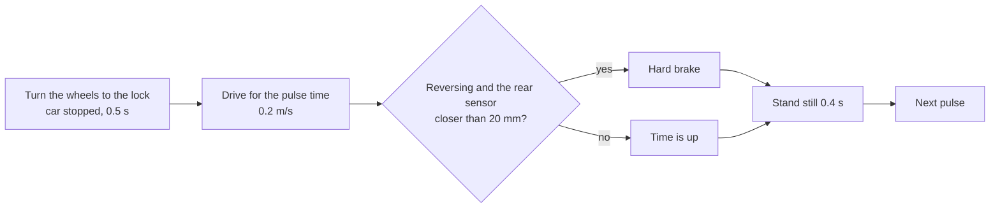

* The 0.5 s with the car stopped is there because the servo needs time to reach the lock; without it the first part of the pulse is driven with the wheels still straight. The command is a velocity plus an angle, and an angle cannot be expressed at zero speed, so the car is sent a tiny forward or backward speed (3 mm/s) under the motor's dead band.
* The pulse speed is 0.2 m/s; the motor floor turns this into about 0.25 m/s on the floor.
* A reverse ends early with a hard brake if the rear sensor reads under 20 mm.
* After the pulse the car stands 0.4 s so the heading we read is the final one.

##### Knowing where we are afterwards

During the pulses nothing sees the walls well, so the exit estimates its own position (`LotExit.pose`): the lot from the parameters, x from the rear sensor and y from the wall gap at the start, and then each pulse as a full-lock arc whose length is the one that turns the gyroscope heading by the amount we measured. When the pulses end, the estimate is given to the localizer (`Localizer.initialize`) as a first guess, and the LiDAR fitted to the known walls corrects it. The estimate and the LiDAR fit differ by up to 0.2 m, which is why the estimate is only used as a starting point.

##### What it looks like on the car

The heading grows by about 10 to 14° per pair of pulses: roughly 1°, 14°, 23°, 37°, 47°, 62° and 69° after the seven pulses (measured on the car, rear distance 50 to 170 mm during the sequence). The car leaves the lot pointing about 70° into the lane, and the lane following takes over from there: the first thing it does is a gentle turn back toward the lane direction.

##### What the exit does not do

It does not check by itself that the pulses worked: it trusts the gyroscope heading and the rear sensor. If a pulse does not turn the car (a wedged car, a servo that does not follow), the sequence keeps going. The steer watch of [chapter 6](#6-obstacle-challenge) is what catches a servo that stops answering, and the lab and the car rounds are what we used to check that the sequence produces the same heading every time.

#### RUN: three laps with signs

##### Finding signs

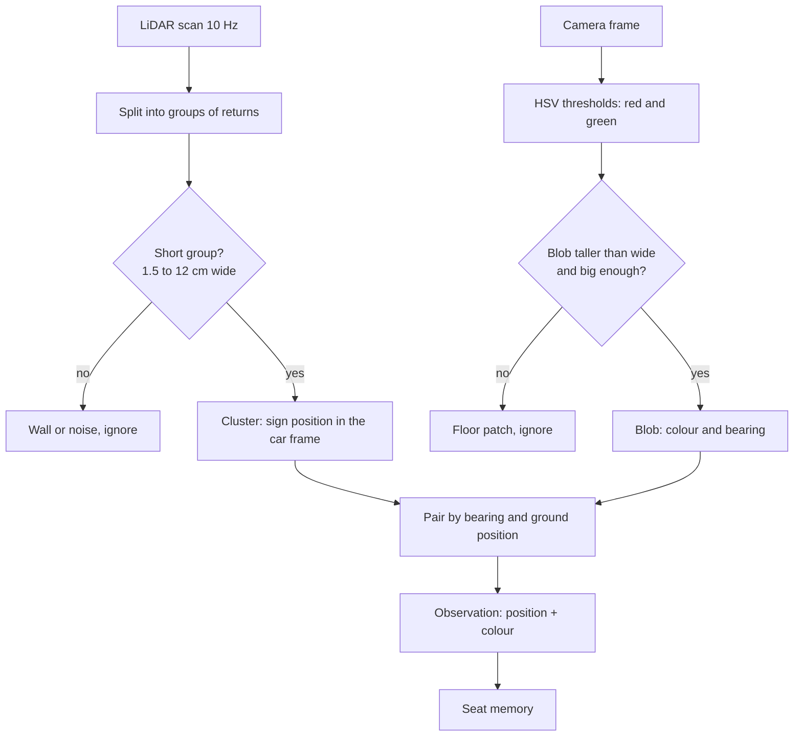

**LiDAR clusters** (`perception.py`). We walk through the scan in order and start a new group whenever two neighbouring returns are more than 7 cm apart. A group of at least two returns and between 1.5 cm and 12 cm across, closer than 2.5 m, is a candidate. Walls never pass this test because they are long. The LiDAR sees the face of the sign that looks at the car, so we move the point 2.5 cm along the ray to land on the centre of the 5 cm sign.

**Colour blobs** (`robotek_course/obstacle_vision.py`). The frame is converted to HSV and thresholded once for red and once for green (red wraps around the hue circle, so it has two bands). A blob counts only if its area is at least 30 pixels, it is at least 8 pixels tall and it is taller than wide: signs are upright, the orange line on the mat and reflections on the floor are not. From the pixel position and the camera's tilt we compute the **bearing** of the blob, and, when its lower edge is visible, the **ground position** where the sign stands.

Two measured details matter here. The red band starts at hue 170 and the green band is 40–85, tuned on the real mat under our room lights; and we leave out dark pixels (value below 80 for red) because the orange line of the mat is dark when seen at a low angle and would otherwise look red.

**Pairing** (`associate` in `obstacle_vision.py`). A blob and a cluster belong together if they lie at the same bearing, within 0.12 rad. When the blob also has a ground position we require the cluster to be close to it (0.20 m plus 0.12 m for every metre of range), which fixes the case of two signs on the same line of sight: the far one is not given the colour of the near one. If a cluster is claimed by blobs of both colours we throw it away rather than guess. What leaves this step is a list of observations, each one a position in the car frame and a colour.

##### Remembering signs: the seat map

A colour is often seen once, from a corner exit, and then the sign leaves the picture while the car is still 40 cm from it. If the planner only used the current frame it would forget. So the mission files every cluster under a **seat** (`Mission._remember`).

The rules of the competition say what the signs can look like: they stand at three places on each straight (start, middle, end), in an inner row 0.4 m from the island wall or an outer row 0.6 m from it, so their lateral offset from the lane centre is about ±0.1 m. We turn each cluster into track coordinates, `progress` along the lane (one unit per straight or per corner, eight per lap) and `lateral` across it. If the cluster is within 0.2 m of the lane centre and within 0.15 units of a seat, it belongs to that seat.

* A seat becomes a **sign** after two sightings (`SEAT_HITS`). One stray return never creates a sign.
* Each seat keeps **colour votes** for the whole round, counted at most once per camera frame. Whichever colour has more votes wins. In a clockwise round the world is mirrored so that the car always drives counter-clockwise, and the colours are swapped with it; the rest of the code never has to think about direction.
* The **layout rules** are enforced (`_enforce_layout`): per straight there can be one sign at the start, in the middle or at the end, or two at the start and the end, never three, and never the middle together with another. If the evidence disagrees, the combination with more sightings wins, and the other one waits in a "shadow" list and can come back if it overtakes. This removed a phantom sign in the middle of a straight that a colour had been wrongly given to.
* A sign that was moved a few centimetres (for example touched by the car) is followed: the seat's lateral offset drifts to where the LiDAR sees it, in 2 cm steps.

##### Deciding the side

For every remembered sign ahead the planner computes the lateral offset the car must have next to it (`Mission._side_offset`):

* **Red:** offset = sign's lateral − (0.18 m clearance + half the car's width)
* **Green:** offset = sign's lateral + (0.18 m clearance + half the car's width)
* clamped to ±0.36 m so the car never plans through a wall.

In the lane frame, positive lateral means toward the island. Green is passed on the left (island side) and red on the right (wall side), which is exactly what these two lines say. The same lines work for both directions because a clockwise round is mirrored before the mission sees it.

**Colour not known yet.** The car keeps to the middle of the lane (`unknown_offset` is 0 in the validated version; another version used 0.12 m away from the sign). From the middle it can still go to either side, and the camera has the whole approach to resolve the colour. The middle is not a safe place: the car is 14.8 cm wide and the inner row of signs is 10 cm from the lane centre, so the gap to a sign is about a millimetre. If the colour never arrives, the car brushes or touches the sign, which is why the peek and the lookout below exist.

##### The planned line

The mission builds a list of knots `(progress, offset)` for everything within three units ahead (`Mission._plan`):

1. Each known sign puts its offset on the line from 0.15 units before the sign to 0.15 units after it (`HOLD`), long enough for the car to be parallel to the sign while the wheels pass it.
2. Between two signs the line is a straight ramp. It cannot be steeper than the car can steer, so the corner planner and the clearance checks keep the line drivable.
3. For an **unknown colour** near a corner, we add a *lookout* knot that moves the car 0.15 m toward the island, so the camera sees an inner sign earlier (`_lookouts`).
4. **Corners** are replaced by a line straight–arc–straight chosen by `corner.py`: it tries arcs of 0.5, 0.6 and 0.75 m radius and many offsets before and after the corner, and keeps the one with the largest clearance to the island, the outer wall, the sign at each end and, near the start, the limits of the parking lot. The clearance is not computed on the ideal line but on the path a simulated car actually drives with our steering law, including the servo's delay and rate. A line that is clear on paper but needs 10 1/m of curvature touches in the real round, because the car can only do about 2.7 1/m.

##### Following the line

Every 20 ms (50 Hz) the mission runs the loop below. The first thing it checks is that the LiDAR, the camera and the gyroscope are fresh; if one is not, the car stands still (WAIT_SENSOR) until it is.

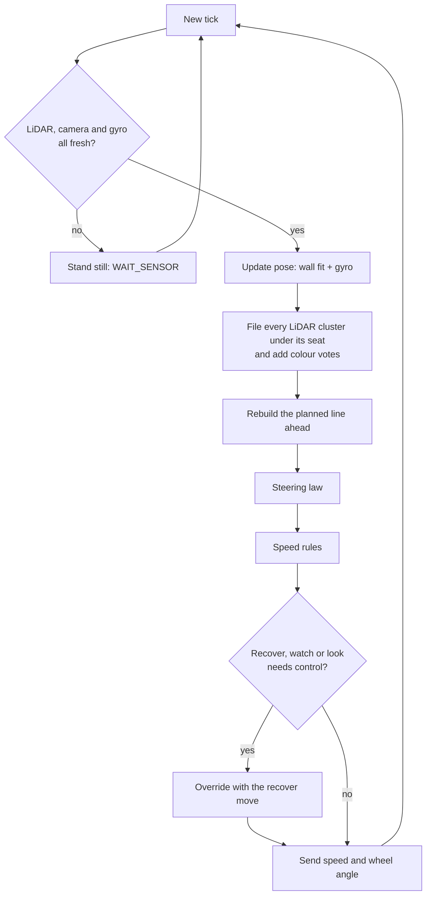

1. **Pose.** The car's position is moved forward with the distance driven and the gyro heading, and then corrected by fitting the LiDAR points to the known walls (`localizer.py`). This also gives the progress along the lane, in track units.
2. **Sign memory.** Every LiDAR cluster is filed under its seat and receives the colour votes of the camera.
3. **The line ahead.** With the signs that are known, the side offsets and the corner arcs are rebuilt.
4. **Steering and speed.** The steering law and the speed rules below.
5. **Overrides.** The front recover, the steering watch and the peek can take control for a moment and replace the normal command (see below).

**The steering law.** For the point of the line at the car, `Mission._steer` computes

`steer = atan(wheelbase · curvature) − 6 · lateral error − 1.5 · heading error − 0.2 · gyro`

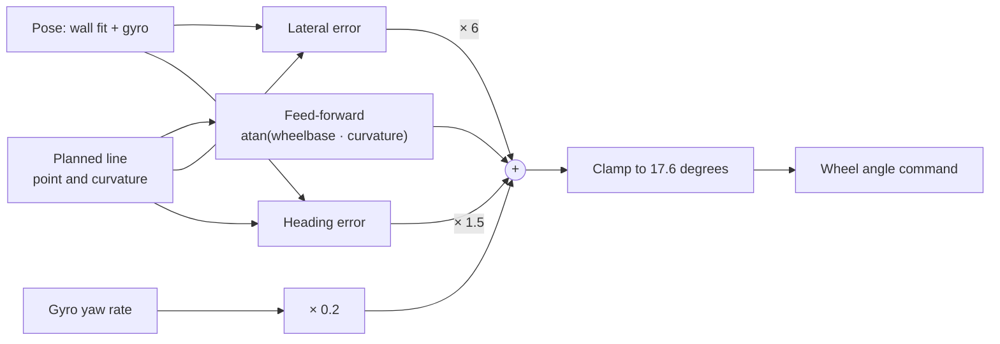

* The **first term** is the steering that would follow the line exactly, from its curvature taken 10 cm ahead of the car to cover the lag of the servo and the motor. For a corner arc of 0.5 m radius the curvature is 2 per metre and the term is `atan(0.119 · 2)`, about 13°.
* The **lateral error** term (6 rad of steering per metre) pulls the car back to the line: 3 cm off the line asks for about 10° of correction.
* The **heading error** term (1.5) aligns the car with the direction of the line: 0.1 rad (6°) of error asks for 0.15 rad (9°).
* The **gyro** term (0.2) is damping: the faster the car is already turning, the less it is asked to turn, so it does not swing.
* The sum is limited to 17.6°, the real wheel-angle limit of the car.

**Speed** (`Mission._speed`): 0.28 m/s on a free lane, 0.30 m/s near a sign or changing lane, 0.20 m/s with something close ahead and 0.15 m/s over the last metres. The motor floor of about 0.25 m/s is why these numbers are so close to each other (see [chapter 3](#3-mechanics-chassis-steering-and-drive)).

##### When the colour is still unknown

Two behaviours exist for the case where the next sign is close and the colour has not arrived:

* **At Start** the car stands still for 0.25 s, and for up to 1.0 s if the first sign is very close and still without colour, so the first signs can be filed before moving. If the first sign is closer than the car needs to change side, it backs up straight (at most 0.5 m).
* **Peek** (`Mission._look`). If the next sign has no colour and is between 0.6 and 1.4 units away, the car stops and reverses at full lock until its nose has turned 15° toward the sign, then waits 0.5 s for a frame. This gets a sign that is too far to the side for the camera into its field of view. It happens once per sign.

##### When something goes wrong

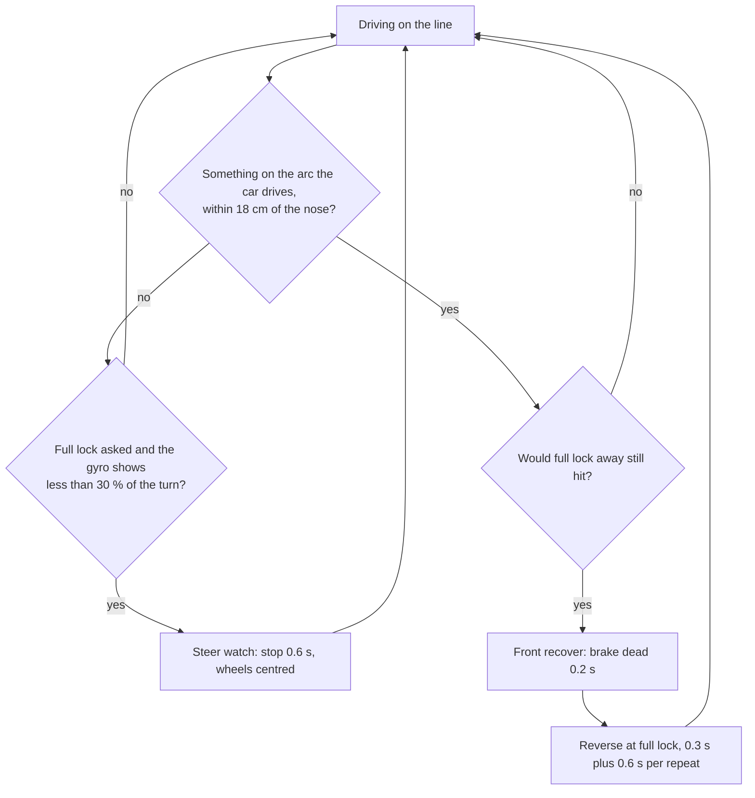

* **Contact guard** (`_guard`): an optional extra that compares the outline of the car, 6 cm ahead on the current arc, with every remembered sign, the island and the outer wall and backs off for 0.8 s if it gets closer than `guard_gap`. It is **switched off** (`guard_gap` 0) in the validated rounds; the front recover below handled the contacts we had.
* **Front recover** (`_front_recovery`): the check looks only at the arc the car is driving and only at the nose (5 cm), because a fixed corridor in front of the car fired on every close dodge. It also waits for the servo lag of 0.3 s: if turning away at full lock still hits, then it brakes dead (the node sends `/robotek/estop`, so the motor does not ramp down), reverses at full lock toward the inside of the lane, or on the other lock if the nose already points more than 40° inward, and tries again. If it triggers again within 0.3 m and 8 s of the last time, each repeat adds 0.6 s to the reverse (at most three), so the line gets room instead of looping on the same sign.
* **Steer watch** (`steer_watch.py`): when the command has been at full lock for 0.35 s plus a 0.5 s window and the gyro shows less than 30 % of the turn that the wheels should give, the servo is not following. The car stops 0.6 s with the wheels centred and then carries on. See the servo failures in [chapter 4](#failure-points-and-mitigations).
* **Stale sensors** (`strategy.py`): the car stops until the LiDAR, camera and gyro are all fresh again.

##### Decision flow for one sign

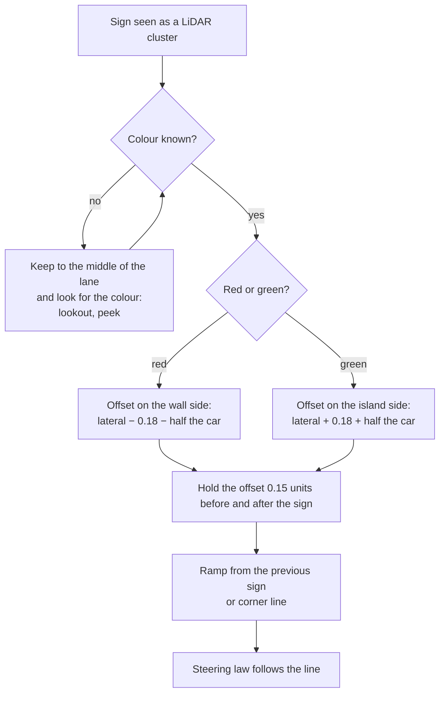

#### PARK: parking in parallel

At the end of the third lap, once the last sign on the start straight has been passed, the mission switches from RUN to PARK (`Mission._park`) and starts `FixedParking` (`park_mode: 1`).

The idea is "no plan, only steps that each end on a sensor". An earlier planner drove 14 short moves at 0.06 m/s; the real car does not move at that speed with full lock and, with the motor floor of about 0.25 m/s, it rolls 3–12 cm after every stop, past the target of a short move. So each step of the fixed manoeuvre uses all the room it has and stops on the gyroscope heading or on the LiDAR pose against the lot, and it anticipates the roll after the stop (the roll is measured and fed back).

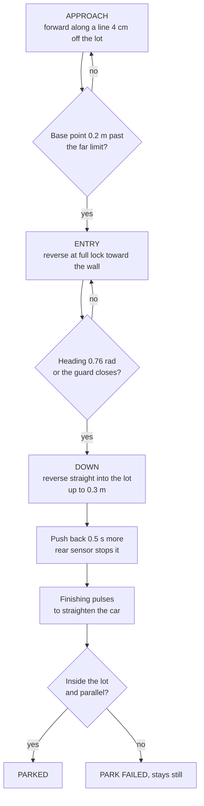

1. **APPROACH.** The car drives forward along a line 4 cm off the lot, at up to 0.3 m/s, until the reference point is 0.2 m past the far limit (`park_fixed_ahead`), measured on the LiDAR pose and aligned with the line. If it overshoots, it backs along the line.
2. **ENTRY.** It reverses at full lock toward the wall until the gyro heading reaches 0.76 rad (about 43.5°, `park_fixed_entry`) or until the guard says that the outline, plus the expected roll, is closer than 1.2 cm to a limit or the wall.
3. **DOWN.** It reverses straight into the lot, up to 0.3 m, until the guard stops it, near the wall or near the near limit.
4. **Push.** `park_partial_back` gives 0.5 s more of straight reverse; the rear sensor stops it before it touches the limit. This is the "half a second more" the coach asked for after watching the car stop a little short.
5. **Finishing pulses.** The car is now inside the lot but at an angle. The pulses straighten it:

   `C+0.20  R-0.40  L-0.50  R+0.05  L-0.15  R+0.1  L-0.1`

   They use the same executor as the lot exit (`LotExit`), at 0.1 m/s that the motor floor raises to about 0.25 m/s, and the same rear distance stop. The sequence is the one that left the car parallel in the lot in the parking-only test of 12 Nov 02:39 (20.3 s).
6. **Check.** At the end the car compares its own pose with the lot (`Lot.parked`): inside, parallel. PARKED or PARK_FAIL; in both cases it stays still.

##### `park_fixed_sense`: placing the lot from the LiDAR

On the car the outer wall showed at y of −1.52 to −1.57 instead of −1.50, and one limit stood about 3 cm from where the map put it. With 2.6 cm of room per side, that is the whole margin. `park_fixed_sense` (0 off, 1 wall and plates, 2 the two plates as a pair in a wide window) fits a line to the wall's returns and finds the limit plates near their expected x, and applies a small, low-pass-filtered correction to the pose. It is available but it is **not part of** the command validated on 12 Nov, so the validated parking runs without it.

#### WAIT_SENSOR, FAULT and STOP

Three situations stop the car without being part of a manoeuvre:

* **WAIT_SENSOR.** If the LiDAR, the gyroscope or the camera is older than 0.35 s (camera 0.8 s), the car stands still until the data is fresh. If the camera is lost for 1.5 s the round goes on with the colours already remembered.
* **FAULT.** 180 s after Start the round ends.
* **STOP.** The normal end: after the park, or after three laps if parking is off. The round is reported as DONE.

### 6.3 Results and validation

On 12 Nov 2026 the car passed 19 of 19 signs on the correct side in the 01:22 round and made a complete round in 107.1 s from Start with no recover move at all (laps 36.2 / 33.1 / 33.8 s). The five front recovers in the 01:22 round all happened on the north straight. In the lab, 195 of 200 rounds without parking were valid (see [chapter 9](#9-build-run-and-test-it-yourself)). Points are estimated until a judge validates a round.

* The colour of a sign far to the side of a corner exit can arrive too late for the car to cross the lane, and the car then passes on the safe side, which may be the wrong one. The peek and the lookout reduce this but do not remove it.
* A sign whose colour changes with the light (glare) can get a wrong vote; the votes make this rare but not impossible, and the HSV bands should be checked at the venue.

| Movement | Direction | State |
| --- | --- | --- |
| Lot exit | CCW | Validated on the car, several rounds |
| Lot exit | CW | Mirrored from the CCW sequence; not validated on the car yet |
| Parking, partial park (approach, entry, straight in) | CCW | Validated in rounds (29° at the end of the partial park, 12 Nov 01:22) |
| Parking, finishing pulses | CCW | Parallel in the lot in the parking-only test (20.3 s, 12 Nov 02:39) |
| Parking | CW | **Not reliable**: the pose along the straight was 20 to 30 cm off in two attempts, one ending 20 cm past the lot and one starting too early and hitting the left limit |

For the final we will run the parking pulses in CW again with `park_fixed_sense: 2` and decide, from those rounds, whether to trust CW parking or to document it as a limit.

### 6.4 Surprise rule (in progress)

The 2026 rules announce a **surprise rule** for the final. We are working on it and it is **in progress**: it is not finished and it is not part of the code in this repository, which is the validated version of 12 Nov 2026. What we have so far are the tools to see what the car understands: a camera test screen that lists every sign it sees with its colour and the side it would pass on, and the RViz view with the LiDAR and the detected signs.

| Camera test screen (in Spanish) | Signs detected, in RViz |
| :--: | :--: |
| 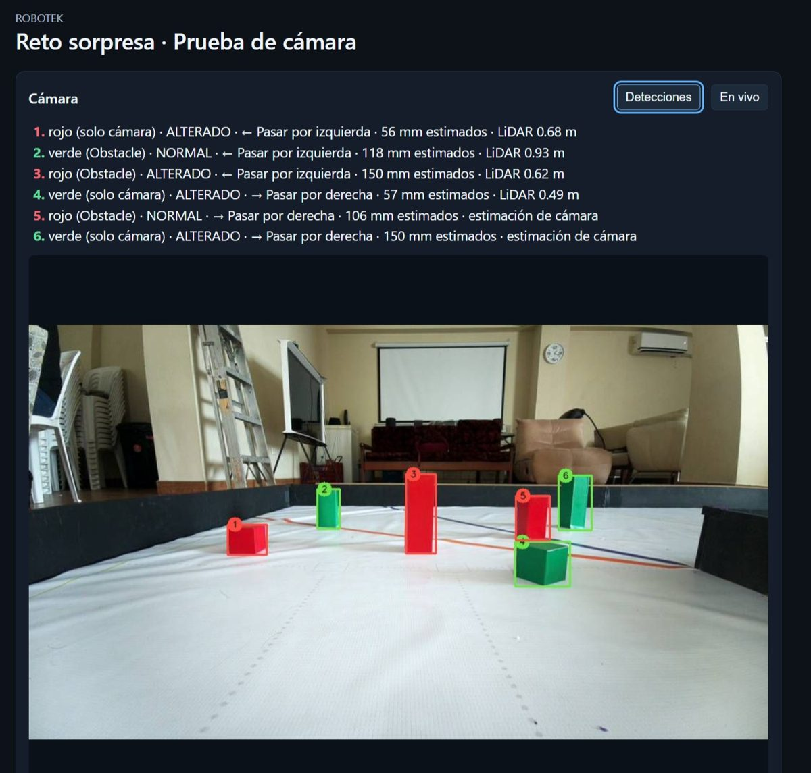 | 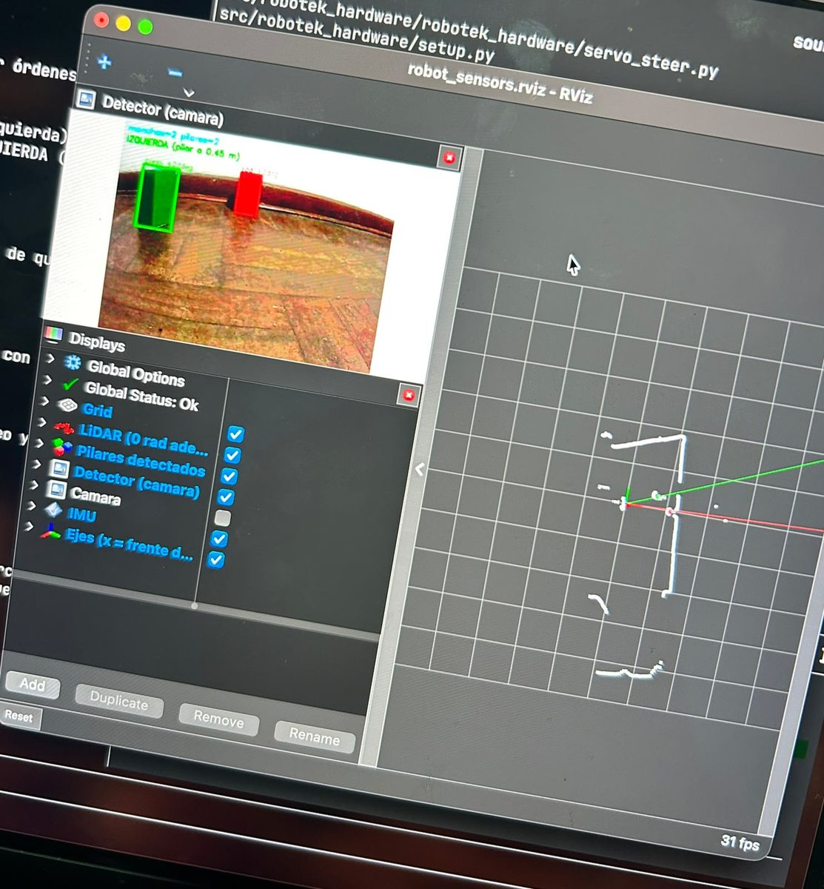 |

## 7. Open Challenge

Three laps of a field where the inner walls change from round to round, with a starting direction that nobody tells the car. There are no signs, so the strategy can be much simpler than the Obstacle one: we use the **fewest states and the least code** that finishes the three laps reliably. This chapter has the same shape as the one of the Obstacle Challenge: an overview, then each state with what the car does in it, then the results. The code is the package `src/robotek_open` (`robotek_open/v5/`), which shares the hardware adapters, the recording and the launch file with the Obstacle.

### 7.1 Overview

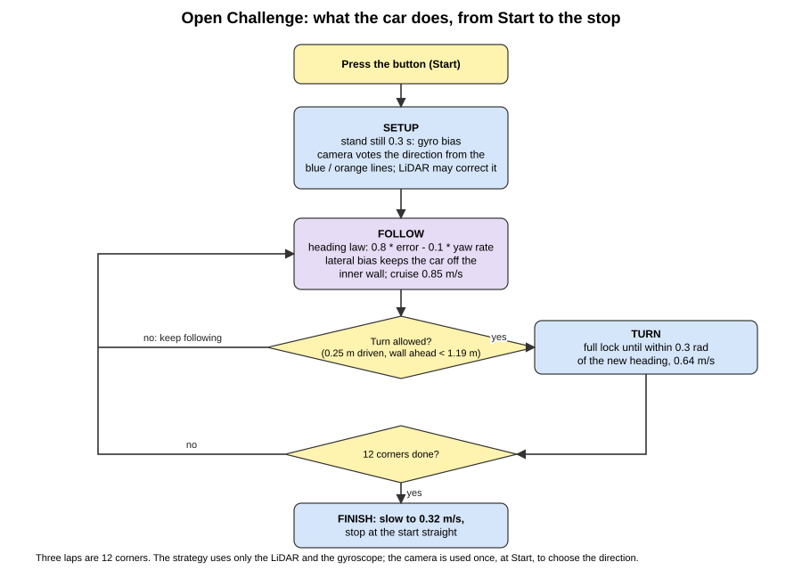

**What it uses.**

* The **LiDAR** for the walls and the island.
* The **gyroscope** for the heading.
* The **camera**, only once at the start, to decide the direction from the blue and the orange lines painted on the mat.

No odometry and no encoder: the distance driven on a straight is measured by how much nearer the front wall got.

### 7.2 States

In the telemetry the states appear as WAIT_START, CALIBRATE, DETECT_DIRECTION, FOLLOW, TURN, FINISH and DONE.

#### SETUP

For 0.3 s after Start the car stands still and measures two things: the **gyro bias** (the average gyro reading, which we subtract afterwards) and the **front range at the start**, which is used later to know where to stop. Calibrating after Start, and not before it, is what the rules require.

Then the camera votes for the direction. The detector (`open_vision.py`) measures how much blue line and how much orange line it sees on the mat, with a confidence, and from that infers the direction of the first turn. It needs several consistent frames before it accepts (3 in the car's settings), so one glare frame cannot decide. If the camera cannot decide within 1.0 s, a parameter can say which direction to assume and let the LiDAR correct it. After 15 s without any direction the car stops, which is better than guessing.

**The LiDAR can overrule the camera.** On 4 Nov 2026 glare hid the blue line and the camera chose clockwise on a counter-clockwise track; the car drove toward a wall waiting for an island end that opened on the other side. Before the first corner, the mission now watches the side away from the island: if it is open (more than 1.2 m) in three consecutive scans while the island is still close beside the car, the direction is flipped (`_check_direction`).

#### FOLLOW (straights)

The car drives at a **heading law**. The goal heading is a multiple of 90° (it changes by ±90° at every corner), and the steering is

`steer = 0.8 · (goal heading + bias − heading) − 0.1 · yaw rate`

limited to the real wheel limit of 17.6°. The `bias` term moves the goal heading by up to 0.4 rad so that the car keeps **0.50 m from the island wall** on the real car (`inner_gap`): 1.0 rad of heading per metre of error (`lateral_kp`), so the car lines up quickly after a corner instead of using the whole straight to do it.

The gyro integrates a small error each lap, and the LiDAR corrects it: on a straight, the island wall shows the real heading of the car, and the yaw is pulled toward it once per scan. This fixed a drift we saw on 4 Nov (after two laps the car pointed 35–40° off while the mission thought it was straight), because our gyro reads about 6 % short in the corners.

**Speed.** On the real car the cruise speed is 0.85 m/s on the straights and the corner speed 0.64 m/s (`config/car_picam.yaml`; the defaults in `settings.py` are the higher simulation values). The car slows down on the approach to a corner: when the front wall is closer than the turn distance plus a braking margin of 0.35 m, the speed above the corner speed falls with the gap.

#### TURN (corners)

Three conditions must hold at the same time (`turn_checks`):

1. At least 0.25 m driven since the last corner (so that the end of the island seen right after a corner is not taken for the next one).
2. The front wall is closer than **1.19 m** along the track axis.
3. The island has ended: either the side that was the island now reads open (farther than 1.0 m) or the end of the island wall has been seen ahead in two consecutive scans, closer than 0.35 m (shorter in a narrow lane).

When all three are true the goal heading changes by 90° in the driving direction and the car turns at **full lock** at the corner speed. The arc ends when the heading is within 0.3 rad (about 17°) of the goal; ending early avoids overshooting into the island, which a tolerance of 0.12 rad did. From that moment the straight-line law finishes the turn and returns the car to 50 cm from the island. We tested a ramped steering reference and it gave the same results in the lab, so the full-lock arc stayed because it is simpler.

#### FINISH and STOP

After 12 corners the car is back in the starting section. It drives at 0.32 m/s with the wheels straight until the front range matches the one measured at Start (14 cm early, `finish_lead`, to compensate for the braking distance) and the heading is within 0.1 rad of straight, then brakes and waits 0.9 s at rest before reporting DONE. It brakes only when it is straight again: braking with the wheels still turned left the car rolling into the island in some lab rounds.

### 7.3 Results and validation

On 11 Nov 2026 (17:29, new motor, 54:30 gears) the car completed three laps in **30.9 s** from Start to DONE, the round the coach called perfect (no judge, so no official score). An earlier record of 23.4 s used a higher cruise speed and no corner speed; it crashed on fields with a narrow corner, so we chose the slower and repeatable settings. In the lab the same speeds had no contact in the standard set of twelve fields.

### 7.4 Other details

#### Crash detector

`crash_watch.py` keeps the last five seconds of the round and says when the car has hit something, from two signals: the LiDAR going blind against a wall (fewer than 120 valid rays of 504 for 0.4 s while the car is told to move), or a jump of the yaw rate bigger than any corner gives within 0.1 s. On a crash the car stops, the board is reset and the window is saved. It is off by default and can be turned on at launch.

#### Why this design

Our first Open version was a wall-following PID that kept the car centred (distance to one wall minus distance to the other; see [chapter 12](#12-history-of-the-car-and-engineering-journal)). The v5 uses only what the track guarantees: straights are straight, corners are 90° and the island is a closed shape. With that we could remove states and parameters until the rounds were repeatable in the lab. The list of choices and their data is in [chapter 8](#8-systems-thinking-and-engineering-decisions).

## 8. Systems thinking and engineering decisions

How the subsystems work together, the constraints we had, the choices we made with data ("we chose X instead of Y because...") and the risks that are left.

### How the subsystems interact

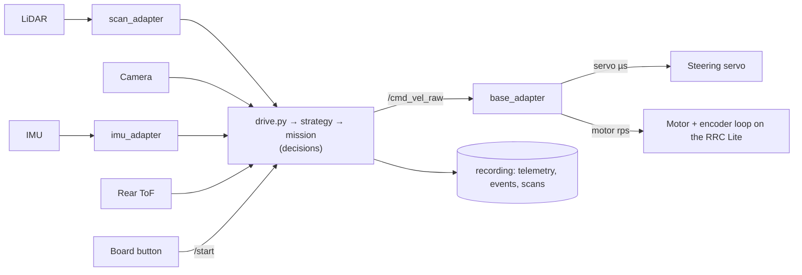

* The strategy never talks to hardware; it publishes a speed and a wheel angle. `base_adapter` is the **only** place that knows the servo table, the motor scale and the acceleration limits. That is why the same strategy ran in Gazebo, in the lab and on the car.
* One loop at 50 Hz (`drive.py`); the camera (about 9–10 fps) and the LiDAR (10 Hz) are slower than the control loop, so the mission works from the **newest** data and refuses to step when any of them is stale.
* Timing is the shared constraint: the single Raspberry Pi runs the LiDAR driver, camera, board driver, adapters, the strategy and the recorder. When the CPU was busy the camera frames arrived late, which is why frame size, JPEG and the age limits were tuned (chapter 4).

### Constraints

| Constraint | Source | Consequence |
| --- | --- | --- |
| 180 s per round, 3 laps | rules 9.2 | Speed cannot be only "safe"; the limit is enforced in the strategy (`FAULT` at 180 s) |
| ≤ 300 × 200 mm, ≤ 1.5 kg, one driven axle | rules 11 | Compact two-level layout; one motor |
| Calibration only after Start | rules 9.9 | Gyro bias measured in the first 0.3 s |
| No inputs to choose direction or mode | rules 9.9 | The direction is detected from the walls |
| No Wi-Fi/Bluetooth during the round | rules 11.10 | Used only for development; see [rules compliance](#11-rules-compliance) |
| Motor cannot hold speeds below about 0.25 m/s | measured | Minimum command; the Obstacle runs at 0.28–0.30 m/s |
| Lot only 1.5 car lengths long | rules, Figure 4 | Exit and parking by hard-coded pulses closed on sensors |
| Pi CPU shared by all nodes | measured | JPEG frames, age limits, light recorder |

### Decisions with data ("we chose X instead of Y because…")

| # | Decision | Alternative | Evidence |
| --- | --- | --- | --- |
| 1 | Drive speed by the **RRC Lite closed loop** | TB6612FNG PWM on the Pi GPIO | With PWM the speed per percent depends on the battery voltage, and on 8 Oct the motor moved the car "only sometimes" (a standby pin never raised and a PWM write ignored by `lgpio`); the board holds the commanded speed with the motor encoder |
| 2 | **1:1 gearing**, `motor_rps_per_mps` 7.0–8.0 | 54:30 reduction (4.4) | The coach chose 1:1 after rounds with several ratios on 11–12 Nov; the complete rounds of 12 Nov took 107.1 s and 105.9 s from Start |
| 3 | **One battery for everything**, through the RRC Lite board (version 12) | A separate motor battery (version 11) | Measured 8 Oct with one battery: the Pi rail dipped to 4.835 V at node start and to 4.914 V under motor pulses (threshold 4.63 V), well above the 4.63 V limit. One battery less to charge and wire. A hard stall has not been measured, so the motor is limited in software |
| 4 | **Pi camera, 102° HFOV, JPEG at quality 90** | USB camera 66°, raw frames | Raw frames: 0.2 of 27.6 frames/s reached the strategy with the Pi busy; JPEG delivered all. The wide lens keeps the sign in view through the corner |
| 5 | **Camera age limit 0.8 s** and "camera lost" after 1.5 s | Stop whenever a frame is late | The camera was 0.35–0.43 s late 48 times in one round (each a stop); on 12 Nov the camera stopped at 14.5 s and the car waited 18 s |
| 6 | **Planned line with a side offset per sign** (Obstacle) | Wall-following PID (Open) | A PID cannot hold a side offset or plan a corner with signs at both ends |
| 7 | **Corner lines scored by driving them in simulation** | Fixed geometry | The car's real minimum radius (about 0.38 m) and the signs at both ends change which line is feasible |
| 8 | **Honest simulation** (LiDAR + gyro + camera only, with noise) | Simulation with exact odometry and sign poses | The real car does not use its encoder or know the pose of the signs; a strategy that used them would be validated on information the car does not have |
| 9 | **Hard-coded pulses closed on sensors** for lot exit and parking | Fully automatic parking search | The automatic planned parking did not reproduce the real result in our lab; the coach's pulses left the car parallel in the lot on 12 Nov (parking-only test, CCW) |
| 10 | **Steering watch** | Trust the commanded angle | 11 Nov 23:56 and 23:59: full lock with almost no turn caused two crashes in corner 6; replayed offline, the watch trips 3 s before the wall |
| 11 | **Rear distance sensor** | Reverse by time only | Reverses by time overshoot differently each time; the sensor stops them 20 mm from the lot limit |
| 12 | **Keep the 12 Nov version for the final** | The later experimental branch (planned line from the car, new vision) | The later changes were not validated in complete rounds on the track; the 12 Nov version has complete validated rounds. The later work is kept in a separate branch for after the final |

### Iteration cycles

* **Steering:** stepper + rack → Hiwonder linkage → servo horizontal → servo vertical → servo re-mounted (18 Nov) with `steer_watch` as the safety net.
* **Drive and power:** L298N → TB6612FNG → RRC Lite closed loop; gears 54:30 → 1:1; two batteries → one.
* **Sensors:** LiDAR high → LiDAR low; USB camera → Pi camera; raw → JPEG.
* **Strategy:** wall following → planned line; beam search → fixed side per sign; manual pulses → parking pulses with a rear sensor.
* Each cycle is recorded with the run folder (`events.jsonl`, `params.yaml`, telemetry) so the change and its effect can be traced, see the [journal](#12-history-of-the-car-and-engineering-journal).

### Risk table

| Risk | Likelihood | Impact | Mitigation | Residual |
| --- | --- | --- | --- | --- |
| Servo does not follow | seen (11 Nov, 18 Nov) | crash / stuck | `steer_watch`, re-mounting, check before each round | medium |
| Sign colour misread under different light | seen | wrong side = fault | HSV bands with minimum value | medium: re-tune HSV at the venue |
| Camera or LiDAR stale | seen | stop | Age limits, `CAMERA_LOST` | low |
| Wi-Fi left on | possible | disqualification (11.10) | Checklist item, see [rules compliance](#11-rules-compliance) | low |
| USB drop from EMI | seen once (4 Nov) | round lost | udev names, the board node reconnects by itself | low |
| CW parking not reliable (pose 20–30 cm off along the straight) | seen | no parking points in CW | The CCW pulses are validated; CW is mirrored and stays untested | **high** for CW |
| Battery low at the final, or sagging on a motor stall | possible | slow motor, Pi brown-out | `battery_guard` warning at 6.8 V, motor limited in software, charged spare | medium: a stall with one battery is untested |
| Surprise rule | announced for 2026 | unknown | Software parameters are all in one file (`settings.py`) so a rule change is a parameter or a small planner change | unknown |

## 9. Build, run and test it yourself

How another team can install the software, run both challenges and repeat our tests. The mechanical build is in chapter 3. Every script mentioned here is explained in [`tools/README.md`](tools/README.md).

### Install the software (Raspberry Pi 5)

You need a Raspberry Pi 5 with Ubuntu 24.04 (arm64) and internet, the RRC Lite board, the LD19 LiDAR and the Pi camera connected as in chapter 4. Then clone the repository and run one script:

```bash
git clone <the URL of this repository>
cd <the repository folder>
bash tools/setup-pi.sh            # ROS 2 Jazzy base, dependencies, udev rules, groups and colcon build
```

The script skips what is already done, so you can run it again. The first time it adds your user to the groups `dialout`, `video` and `gpio`: **log out and in again**. Then:

```bash
bash tools/setup-pi.sh --check    # board, LiDAR, camera, groups: it only checks, it changes nothing
source install/setup.bash
```

`--dry-run` shows what the script would do. After you change a package, build it again (`colcon build --packages-select <package>`): the installation is a copy of the source.

**After building on the Pi, run `sync` (or `sudo poweroff`) before cutting the power.** A cut in the middle of a write leaves empty files; it happened to the executable of a strategy.

### Running the challenges

Wait until the two board LEDs are **green**, then press the board button **once**: it is the Start. A second press stops the car. Lights: green = ready, blue = pressed (the round is running or over), blinking red = low battery.

```bash
bash tools/obstacle-round.sh      # Obstacle: start in the lot, three laps, partial park (the command validated on 12 Nov 2026)
bash tools/car-run.sh open        # Open Challenge, version 5
```

Both scripts first stop the autostart and any leftover node (`tools/car-clean.sh`), so two strategies never publish speed commands at the same time, and they set the network that your computer sees (Cyclone DDS, domain 1). When the terminal says `READY` the LEDs are green. The terminal prints every change of state with its time, the laps and the final time; the telemetry goes to `~/runs/<date>-<time>-obstacle-v3/` or `-open-v5/`.

`obstacle-round.sh` uses the profile `src/robotek_obstacle_v3/config/car_picam_park_round.yaml` (team field lot: far limit 0.31 m, length 0.3675 m). Extra arguments go at the end: `bash tools/obstacle-round.sh direction:=cw`.

**The Open on the car**

* The car's own values are in `src/robotek_open/config/car_picam.yaml` and `car.launch.py` loads them by itself. Any of them can be changed at launch: `bash tools/car-run.sh open cruise_speed:=0.8`.
* **Gears and speed.** The car has 1:1 gears and `robot.yaml` has `motor_rps_per_mps: 7.0` (with 8.0 it goes a little faster). The motor limit of the Open is `motor_max_rps` 6.7.
* **Direction.** The camera decides it from the longer line, blue or orange. If it cannot decide in 1 s the car starts counter-clockwise (`direction_fallback`) and the LiDAR corrects it before the first corner. Without a camera it runs anyway.
* **Heading.** From the gyroscope, corrected on every straight with the island wall (`wall_heading_gain`): the gyro of the car reads about 6 % short.
* **Distance.** There is no wheel encoder and no odometry: what the car has advanced on a straight is how much nearer the wall ahead has become.
* **Button.** Presses in the first 5 s after Start are ignored; a later press stops the car.

**Open v5 parameters most often changed**

| Parameter | Car value | What it does |
| --- | ---: | --- |
| `cruise_speed` | 0.85 m/s | speed on the straights |
| `corner_speed` | 0.64 m/s | speed in the 12 corners; the car slows down to it before the wall |
| `brake_margin` | 0.35 m | how much before `turn_front_distance` the car is already at corner speed (higher = brakes earlier) |
| `inner_gap` | 0.50 m | distance kept from the island on the straights (in a narrow lane it keeps 0.25 m from the outer wall) |
| `lateral_kp` | 1.0 | how strongly the distance to the island is corrected (rad per metre of error, at most 0.4 rad) |
| `turn_tolerance` | 0.30 rad | the arc ends this far from the 90° goal; more = a shorter corner |
| `corner_lookahead` | 0.35 m | an island end this close (or an open side) starts the corner |
| `turn_front_distance` | 1.19 m | wall ahead (along the track) from which a corner may start |
| `wall_heading_gain` | 0.3 | share of the gyro-versus-wall heading difference corrected on every scan |
| `finish_speed`, `finish_lead` | 0.32 m/s, 0.14 m | speed of the last stretch and how close to the start wall the car brakes |
| `direction`, `direction_fallback` | auto, ccw | `ccw`, `cw` or `auto`; and what to do if the camera does not decide |
| `scan_max_age`, `imu_max_age` | 1.0 s, 0.2 s | an older LiDAR scan or gyro reading stops the car until fresh data arrives |

The camera colours (HSV bands for the blue and orange lines, tuned for the IMX708) and the other parameters are in `car_picam.yaml` and in `src/robotek_open/robotek_open/v5/settings.py`, each with a comment. If you pass your own `strategy_params:=<file>`, it replaces `car_picam.yaml`, it is not added to it.

**Before each round:** lift the car and move the steering to full lock both ways to check that the wheels follow (`tools/steer_calibration.py`); check the battery (LEDs); and for the official run, check that Wi-Fi and Bluetooth are off (see [rules compliance](#11-rules-compliance)).

### Start by itself when the Pi is switched on

```bash
bash tools/car-autostart.sh on        # the Open v5 with the car's values
bash tools/car-autostart.sh status    # is it running? (log shows its output)
bash tools/car-autostart.sh stop      # stop it now, for example to launch something by hand
bash tools/car-autostart.sh start     # another round (the Open ends in DONE and has to be launched again)
bash tools/car-autostart.sh off       # do not start at boot any more
```

It is a systemd user service (`robotek-car.service`, no sudo). At boot it waits for Wi-Fi (up to 60 s) and launches `car.launch.py`; the strategy **waits for the board button**, and `button:=false` is refused here because the car would drive off 12 s after every boot. Running `on` again changes the arguments. Every start and every `stop` first go through `tools/car-clean.sh`, which stops any node left over from an earlier launch and sets the motors to 0 (on 4 Nov 2026 leftover nodes ran two strategies at once and braked the Open into a wall): use it by hand before any test too. Every round is saved in `~/runs/<date>-<time>-autostart/` with `launch.log`, `kernel.log` (USB cuts of the board) and a light rosbag that starts when Start is pressed.

### Driving the car with the keyboard

To place the car at the start, drive it by hand. On the car, run everything except the strategy:

```bash
ros2 launch robotek_course car.launch.py teleop:=true                    # up to about 0.2 m/s
ros2 launch robotek_course car.launch.py teleop:=true motor_max_rps:=3   # another limit for driving
```

On your computer, on the same Wi-Fi as the car, a window works like a racing game: hold and combine the arrow keys (or W A S D). When you release everything the car stops and centres the steering; if the window loses focus or closes, the car stops. The numbers are the speed (m/s) and the steering in degrees.

* **Mac** (RoboStack): `ROBOSTACK_ENV=~/robotek-ros/jazzy bash tools/keyboard_racing.sh 0.4 15`
* **Windows**, from a terminal with ROS 2 Jazzy loaded: `powershell -ExecutionPolicy Bypass -File tools\keyboard_racing.ps1 -Speed 0.4 -Steer 15`. The first time, allow Python in the Windows firewall (private networks). If the car has another IP, add `-PiIp 192.168.8.xxx`.

The real speed is limited by `motor_max_rps` of the launch, not by the window. From a terminal on the Pi, without a window: `ros2 run robotek_course keyboard_drive --ros-args -p hold:=true`.

### Seeing what the car does

* `debug:=true` in the launch: the same terminal reports the states, the direction, each corner and lap and the lines crossed.
* `python3 tools/open_monitor.py` in a second terminal on the Pi: twice a second the state, what the camera sees, the LiDAR, the gyroscope and the steering and speed the strategy sends. It also saves the images of the direction decision.
* RViz on your computer shows the scan, the signs and the planned line.

### Try the simulation

You do not need the car to run our code. The simulator puts the same strategies in a Gazebo field with the measures and the delays of the real car, with a judge that scores the round with the rules. The points it gives are an **estimate**, not an official score.

The video [simulation-run.mp4](videos/simulation-run.mp4) shows a round in the simulator.

On Ubuntu 24.04 (or WSL2):

```bash
bash tools/install-ubuntu.sh                  # ROS 2 Jazzy and Gazebo Harmonic
source /opt/ros/jazzy/setup.bash
colcon build --symlink-install
source install/setup.bash

ros2 launch robotek_course sim.launch.py                                             # only the car in its field
ros2 launch robotek_course obstacle_round.launch.py strategy:=robotek_obstacle_v3 seed:=0 direction:=ccw gui:=true
ros2 launch robotek_course round.launch.py strategy:=robotek_open direction:=ccw gui:=true
ros2 run robotek_course score                                                        # scores the last round again
```

Rounds are saved in `~/robotek_runs/`. The simulation is **honest**: the strategy only gets what the real car has (LiDAR, gyroscope and camera, with noise); the true pose of the car is recorded apart, only to audit.

**Without Gazebo.** The Obstacle also has a fast lab written in plain Python (it needs only Python and NumPy). One round of the Obstacle takes about 10 seconds:

```bash
python3 -m robotek_evaluation.obstacle_lab --strategy robotek_obstacle_v3.strategy:Strategy --layouts 0 --direction ccw
```

On our computer that command printed `obstacle-0-ccw  pts=40/40  t=111.3  VALID`, that is, a valid round of 111.3 simulated seconds. Use `--layouts 0-4 --parking` for a batch with the parking lot.

### Tests without the car

```bash
# unit tests of the Obstacle package
cd src/robotek_obstacle_v3 && python3 -m pytest test -q

# honest kinematic lab: 10 fields, both directions, with the parking lot
python3 -m robotek_evaluation.obstacle_lab --strategy robotek_obstacle_v3.strategy:Strategy --parking --layouts 0-4
```

The lab uses only LiDAR, gyroscope and camera, with noise (see [chapter 5](#testing-and-tuning-process-with-metrics)). The Gazebo simulator is launched from `robotek_gazebo`. Both write the same record as the car.

### Round records

Every round on the car writes a folder `~/runs/<date>-obstacle-v3/` with `params.yaml` (the parameters used), `events.jsonl` (state changes, laps, signs, recovers, faults), `telemetry.csv` (pose, commanded speed and steering, LiDAR sectors, rear distance) and the LiDAR scans. The rule for a round record is: the whole attempt of three laps, times from Start to the end with the laps as partial times, estimated points separated from validated ones.

#### Obstacle rounds on the car

| Date | Round | Result | Notes |
| --- | --- | --- | --- |
| 11 Nov 23:56 | Obstacle v3, 1:1 gears | Crash in corner 6 at 58 s | Full lock with almost no turn; led to `steer_watch` |
| 11 Nov 23:59 | Obstacle v3 | Crash in corner 6 at 55 s | Same cause |
| 12 Nov 00:02 | Complete round, no lot exit, no parking | **107.1 s** from Start; laps 36.2 / 33.1 / 33.8 s; 12 corners; no recover | The coach: perfect round. No judge, points not validated |
| 12 Nov 01:22 | Lot exit, three laps and the partial park | **105.9 s** to DONE; laps 34.3 / 26.8 / 25.1 s; 19 of 19 signs passed on the right side; partial park at 29°; five front recovers on the north side | No official total |
| 12 Nov 02:39 | Parking-only test, CCW | 20.3 s, parallel in the lot (the coach) | CW: one attempt ended about 20 cm past the lot, another started too early and hit the left limit |

Simulation lab, 50 fields × 2 directions × 2 noise seeds, `real_v4` car: **195 of 200** valid rounds without parking (mean 123.5 s) and **127 of 200** with parking (mean 159.5 s).

### Test plan before the final

1. Measure and record the **mass** and **height** of the car with all parts (limits in the rules: 1.5 kg and 300 mm).
2. Measure the **current** of the battery with a clamp meter during a complete round and update the power budget in [chapter 4](#power-budget).
3. Run 10 complete Obstacle rounds in each direction and record points, time and faults in the table of this chapter.
4. Re-tune the HSV bands with the venue's light.
5. Check the parking pulses in CW; if they do not hold, park only in CCW and document the limit.

### Versioning

The code that drives the car is the Obstacle of 12 Nov 2026 and the Open v5, both inside `src`. Each change of the repository is a commit with a message that says what changed and why; the final version is marked with a Git tag (`v2.0`) so that the code that competed can always be found again.

## 10. Results and videos

### Results on the car and in the lab

Complete Obstacle rounds on the car (12 Nov 2026, the version in this repository):

| Round | Result |
| --- | --- |
| 00:02, no lot exit, no parking | 107.1 s from Start, laps 36.2 / 33.1 / 33.8 s, no recover manoeuvre; "perfect round" for the coach |
| 01:22, lot exit, three laps and partial park | 105.9 s to DONE, 19 of 19 signs passed on the right side, partial park at 29° |
| 02:39, parking-only test, CCW | 20.3 s, left parallel in the lot |

Honest simulation lab (LiDAR, gyroscope and camera only, with noise): 195 of 200 valid rounds without parking (mean 123.5 s) and 127 of 200 with parking. Points are **estimated** until a judge validates a round. Known limitation: parking in CW is not yet reliable. Details, dates and the test plan: [chapter 9](#9-build-run-and-test-it-yourself).

### Performance videos

| Challenge | Video |
| --- | --- |
| Obstacle Challenge (challenge 2) | [Watch on YouTube](https://youtu.be/lE8SPT6_tL0?si=ECjmNy6-T6QCe0LI) |
| Open Challenge (challenge 1) | [Watch on YouTube](https://youtu.be/DUVe36ZpR18?si=IGmmhTL5FZdeEi8m) |

The videos show the vehicle driving autonomously for more than 30 seconds, one for each challenge. They are also listed in [`videos`](videos).

## 11. Rules compliance

A rule-by-rule check of the vehicle and of this repository against the WRO 2026 Future Engineers general rules of 15 Jan 2026.

| Rule | Requirement | Our vehicle | Status |
| --- | --- | --- | --- |
| 11.1 | ≤ 300 × 200 mm, 300 mm high | Outline about 233 mm long and 147.6 mm wide at the front wheels (CAD and caliper). Height to be measured with all parts | Length and width met; **height to measure** |
| 11.2 | ≤ 1.5 kg | To be weighed with batteries | **To measure before the final** |
| 11.3–11.5 | Four wheels, one driven axle, one steering actuator, no differential or omni wheels | Rear-wheel drive with one motor, Ackermann steering with one servo, ordinary wheels | Met |
| 11.6, 11.7 | Autonomous; no remote control or help | Starts with the board button and decides alone; no inputs after Start | Met |
| 11.10 | No Wi-Fi/Bluetooth/RF during rounds | The Raspberry Pi has Wi-Fi that we use for development only (SSH, live viewer). It must be **turned off** (`sudo rfkill block wifi bluetooth`) before the vehicle check; the code does not use it | **Checklist item** |
| 11.13 | At most two drive motors | One | Met |
| 11.17 | Only wired communication between electromechanical parts | USB, I²C, GPIO, CSI cables | Met |
| 9.9 | No sensor calibration before Start; no inputs choosing direction or mode | Gyro bias measured after Start; direction detected from the walls | Met |
| 7 | GitHub: README ≥ 5000 characters in English, ≥ 3 commits, photos, video ≥ 30 s per challenge, public | See the README | In progress |
| 3.3, 3.7 | Own work; no copied control program | Code by the team; the LD19 driver and the Hiwonder SDK are third-party and credited in the `NOTICE` files of `src` | Met |

## 12. History of the car and engineering journal

The versions of the car, with photos, are in [chapter 2](#2-vehicle-overview-and-versions). This chapter keeps the timeline of the work.

### Engineering journal

The story of the engineering work, in order, with the reason for each change. The details are in the chapters above; this is the timeline that connects them.

| Date | What happened | Decision / change |
| --- | --- | --- |
| 2024 | Version 1: cardboard prototype to understand Ackermann and component placement | Move to acrylic chassis and printed housings (versions 2–5) |
| 2024–2025 | Stepper-and-rack steering, then Hiwonder kit linkage; Raspberry Pi 4 → Pi 5 and ROS 2 | The kit linkage replaced the printed rack (imprecise teeth, collisions); ROS 2 split the system into nodes |
| 1 Aug 2026 | Repository created for WRO 2026 | Documentation and models start here |
| Aug–Sep 2026 | Versions 9–11: two-level layout, new base, lighting ring, TB6612FNG driver, a separate motor battery | See "The versions of the car" below |
| 7–8 Oct 2026 | Real-car tests: servo, motor, wheel angle by circles, power log | Motor "worked only sometimes": two software bugs found; wheel table measured (19.7° left / 17.6° right at 25°) |
| 9 Oct 2026 | USB topology measured; udev names; the motor gets its own battery (version 11) | See [the measurements of chapter 4](#why-one-battery-measured-evidence) |
| 1 Nov 2026 | **Version 12 begins:** motor and servo moved to the RRC Lite board, the motor battery removed (one battery for everything); servo calibration | Closed-loop speed on the board |
| 4 Nov 2026 | USB hub disabled by noise during a run; motor port moved to M2 | Relaunch procedure, retry in the board node |
| 8 Nov 2026 | Real-car model in the lab (`real_v3`) | The strategy is tuned with the real motor response |
| 9 Nov 2026 | Camera 0.35–0.43 s late 48 times in one round | Camera age limit 0.8 s |
| 11 Nov 2026 | First rounds with 1:1 gears and recording; two crashes in corner 6 | Analysis of commanded steering against gyro: the servo did not follow; `steer_watch` added |
| 12 Nov 2026 | Complete rounds: **107.1 s**, then **105.9 s** with lot exit and partial park; parking-only test parallel in the lot; the camera stalled once at 14.5 s | `CAMERA_LOST`, front recover only when full lock away still hits, rear sensor stops reverses; the coach's finishing pulses saved as the validated command |
| 18 Nov 2026 | Steering faults again; the servo mounting was found wrong on the car | Re-mounted; faults reduced. A new set of vision and planning experiments was tried in a separate branch |
| 23 Nov 2026 | Decision for the final | Keep the validated 12 Nov Obstacle; keep the experiments in a branch; update the documentation to the real car |
| 24 Nov 2026 | Documentation and code reorganised for the international final | Single README, diagrams redrawn for version 12; see the commit history |

### What we learned

1. A planned line is only as good as the steering that follows it: half of our crashes were a servo or a mounting, not the strategy. Logging the *commanded* and the *measured* turn side by side was the tool that found them.
2. The limit of the real system was the slowest sensor (the camera) and the lowest motor speed, not the algorithms.
3. A validated version beats a better untested one two weeks before the final.

### Motor driver history

| When | Driver | What happened |
| --- | --- | --- |
| 2024 – Oct 2026 | L298N, then TB6612FNG on the Raspberry Pi GPIO | The TB6612FNG allowed smooth speeds from about 35 % PWM and reliable reversing; the L298N stalled at 50 % or less. |
| 8 Oct 2026 | TB6612FNG, standby pin GPIO13 | The motor "worked only sometimes": a software bug (the standby pin was never raised by our node) and a PWM write that `lgpio` ignored. Both fixed and verified with the car in the air. |
| From 1 Nov 2026 | RRC Lite board, motor port M2 (since 4 Nov), closed-loop speed from the motor encoder (`rrc_lite_driver`) | The board holds the commanded speed itself, so the strategies ask for m/s and stop being sensitive to battery sag. See [01 Mobility](#3-mechanics-chassis-steering-and-drive). |

## 13. Licence and third-party code

The code of the team is under the [MIT licence](LICENSE). Two parts of `src` are not ours and keep their own notices: the LD19 LiDAR driver (`src/ldlidar_stl_ros2`, MIT, LDROBOT) and the board driver derived from Hiwonder MentorPi (`src/rrc_lite_driver`, `src/rrc_lite_msgs`, used with Hiwonder's permission). Each folder has a `NOTICE` file with the origin and the changes we made.
