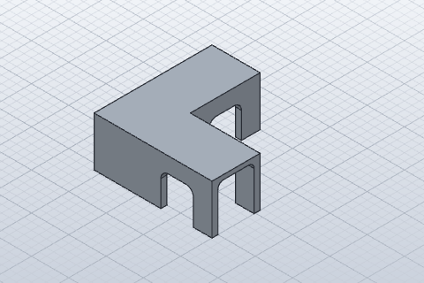
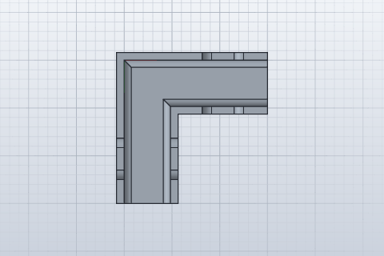

# Piezas para el campo

## Esquinero para las paredes de madera (11 nov 2026)

Las paredes del campo son tablas de madera de 9,5 mm y se caen al montarlas. Este esquinero se encaja por arriba en
la unión de dos tablas a 90° y las mantiene juntas y de pie.

- Archivos: `wall-corner-clip.stl` (imprimir), `.step` (CAD), `.sc` (SolidCraft, paramétrico).
- Versión ligera reforzada (11 nov 2026): ~2,3 cm³, menos de una cuarta parte de la primera (10 cm³). Solo tiene
  que tenerlas de pie, no aguantar golpes.
- Ranura en L de 9,7 mm (`T` 9,5 mm de la tabla + `c` 0,2 mm de holgura) que baja 12 mm (`d`) por la tabla.
- Brazos de 30 mm (`L`) medidos desde la esquina interior, paredes de 1,6 mm (`w`, 4 líneas con boquilla de 0,4) y
  techo de 1,2 mm (`top`). La pieza mide 31,6 × 31,6 × 13,2 mm.
- Huecos abiertos por abajo en el medio de cada brazo (`WindowX`, `WindowY`): las paredes quedan como patas de 5 mm
  (`end`) en la esquina y en las puntas, unidas por una franja de 3 mm (`band`) bajo el techo. Al estar abiertos por
  abajo no hay puentes.
- Redondeos donde la pared se quebraría: R 2 mm en las esquinas de arriba de cada hueco (`WindowFillets`) y R 1,5 mm
  entre el techo y las paredes dentro de la ranura (`SlotRoofFillets`). Por estos últimos la tabla se queda 1,5 mm
  por debajo del techo; no hace falta que lo toque.
- La ranura es la unión de las dos tablas, así que sirve para cualquier esquina, también si una tabla tapa el canto
  de la otra, y para las esquinas de la isla.
- Imprimir con el techo sobre la cama, sin soportes.
- **No se probó** con las tablas reales. Si entra muy justo, subir `c` (p. ej. 0,4 mm); si baila, bajarlo.

 
