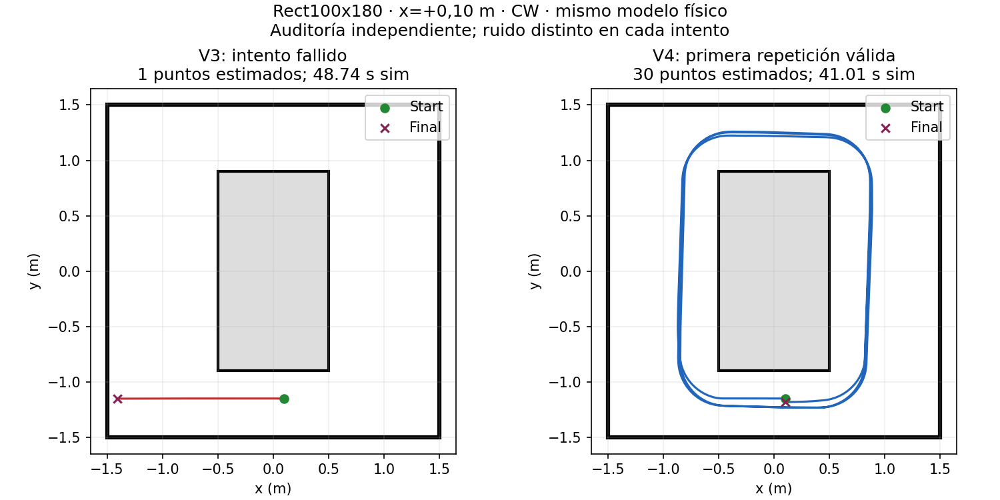

# Open con otras salidas: pruebas graduales y hallazgos

8 de octubre de 2026. Mismo motor `real_car_v1` limitado al 100 % PWM,
dirección equivalente ±17,6°, sensores ruidosos y detección automática del sentido.
La estrategia no recibe la pose; el juez usa la auditoría aparte a 50 Hz.
Cada intento conserva puntos, ambos relojes desde Start, parciales, sensores y código.

Etapas: primero x ±10 cm, después y ±5 cm, después x ±25 cm / y ±15 cm.
Se mantiene yaw 0 para CCW y π para CW. Las coordenadas se usan solo al preparar
la prueba y al auditarla; nunca son una entrada del controlador.
Son diagnósticos por salida; las comparaciones de perfiles usan además el set
estándar completo. Las repeticiones con ruido y GUI se identifican por ronda.

[Guía para correr y conservar hallazgos](../guia-correr-open-v4.md#coche-real-y-registro-de-mejoras).
[Mejor ronda histórica en la salida original](best-realcar-open-round.md).
[Mejores validadas por geometría y salida](realcar-robust-best-rounds.md).

## Todos los intentos

| Evidencia | Campo / sentido | Salida x, y, yaw | GUI | Puntos estimados | Start → fin sim / pared (s) | Válida | Fallos |
|---|---|---|---|---:|---:|---|---|
| [std12-realcar-symmetric-final-r1-square100-ccw](20261008T051639Z-std12-realcar-symmetric-final-r1-square100-ccw/round.json) | square100 / CCW | 0.00, -1.15, 0.000 | no | 30 | 29.730 / 13.264 | sí | — |
| [std12-realcar-symmetric-final-r1-square100-cw](20261008T051724Z-std12-realcar-symmetric-final-r1-square100-cw/round.json) | square100 / CW | 0.00, -1.15, 3.142 | no | 30 | 30.034 / 13.373 | sí | — |
| [std12-realcar-symmetric-final-r1-square180-ccw](20261008T051808Z-std12-realcar-symmetric-final-r1-square180-ccw/round.json) | square180 / CCW | 0.00, -1.15, 0.000 | no | 1 | 35.996 / 17.695 | no | rule_maximum, stop_observed, no_contacts, min_inner_wall_clearance_m |
| [std12-realcar-symmetric-final-r1-square180-cw](20261008T051837Z-std12-realcar-symmetric-final-r1-square180-cw/round.json) | square180 / CW | 0.00, -1.15, 3.142 | no | 1 | 30.217 / 14.657 | no | rule_maximum, stop_observed, no_contacts, min_inner_wall_clearance_m |
| [std12-realcar-symmetric-final-r1-rect100x180-ccw](20261008T051904Z-std12-realcar-symmetric-final-r1-rect100x180-ccw/round.json) | rect100x180 / CCW | 0.00, -1.15, 0.000 | no | 25 | 71.236 / 32.262 | no | rule_maximum, stop_observed, no_contacts, min_inner_wall_clearance_m |
| [std12-realcar-symmetric-final-r1-rect100x180-cw](20261008T051952Z-std12-realcar-symmetric-final-r1-rect100x180-cw/round.json) | rect100x180 / CW | 0.00, -1.15, 3.142 | no | 30 | 35.830 / 15.973 | no | min_inner_wall_clearance_m |
| [std12-realcar-symmetric-final-r1-rect180x100-ccw](20261008T052040Z-std12-realcar-symmetric-final-r1-rect180x100-ccw/round.json) | rect180x100 / CCW | 0.00, -1.15, 0.000 | no | 25 | 71.875 / 32.152 | no | rule_maximum, stop_observed |
| [std12-realcar-symmetric-final-r1-rect180x100-cw](20261008T052127Z-std12-realcar-symmetric-final-r1-rect180x100-cw/round.json) | rect180x100 / CW | 0.00, -1.15, 3.142 | no | 5 | 35.676 / 17.147 | no | rule_maximum, stop_observed, no_contacts, min_inner_wall_clearance_m |
| [std12-realcar-symmetric-final-r1-shift140-ccw](20261008T052155Z-std12-realcar-symmetric-final-r1-shift140-ccw/round.json) | shift140 / CCW | 0.00, -1.15, 0.000 | no | 1 | 35.237 / 17.685 | no | rule_maximum, stop_observed, no_contacts, min_inner_wall_clearance_m |
| [std12-realcar-symmetric-final-r1-shift140-cw](20261008T052225Z-std12-realcar-symmetric-final-r1-shift140-cw/round.json) | shift140 / CW | 0.00, -1.15, 3.142 | no | 7 | 45.116 / 21.720 | no | rule_maximum, stop_observed, no_contacts, min_inner_wall_clearance_m |
| [std12-realcar-symmetric-final-r1-east140x100-ccw](20261008T052300Z-std12-realcar-symmetric-final-r1-east140x100-ccw/round.json) | east140x100 / CCW | 0.00, -1.15, 0.000 | no | 30 | 33.115 / 14.777 | sí | — |
| [std12-realcar-symmetric-final-r1-east140x100-cw](20261008T052346Z-std12-realcar-symmetric-final-r1-east140x100-cw/round.json) | east140x100 / CW | 0.00, -1.15, 3.142 | no | 14 | 54.396 / 25.770 | no | rule_maximum, stop_observed, no_contacts, min_inner_wall_clearance_m |
| [realcar-starts-v1-r1-sq100-xp10-ccw](20261008T060234Z-realcar-starts-v1-r1-sq100-xp10-ccw/round.json) | square100 / CCW | 0.10, -1.15, 0.000 | no | 30 | 29.832 / 13.300 | sí | — |
| [realcar-starts-v1-r1-sq100-xp10-cw](20261008T060319Z-realcar-starts-v1-r1-sq100-xp10-cw/round.json) | square100 / CW | 0.10, -1.15, 3.142 | no | 30 | 31.615 / 13.979 | sí | — |
| [realcar-starts-v1-r1-sq100-xm10-ccw](20261008T060404Z-realcar-starts-v1-r1-sq100-xm10-ccw/round.json) | square100 / CCW | -0.10, -1.15, 0.000 | no | 30 | 31.116 / 13.817 | sí | — |
| [realcar-starts-v1-r1-sq100-xm10-cw](20261008T060449Z-realcar-starts-v1-r1-sq100-xm10-cw/round.json) | square100 / CW | -0.10, -1.15, 3.142 | no | 30 | 30.029 / 13.387 | sí | — |
| [realcar-starts-v1-r1-sq100-yp05-ccw](20261008T060633Z-realcar-starts-v1-r1-sq100-yp05-ccw/round.json) | square100 / CCW | 0.00, -1.10, 0.000 | no | 30 | 29.834 / 13.227 | sí | — |
| [realcar-starts-v1-r1-sq100-yp05-cw](20261008T060718Z-realcar-starts-v1-r1-sq100-yp05-cw/round.json) | square100 / CW | 0.00, -1.10, 3.142 | no | 30 | 30.032 / 13.334 | sí | — |
| [realcar-starts-v1-r1-sq100-ym05-ccw](20261008T060803Z-realcar-starts-v1-r1-sq100-ym05-ccw/round.json) | square100 / CCW | 0.00, -1.20, 0.000 | no | 30 | 30.231 / 13.156 | sí | — |
| [realcar-starts-v1-r1-sq100-ym05-cw](20261008T060848Z-realcar-starts-v1-r1-sq100-ym05-cw/round.json) | square100 / CW | 0.00, -1.20, 3.142 | no | 30 | 30.030 / 13.351 | sí | — |
| [realcar-starts-v1-r1-sq100-xp25-ccw](20261008T061058Z-realcar-starts-v1-r1-sq100-xp25-ccw/round.json) | square100 / CCW | 0.25, -1.15, 0.000 | no | 30 | 30.115 / 13.358 | sí | — |
| [realcar-starts-v1-r1-sq100-xp25-cw](20261008T061143Z-realcar-starts-v1-r1-sq100-xp25-cw/round.json) | square100 / CW | 0.25, -1.15, 3.142 | no | 30 | 31.831 / 14.179 | sí | — |
| [realcar-starts-v1-r1-sq100-xm25-ccw](20261008T061229Z-realcar-starts-v1-r1-sq100-xm25-ccw/round.json) | square100 / CCW | -0.25, -1.15, 0.000 | no | 30 | 32.333 / 14.477 | sí | — |
| [realcar-starts-v1-r1-sq100-xm25-cw](20261008T061315Z-realcar-starts-v1-r1-sq100-xm25-cw/round.json) | square100 / CW | -0.25, -1.15, 3.142 | no | 30 | 30.498 / 13.369 | sí | — |
| [realcar-starts-v1-r1-sq100-yp15-ccw](20261008T061400Z-realcar-starts-v1-r1-sq100-yp15-ccw/round.json) | square100 / CCW | 0.00, -1.00, 0.000 | no | 30 | 29.937 / 13.315 | sí | — |
| [realcar-starts-v1-r1-sq100-yp15-cw](20261008T061444Z-realcar-starts-v1-r1-sq100-yp15-cw/round.json) | square100 / CW | 0.00, -1.00, 3.142 | no | 30 | 29.656 / 13.229 | sí | — |
| [realcar-starts-v1-r1-sq100-ym15-ccw](20261008T061529Z-realcar-starts-v1-r1-sq100-ym15-ccw/round.json) | square100 / CCW | 0.00, -1.30, 0.000 | no | 0 | 15.776 / 7.015 | no | rule_maximum, stop_observed, steering_limit |
| [realcar-starts-v1-r1-sq100-ym15-cw](20261008T061552Z-realcar-starts-v1-r1-sq100-ym15-cw/round.json) | square100 / CW | 0.00, -1.30, 3.142 | no | 30 | 31.116 / 13.841 | sí | — |
| [realcar-starts-v2-probe-sq100-ym15-ccw](20261008T061905Z-realcar-starts-v2-probe-sq100-ym15-ccw/round.json) | square100 / CCW | 0.00, -1.30, 0.000 | no | 30 | 32.116 / 14.255 | sí | — |
| [realcar-starts-v2-narrow-square180-ccw](20261008T062007Z-realcar-starts-v2-narrow-square180-ccw/round.json) | square180 / CCW | 0.00, -1.15, 0.000 | no | 25 | 82.536 / 36.762 | no | rule_maximum, stop_observed |
| [std12-realcar-starts-v2-r1-square100-ccw](20261008T062122Z-std12-realcar-starts-v2-r1-square100-ccw/round.json) | square100 / CCW | 0.00, -1.15, 0.000 | no | 30 | 30.936 / 13.835 | sí | — |
| [std12-realcar-starts-v2-r1-square100-cw](20261008T062207Z-std12-realcar-starts-v2-r1-square100-cw/round.json) | square100 / CW | 0.00, -1.15, 3.142 | no | 30 | 30.938 / 13.738 | sí | — |
| [std12-realcar-starts-v2-r1-square180-ccw](20261008T062252Z-std12-realcar-starts-v2-r1-square180-ccw/round.json) | square180 / CCW | 0.00, -1.15, 0.000 | no | 25 | 81.735 / 36.396 | no | rule_maximum, stop_observed |
| [realcar-starts-v2b-narrow-square180-ccw](20261008T062522Z-realcar-starts-v2b-narrow-square180-ccw/round.json) | square180 / CCW | 0.00, -1.15, 0.000 | no | 30 | 51.016 / 22.686 | sí | — |
| [std12-realcar-starts-v2-r2-square100-ccw](20261008T062724Z-std12-realcar-starts-v2-r2-square100-ccw/round.json) | square100 / CCW | 0.00, -1.15, 0.000 | no | 30 | 33.095 / 14.663 | sí | — |
| [std12-realcar-starts-v2-r2-square100-cw](20261008T062810Z-std12-realcar-starts-v2-r2-square100-cw/round.json) | square100 / CW | 0.00, -1.15, 3.142 | no | 30 | 32.917 / 14.777 | sí | — |
| [std12-realcar-starts-v2-r2-square180-ccw](20261008T062857Z-std12-realcar-starts-v2-r2-square180-ccw/round.json) | square180 / CCW | 0.00, -1.15, 0.000 | no | 30 | 49.916 / 22.276 | no | no_contacts, min_inner_wall_clearance_m |
| [std12-realcar-starts-v2-r2-square180-cw](20261008T062950Z-std12-realcar-starts-v2-r2-square180-cw/round.json) | square180 / CW | 0.00, -1.15, 3.142 | no | 30 | 49.516 / 22.054 | sí | — |
| [std12-realcar-starts-v2-r2-rect100x180-ccw](20261008T063044Z-std12-realcar-starts-v2-r2-rect100x180-ccw/round.json) | rect100x180 / CCW | 0.00, -1.15, 0.000 | no | 30 | 40.397 / 17.665 | sí | — |
| [std12-realcar-starts-v2-r2-rect100x180-cw](20261008T063133Z-std12-realcar-starts-v2-r2-rect100x180-cw/round.json) | rect100x180 / CW | 0.00, -1.15, 3.142 | no | 30 | 40.896 / 18.204 | sí | — |
| [std12-realcar-starts-v2-r2-rect180x100-ccw](20261008T063223Z-std12-realcar-starts-v2-r2-rect180x100-ccw/round.json) | rect180x100 / CCW | 0.00, -1.15, 0.000 | no | 30 | 42.315 / 18.972 | sí | — |
| [std12-realcar-starts-v2-r2-rect180x100-cw](20261008T063313Z-std12-realcar-starts-v2-r2-rect180x100-cw/round.json) | rect180x100 / CW | 0.00, -1.15, 3.142 | no | 30 | 41.895 / 18.763 | sí | — |
| [std12-realcar-starts-v2-r2-shift140-ccw](20261008T063404Z-std12-realcar-starts-v2-r2-shift140-ccw/round.json) | shift140 / CCW | 0.00, -1.15, 0.000 | no | 30 | 40.616 / 18.087 | sí | — |
| [std12-realcar-starts-v2-r2-shift140-cw](20261008T063453Z-std12-realcar-starts-v2-r2-shift140-cw/round.json) | shift140 / CW | 0.00, -1.15, 3.142 | no | 23 | 42.017 / 19.236 | no | rule_maximum, stop_observed, no_contacts, min_inner_wall_clearance_m |
| [std12-realcar-starts-v2-r2-east140x100-ccw](20261008T063524Z-std12-realcar-starts-v2-r2-east140x100-ccw/round.json) | east140x100 / CCW | 0.00, -1.15, 0.000 | no | 30 | 36.716 / 16.387 | sí | — |
| [std12-realcar-starts-v2-r2-east140x100-cw](20261008T063612Z-std12-realcar-starts-v2-r2-east140x100-cw/round.json) | east140x100 / CW | 0.00, -1.15, 3.142 | no | 30 | 38.216 / 17.062 | sí | — |
| [realcar-starts-v2-gui-rect100x180-xp10-ccw](20261008T063754Z-realcar-starts-v2-gui-rect100x180-xp10-ccw/round.json) | rect100x180 / CCW | 0.10, -1.15, 0.000 | sí | 30 | 40.196 / 41.186 | sí | — |
| [realcar-starts-v2-gui-rect100x180-xm10-cw](20261008T064136Z-realcar-starts-v2-gui-rect100x180-xm10-cw/round.json) | rect100x180 / CW | -0.10, -1.15, 3.142 | sí | 30 | 39.996 / 42.967 | sí | — |
| [realcar-starts-v2-gui-square180-ccw](20261008T064322Z-realcar-starts-v2-gui-square180-ccw/round.json) | square180 / CCW | 0.00, -1.00, 0.000 | sí | 30 | 49.496 / 50.320 | no | min_inner_wall_clearance_m |
| [realcar-starts-v2-gui-square180-standard-ccw](20261008T064548Z-realcar-starts-v2-gui-square180-standard-ccw/round.json) | square180 / CCW | 0.00, -1.15, 0.000 | sí | 30 | 49.677 / 50.419 | sí | — |
| [realcar-starts-v3-diag-square180-ccw](20261008T065038Z-realcar-starts-v3-diag-square180-ccw/round.json) | square180 / CCW | 0.00, -1.15, 0.000 | no | 30 | 51.816 / 22.971 | sí | — |
| [realcar-starts-v3-diag-shift140-cw](20261008T065143Z-realcar-starts-v3-diag-shift140-cw/round.json) | shift140 / CW | 0.00, -1.15, 3.142 | no | 30 | 42.816 / 19.189 | sí | — |
| [std12-realcar-starts-v3-r1-square100-ccw](20261008T065241Z-std12-realcar-starts-v3-r1-square100-ccw/round.json) | square100 / CCW | 0.00, -1.15, 0.000 | no | 30 | 33.416 / 14.827 | sí | — |
| [std12-realcar-starts-v3-r1-square100-cw](20261008T065327Z-std12-realcar-starts-v3-r1-square100-cw/round.json) | square100 / CW | 0.00, -1.15, 3.142 | no | 30 | 33.596 / 14.843 | sí | — |
| [std12-realcar-starts-v3-r1-square180-ccw](20261008T065413Z-std12-realcar-starts-v3-r1-square180-ccw/round.json) | square180 / CCW | 0.00, -1.15, 0.000 | no | 30 | 53.516 / 23.638 | sí | — |
| [std12-realcar-starts-v3-r1-square180-cw](20261008T065508Z-std12-realcar-starts-v3-r1-square180-cw/round.json) | square180 / CW | 0.00, -1.15, 3.142 | no | 30 | 51.016 / 22.652 | sí | — |
| [std12-realcar-starts-v3-r1-rect100x180-ccw](20261008T065602Z-std12-realcar-starts-v3-r1-rect100x180-ccw/round.json) | rect100x180 / CCW | 0.00, -1.15, 0.000 | no | 30 | 41.316 / 18.325 | sí | — |
| [std12-realcar-starts-v3-r1-rect100x180-cw](20261008T065651Z-std12-realcar-starts-v3-r1-rect100x180-cw/round.json) | rect100x180 / CW | 0.00, -1.15, 3.142 | no | 30 | 41.316 / 18.346 | sí | — |
| [std12-realcar-starts-v3-r1-rect180x100-ccw](20261008T065741Z-std12-realcar-starts-v3-r1-rect180x100-ccw/round.json) | rect180x100 / CCW | 0.00, -1.15, 0.000 | no | 30 | 44.916 / 19.814 | sí | — |
| [std12-realcar-starts-v3-r1-rect180x100-cw](20261008T065832Z-std12-realcar-starts-v3-r1-rect180x100-cw/round.json) | rect180x100 / CW | 0.00, -1.15, 3.142 | no | 30 | 43.616 / 19.444 | sí | — |
| [std12-realcar-starts-v3-r1-shift140-ccw](20261008T065923Z-std12-realcar-starts-v3-r1-shift140-ccw/round.json) | shift140 / CCW | 0.00, -1.15, 0.000 | no | 30 | 42.432 / 18.859 | sí | — |
| [std12-realcar-starts-v3-r1-shift140-cw](20261008T070013Z-std12-realcar-starts-v3-r1-shift140-cw/round.json) | shift140 / CW | 0.00, -1.15, 3.142 | no | 30 | 42.706 / 18.991 | sí | — |
| [std12-realcar-starts-v3-r1-east140x100-ccw](20261008T070104Z-std12-realcar-starts-v3-r1-east140x100-ccw/round.json) | east140x100 / CCW | 0.00, -1.15, 0.000 | no | 30 | 37.716 / 16.765 | sí | — |
| [std12-realcar-starts-v3-r1-east140x100-cw](20261008T070152Z-std12-realcar-starts-v3-r1-east140x100-cw/round.json) | east140x100 / CW | 0.00, -1.15, 3.142 | no | 30 | 39.395 / 17.540 | sí | — |
| [realcar-starts-v3-r1-rect100x180-xp10-ccw](20261008T070256Z-realcar-starts-v3-r1-rect100x180-xp10-ccw/round.json) | rect100x180 / CCW | 0.10, -1.15, 0.000 | no | 30 | 42.115 / 18.614 | sí | — |
| [realcar-starts-v3-r1-rect100x180-xp10-cw](20261008T070346Z-realcar-starts-v3-r1-rect100x180-xp10-cw/round.json) | rect100x180 / CW | 0.10, -1.15, 3.142 | no | 1 | 48.738 / 22.793 | no | rule_maximum, no_rule_faults, stop_observed, no_contacts, min_outer_wall_clearance_m |
| [realcar-starts-v3-r1-rect100x180-xm10-ccw](20261008T070420Z-realcar-starts-v3-r1-rect100x180-xm10-ccw/round.json) | rect100x180 / CCW | -0.10, -1.15, 0.000 | no | 30 | 41.133 / 18.254 | sí | — |
| [realcar-starts-v3-r1-rect100x180-xm10-cw](20261008T070510Z-realcar-starts-v3-r1-rect100x180-xm10-cw/round.json) | rect100x180 / CW | -0.10, -1.15, 3.142 | no | 30 | 41.815 / 18.607 | sí | — |
| [realcar-starts-v4-diag-rect100x180-xp10-cw](20261008T071126Z-realcar-starts-v4-diag-rect100x180-xp10-cw/round.json) | rect100x180 / CW | 0.10, -1.15, 3.142 | no | 30 | 41.008 / 18.168 | sí | — |
| [std12-realcar-starts-v4-r1-square100-ccw](20261008T071231Z-std12-realcar-starts-v4-r1-square100-ccw/round.json) | square100 / CCW | 0.00, -1.15, 0.000 | no | 30 | 33.916 / 14.985 | sí | — |
| [std12-realcar-starts-v4-r1-square100-cw](20261008T071317Z-std12-realcar-starts-v4-r1-square100-cw/round.json) | square100 / CW | 0.00, -1.15, 3.142 | no | 30 | 33.416 / 14.867 | sí | — |
| [std12-realcar-starts-v4-r1-square180-ccw](20261008T071404Z-std12-realcar-starts-v4-r1-square180-ccw/round.json) | square180 / CCW | 0.00, -1.15, 0.000 | no | 30 | 51.315 / 22.837 | sí | — |
| [std12-realcar-starts-v4-r1-square180-cw](20261008T071458Z-std12-realcar-starts-v4-r1-square180-cw/round.json) | square180 / CW | 0.00, -1.15, 3.142 | no | 30 | 50.735 / 22.464 | sí | — |
| [std12-realcar-starts-v4-r1-rect100x180-ccw](20261008T071552Z-std12-realcar-starts-v4-r1-rect100x180-ccw/round.json) | rect100x180 / CCW | 0.00, -1.15, 0.000 | no | 30 | 40.216 / 17.868 | sí | — |
| [std12-realcar-starts-v4-r1-rect100x180-cw](20261008T071641Z-std12-realcar-starts-v4-r1-rect100x180-cw/round.json) | rect100x180 / CW | 0.00, -1.15, 3.142 | no | 30 | 40.316 / 17.943 | sí | — |
| [std12-realcar-starts-v4-r1-rect180x100-ccw](20261008T071730Z-std12-realcar-starts-v4-r1-rect180x100-ccw/round.json) | rect180x100 / CCW | 0.00, -1.15, 0.000 | no | 30 | 44.115 / 19.692 | sí | — |
| [std12-realcar-starts-v4-r1-rect180x100-cw](20261008T071821Z-std12-realcar-starts-v4-r1-rect180x100-cw/round.json) | rect180x100 / CW | 0.00, -1.15, 3.142 | no | 30 | 43.216 / 19.256 | sí | — |
| [std12-realcar-starts-v4-r1-shift140-ccw](20261008T071912Z-std12-realcar-starts-v4-r1-shift140-ccw/round.json) | shift140 / CCW | 0.00, -1.15, 0.000 | no | 30 | 42.015 / 18.677 | sí | — |
| [std12-realcar-starts-v4-r1-shift140-cw](20261008T072002Z-std12-realcar-starts-v4-r1-shift140-cw/round.json) | shift140 / CW | 0.00, -1.15, 3.142 | no | 30 | 43.016 / 19.123 | sí | — |
| [std12-realcar-starts-v4-r1-east140x100-ccw](20261008T072052Z-std12-realcar-starts-v4-r1-east140x100-ccw/round.json) | east140x100 / CCW | 0.00, -1.15, 0.000 | no | 30 | 37.216 / 16.611 | sí | — |
| [std12-realcar-starts-v4-r1-east140x100-cw](20261008T072140Z-std12-realcar-starts-v4-r1-east140x100-cw/round.json) | east140x100 / CW | 0.00, -1.15, 3.142 | no | 30 | 39.517 / 17.604 | sí | — |
| [realcar-starts-v4-r1-rect100x180-xp10-ccw](20261008T072449Z-realcar-starts-v4-r1-rect100x180-xp10-ccw/round.json) | rect100x180 / CCW | 0.10, -1.15, 0.000 | no | 30 | 41.516 / 18.559 | sí | — |
| [realcar-starts-v4-r1-rect100x180-xp10-cw](20261008T072539Z-realcar-starts-v4-r1-rect100x180-xp10-cw/round.json) | rect100x180 / CW | 0.10, -1.15, 3.142 | no | 30 | 40.033 / 17.754 | sí | — |
| [realcar-starts-v4-r1-rect100x180-xm10-ccw](20261008T072628Z-realcar-starts-v4-r1-rect100x180-xm10-ccw/round.json) | rect100x180 / CCW | -0.10, -1.15, 0.000 | no | 30 | 41.396 / 18.447 | sí | — |
| [realcar-starts-v4-r1-rect100x180-xm10-cw](20261008T072718Z-realcar-starts-v4-r1-rect100x180-xm10-cw/round.json) | rect100x180 / CW | -0.10, -1.15, 3.142 | no | 30 | 42.116 / 18.743 | sí | — |
| [realcar-starts-v4-gui-rect100x180-xp10-cw](20261008T072832Z-realcar-starts-v4-gui-rect100x180-xp10-cw/round.json) | rect100x180 / CW | 0.10, -1.15, 3.142 | sí | 30 | 39.811 / 40.396 | sí | — |
| [realcar-starts-v4-gui-square180-ccw](20261008T073041Z-realcar-starts-v4-gui-square180-ccw/round.json) | square180 / CCW | 0.00, -1.15, 0.000 | sí | 30 | 50.897 / 51.657 | sí | — |
| [realcar-starts-v4-probe-sq100-ym15-ccw](20261008T073313Z-realcar-starts-v4-probe-sq100-ym15-ccw/round.json) | square100 / CCW | 0.00, -1.30, 0.000 | no | 30 | 34.216 / 15.391 | sí | — |
| [realcar-starts-v4-gui-shift140-cw](20261008T073508Z-realcar-starts-v4-gui-shift140-cw/round.json) | shift140 / CW | 0.00, -1.15, 3.142 | sí | 30 | 42.796 / 43.426 | sí | — |

## Historial de mejores por salida y sentido

Primero se exige validación aprobada y se comparan puntos; con igual puntuación,
menor tiempo total. Se separa GUI de ejecución acelerada. Todas las promociones
anteriores se conservan. Los perfiles y el código exactos están en `source/`.

| Mejor observada y evidencia | Salida | Sentido / GUI | Tiempo sim (s) | Motivo |
|---|---|---|---:|---|
| [std12-realcar-symmetric-final-r1-square100-ccw](20261008T051639Z-std12-realcar-symmetric-final-r1-square100-ccw/round.json) | 0.00, -1.15, 0.000 | CCW / sin GUI | 29.730 | Primera válida: 30 puntos estimados, secciones, parada, contactos y margen aprobados. |
| [std12-realcar-symmetric-final-r1-square100-cw](20261008T051724Z-std12-realcar-symmetric-final-r1-square100-cw/round.json) | 0.00, -1.15, 3.142 | CW / sin GUI | 30.034 | Primera válida: 30 puntos estimados, secciones, parada, contactos y margen aprobados. |
| [std12-realcar-symmetric-final-r1-east140x100-ccw](20261008T052300Z-std12-realcar-symmetric-final-r1-east140x100-ccw/round.json) | 0.00, -1.15, 0.000 | CCW / sin GUI | 33.115 | Primera válida: 30 puntos estimados, secciones, parada, contactos y margen aprobados. |
| [realcar-starts-v1-r1-sq100-xp10-ccw](20261008T060234Z-realcar-starts-v1-r1-sq100-xp10-ccw/round.json) | 0.10, -1.15, 0.000 | CCW / sin GUI | 29.832 | Primera válida: 30 puntos estimados, secciones, parada, contactos y margen aprobados. |
| [realcar-starts-v1-r1-sq100-xp10-cw](20261008T060319Z-realcar-starts-v1-r1-sq100-xp10-cw/round.json) | 0.10, -1.15, 3.142 | CW / sin GUI | 31.615 | Primera válida: 30 puntos estimados, secciones, parada, contactos y margen aprobados. |
| [realcar-starts-v1-r1-sq100-xm10-ccw](20261008T060404Z-realcar-starts-v1-r1-sq100-xm10-ccw/round.json) | -0.10, -1.15, 0.000 | CCW / sin GUI | 31.116 | Primera válida: 30 puntos estimados, secciones, parada, contactos y margen aprobados. |
| [realcar-starts-v1-r1-sq100-xm10-cw](20261008T060449Z-realcar-starts-v1-r1-sq100-xm10-cw/round.json) | -0.10, -1.15, 3.142 | CW / sin GUI | 30.029 | Primera válida: 30 puntos estimados, secciones, parada, contactos y margen aprobados. |
| [realcar-starts-v1-r1-sq100-yp05-ccw](20261008T060633Z-realcar-starts-v1-r1-sq100-yp05-ccw/round.json) | 0.00, -1.10, 0.000 | CCW / sin GUI | 29.834 | Primera válida: 30 puntos estimados, secciones, parada, contactos y margen aprobados. |
| [realcar-starts-v1-r1-sq100-yp05-cw](20261008T060718Z-realcar-starts-v1-r1-sq100-yp05-cw/round.json) | 0.00, -1.10, 3.142 | CW / sin GUI | 30.032 | Primera válida: 30 puntos estimados, secciones, parada, contactos y margen aprobados. |
| [realcar-starts-v1-r1-sq100-ym05-ccw](20261008T060803Z-realcar-starts-v1-r1-sq100-ym05-ccw/round.json) | 0.00, -1.20, 0.000 | CCW / sin GUI | 30.231 | Primera válida: 30 puntos estimados, secciones, parada, contactos y margen aprobados. |
| [realcar-starts-v1-r1-sq100-ym05-cw](20261008T060848Z-realcar-starts-v1-r1-sq100-ym05-cw/round.json) | 0.00, -1.20, 3.142 | CW / sin GUI | 30.030 | Primera válida: 30 puntos estimados, secciones, parada, contactos y margen aprobados. |
| [realcar-starts-v1-r1-sq100-xp25-ccw](20261008T061058Z-realcar-starts-v1-r1-sq100-xp25-ccw/round.json) | 0.25, -1.15, 0.000 | CCW / sin GUI | 30.115 | Primera válida: 30 puntos estimados, secciones, parada, contactos y margen aprobados. |
| [realcar-starts-v1-r1-sq100-xp25-cw](20261008T061143Z-realcar-starts-v1-r1-sq100-xp25-cw/round.json) | 0.25, -1.15, 3.142 | CW / sin GUI | 31.831 | Primera válida: 30 puntos estimados, secciones, parada, contactos y margen aprobados. |
| [realcar-starts-v1-r1-sq100-xm25-ccw](20261008T061229Z-realcar-starts-v1-r1-sq100-xm25-ccw/round.json) | -0.25, -1.15, 0.000 | CCW / sin GUI | 32.333 | Primera válida: 30 puntos estimados, secciones, parada, contactos y margen aprobados. |
| [realcar-starts-v1-r1-sq100-xm25-cw](20261008T061315Z-realcar-starts-v1-r1-sq100-xm25-cw/round.json) | -0.25, -1.15, 3.142 | CW / sin GUI | 30.498 | Primera válida: 30 puntos estimados, secciones, parada, contactos y margen aprobados. |
| [realcar-starts-v1-r1-sq100-yp15-ccw](20261008T061400Z-realcar-starts-v1-r1-sq100-yp15-ccw/round.json) | 0.00, -1.00, 0.000 | CCW / sin GUI | 29.937 | Primera válida: 30 puntos estimados, secciones, parada, contactos y margen aprobados. |
| [realcar-starts-v1-r1-sq100-yp15-cw](20261008T061444Z-realcar-starts-v1-r1-sq100-yp15-cw/round.json) | 0.00, -1.00, 3.142 | CW / sin GUI | 29.656 | Primera válida: 30 puntos estimados, secciones, parada, contactos y margen aprobados. |
| [realcar-starts-v1-r1-sq100-ym15-cw](20261008T061552Z-realcar-starts-v1-r1-sq100-ym15-cw/round.json) | 0.00, -1.30, 3.142 | CW / sin GUI | 31.116 | Primera válida: 30 puntos estimados, secciones, parada, contactos y margen aprobados. |
| [realcar-starts-v2-probe-sq100-ym15-ccw](20261008T061905Z-realcar-starts-v2-probe-sq100-ym15-ccw/round.json) | 0.00, -1.30, 0.000 | CCW / sin GUI | 32.116 | Primera válida: 30 puntos estimados, secciones, parada, contactos y margen aprobados. El eje frontal permite explorar sin confundir el muro paralelo; resuelve el arranque fallido de v1. |
| [realcar-starts-v2b-narrow-square180-ccw](20261008T062522Z-realcar-starts-v2b-narrow-square180-ccw/round.json) | 0.00, -1.15, 0.000 | CCW / sin GUI | 51.016 | Primera válida: 30 puntos estimados, secciones, parada, contactos y margen aprobados. Anticipación limitada por el hueco interior y llegada referida al LiDAR de Start. |
| [std12-realcar-starts-v2-r2-square180-cw](20261008T062950Z-std12-realcar-starts-v2-r2-square180-cw/round.json) | 0.00, -1.15, 3.142 | CW / sin GUI | 49.516 | Primera válida: 30 puntos estimados, secciones, parada, contactos y margen aprobados. |
| [std12-realcar-starts-v2-r2-rect100x180-ccw](20261008T063044Z-std12-realcar-starts-v2-r2-rect100x180-ccw/round.json) | 0.00, -1.15, 0.000 | CCW / sin GUI | 40.397 | Primera válida: 30 puntos estimados, secciones, parada, contactos y margen aprobados. |
| [std12-realcar-starts-v2-r2-rect100x180-cw](20261008T063133Z-std12-realcar-starts-v2-r2-rect100x180-cw/round.json) | 0.00, -1.15, 3.142 | CW / sin GUI | 40.896 | Primera válida: 30 puntos estimados, secciones, parada, contactos y margen aprobados. |
| [std12-realcar-starts-v2-r2-rect180x100-ccw](20261008T063223Z-std12-realcar-starts-v2-r2-rect180x100-ccw/round.json) | 0.00, -1.15, 0.000 | CCW / sin GUI | 42.315 | Primera válida: 30 puntos estimados, secciones, parada, contactos y margen aprobados. |
| [std12-realcar-starts-v2-r2-rect180x100-cw](20261008T063313Z-std12-realcar-starts-v2-r2-rect180x100-cw/round.json) | 0.00, -1.15, 3.142 | CW / sin GUI | 41.895 | Primera válida: 30 puntos estimados, secciones, parada, contactos y margen aprobados. |
| [std12-realcar-starts-v2-r2-shift140-ccw](20261008T063404Z-std12-realcar-starts-v2-r2-shift140-ccw/round.json) | 0.00, -1.15, 0.000 | CCW / sin GUI | 40.616 | Primera válida: 30 puntos estimados, secciones, parada, contactos y margen aprobados. |
| [std12-realcar-starts-v2-r2-east140x100-cw](20261008T063612Z-std12-realcar-starts-v2-r2-east140x100-cw/round.json) | 0.00, -1.15, 3.142 | CW / sin GUI | 38.216 | Primera válida: 30 puntos estimados, secciones, parada, contactos y margen aprobados. |
| [realcar-starts-v2-gui-rect100x180-xp10-ccw](20261008T063754Z-realcar-starts-v2-gui-rect100x180-xp10-ccw/round.json) | 0.10, -1.15, 0.000 | CCW / GUI | 40.196 | Primera válida: 30 puntos estimados, secciones, parada, contactos y margen aprobados. |
| [realcar-starts-v2-gui-rect100x180-xm10-cw](20261008T064136Z-realcar-starts-v2-gui-rect100x180-xm10-cw/round.json) | -0.10, -1.15, 3.142 | CW / GUI | 39.996 | Primera válida: 30 puntos estimados, secciones, parada, contactos y margen aprobados. |
| [realcar-starts-v2-gui-square180-standard-ccw](20261008T064548Z-realcar-starts-v2-gui-square180-standard-ccw/round.json) | 0.00, -1.15, 0.000 | CCW / GUI | 49.677 | Primera válida: 30 puntos estimados, secciones, parada, contactos y margen aprobados. |
| [realcar-starts-v3-diag-shift140-cw](20261008T065143Z-realcar-starts-v3-diag-shift140-cw/round.json) | 0.00, -1.15, 3.142 | CW / sin GUI | 42.816 | Primera válida: 30 puntos estimados, secciones, parada, contactos y margen aprobados. Ajuste lateral ampliado y confirmación con dos escaneos independientes; mismo motor y juez. |
| [std12-realcar-starts-v3-r1-shift140-cw](20261008T070013Z-std12-realcar-starts-v3-r1-shift140-cw/round.json) | 0.00, -1.15, 3.142 | CW / sin GUI | 42.706 | Mismos puntos y validación; mejora 42.816 → 42.706 s. Ajuste lateral ampliado y confirmación con dos escaneos independientes; mismo motor y juez. |
| [realcar-starts-v3-r1-rect100x180-xp10-ccw](20261008T070256Z-realcar-starts-v3-r1-rect100x180-xp10-ccw/round.json) | 0.10, -1.15, 0.000 | CCW / sin GUI | 42.115 | Primera válida: 30 puntos estimados, secciones, parada, contactos y margen aprobados. Ajuste lateral ampliado y confirmación con dos escaneos independientes; mismo motor y juez. |
| [realcar-starts-v3-r1-rect100x180-xm10-ccw](20261008T070420Z-realcar-starts-v3-r1-rect100x180-xm10-ccw/round.json) | -0.10, -1.15, 0.000 | CCW / sin GUI | 41.133 | Primera válida: 30 puntos estimados, secciones, parada, contactos y margen aprobados. Ajuste lateral ampliado y confirmación con dos escaneos independientes; mismo motor y juez. |
| [realcar-starts-v3-r1-rect100x180-xm10-cw](20261008T070510Z-realcar-starts-v3-r1-rect100x180-xm10-cw/round.json) | -0.10, -1.15, 3.142 | CW / sin GUI | 41.815 | Primera válida: 30 puntos estimados, secciones, parada, contactos y margen aprobados. Ajuste lateral ampliado y confirmación con dos escaneos independientes; mismo motor y juez. |
| [realcar-starts-v4-diag-rect100x180-xp10-cw](20261008T071126Z-realcar-starts-v4-diag-rect100x180-xp10-cw/round.json) | 0.10, -1.15, 3.142 | CW / sin GUI | 41.008 | Primera válida: 30 puntos estimados, secciones, parada, contactos y margen aprobados. Misma percepción v3; freno ante LiDAR/IMU antiguos, sin modificar la física. |
| [std12-realcar-starts-v4-r1-rect100x180-ccw](20261008T071552Z-std12-realcar-starts-v4-r1-rect100x180-ccw/round.json) | 0.00, -1.15, 0.000 | CCW / sin GUI | 40.216 | Mismos puntos y validación; mejora 40.397 → 40.216 s. Misma percepción v3; freno ante LiDAR/IMU antiguos, sin modificar la física. |
| [std12-realcar-starts-v4-r1-rect100x180-cw](20261008T071641Z-std12-realcar-starts-v4-r1-rect100x180-cw/round.json) | 0.00, -1.15, 3.142 | CW / sin GUI | 40.316 | Mismos puntos y validación; mejora 40.896 → 40.316 s. Misma percepción v3; freno ante LiDAR/IMU antiguos, sin modificar la física. |
| [realcar-starts-v4-r1-rect100x180-xp10-ccw](20261008T072449Z-realcar-starts-v4-r1-rect100x180-xp10-ccw/round.json) | 0.10, -1.15, 0.000 | CCW / sin GUI | 41.516 | Mismos puntos y validación; mejora 42.115 → 41.516 s. Misma percepción v3; freno ante LiDAR/IMU antiguos, sin modificar la física. |
| [realcar-starts-v4-r1-rect100x180-xp10-cw](20261008T072539Z-realcar-starts-v4-r1-rect100x180-xp10-cw/round.json) | 0.10, -1.15, 3.142 | CW / sin GUI | 40.033 | Mismos puntos y validación; mejora 41.008 → 40.033 s. Misma percepción v3; freno ante LiDAR/IMU antiguos, sin modificar la física. |
| [realcar-starts-v4-gui-rect100x180-xp10-cw](20261008T072832Z-realcar-starts-v4-gui-rect100x180-xp10-cw/round.json) | 0.10, -1.15, 3.142 | CW / GUI | 39.811 | Primera válida: 30 puntos estimados, secciones, parada, contactos y margen aprobados. Misma percepción v3; freno ante LiDAR/IMU antiguos, sin modificar la física. |
| [realcar-starts-v4-gui-shift140-cw](20261008T073508Z-realcar-starts-v4-gui-shift140-cw/round.json) | 0.00, -1.15, 3.142 | CW / GUI | 42.796 | Primera válida: 30 puntos estimados, secciones, parada, contactos y margen aprobados. Misma percepción v3; freno ante LiDAR/IMU antiguos, sin modificar la física. |

## Hallazgos de estrategia

- Las primeras cuatro salidas x ±10 cm con v1 dieron 30 puntos y validación
  aprobada; el tiempo varió de 29,832 a 31,615 s simulados. La salida influye
  en la detección de la primera curva: no extrapolar el récord a cada salida.
- Las siguientes etapas y cualquier fallo permanecen en la tabla, incluso
  cuando una nueva configuración los resuelva.
- La etapa y = −1,30 m falló en v1 CCW: el mínimo del cono frontal veía el
  muro exterior paralelo a 0,57 m, aunque el eje frontal medía 1,44 m libres.
  Bloqueaba la exploración y las líneas de color quedaban demasiado finas/lejos.
  Se corrigió la exploración para usar el eje frontal; sigue parando ante
  obstáculos axiales, imágenes antiguas, datos ausentes o evidencia contradictoria.
- El candidato v2 limita la anticipación al hueco interior medido menos
  8 cm. En corredores estrechos espera a despejar la isla antes de girar.
  La llegada compara el LiDAR frontal con su mediana al iniciar; la distancia
  estimada de frenada baja de 35 a 8 cm cuando el motor se asienta a velocidad
  de llegada. Son ajustes del controlador, no datos de pose ni cambios del juez.
- La primera square180 con v2 dejó de contactar y tuvo 10,65 cm de margen,
  pero solo sumó 25 puntos: el último arco proporcionaba una distancia en
  el rumbo inclinado del coche y la frenada quedaba enclavada antes de salir
  de la curva. Se corrigió el eje frontal en TURN/FINISH para este perfil.
  El primer lote v2-r1 se detuvo tras tres rondas guardadas; no se presenta
  como un set estándar completo. La siguiente versión de código se prueba
  con un tag distinto y las rondas anteriores permanecen en la tabla.
- Con el eje corregido, square180 CCW pasó de 25 a 30 puntos y paró dentro
  de la sección de llegada en 51,016 s simulados, sin contactos. El mismo
  perfil antes del ajuste interior había tocado la isla: no usar su menor
  tiempo como si fuese una ronda completa. La versión y parámetros exactos
  de cada intento quedan archivados; el set completo y GUI siguen en la tabla.
- El set estándar completo v2-r2 aprobó 10 de 12 rondas, frente a 3 de 12
  de v1 con el mismo modelo físico. Fallaron square180 CCW y shift140 CW
  por contacto con la isla; no se considera validado el perfil en todas las
  geometrías. En square180 se observó una distancia de extremo espuria en
  un único escaneo: adelanta el giro. Falta corregirla y repetir con ruido.
- La GUI rect100x180 CCW desde x = +0,10 m completó tres vueltas con 30
  puntos estimados en 40,196 s simulados / 41,186 s de pared: sin contactos,
  margen mínimo de 11,80 cm y parada observada de 34,66 s. Es una validación
  de esa salida; no alcanza el objetivo de menos de 30 s en este rectángulo.
- La GUI square180 sin coordenadas explícitas usó el default del runner
  y = −1,00 m (no −1,15 m del set estándar). Aunque estimó 30 puntos y no
  registró contactos, falló el margen interior (−2 mm): no es una ronda válida
  ni una repetición del contexto estándar. Se conserva íntegra y se repite
  especificando x, y y yaw. No usar defaults de salida para comparar geometrías.
- La repetición GUI square180 CCW con salida estándar explícita (0, −1,15)
  sí aprobó: 30 puntos estimados en 49.677 s simulados /
  50.419 s de pared, sin contactos, margen mínimo de
  4,93 cm y parada observada de 34,70 s. El perfil no cambió entre las GUI.
  No elimina el contacto de la repetición anterior del set estándar: hace
  falta filtrar mejor los extremos espurios y repetir antes de promocionarlo.
- El candidato v3 mantiene los parámetros físicos y de conducción de v2.
  Ajusta la pared lateral con rayos de 70–110° (y su reflejo para CW), en
  lugar de extrapolar solamente el pequeño tramo trasero visible del LiDAR
  real. Excluye retornos lejanos antes del ajuste y exige dos escaneos con
  timestamps distintos que confirmen que el extremo está al alcance del giro.
  El escaneo del fallo square180 de v2-r2, stamp 17,3 s, pasa de una falsa
  distancia de 16,96 cm a 45,28 cm: el coche espera a despejar la isla.
  Se conserva ese escaneo como prueba de regresión; solo entra LiDAR ruidoso.
  Las rondas v3 quedan en las tablas con su código archivado y resultados reales.
- El set estándar completo v3-r1 aprobó **12/12**: seis geometrías, ambos
  sentidos, 30 puntos estimados, sin contactos y márgenes cómodos en todas.
  Frente a v2-r2 (10/12) resuelve los dos contextos fallidos; frente a v1
  (3/12) amplía claramente la cobertura. Es una repetición por combinación,
  no una tasa de éxito garantizada; se añade comprobación de salidas y GUI.
  Square100 tarda 33,416 / 33,596 s (CCW / CW), por encima de los 30 s:
  aún no sustituye el récord rápido histórico ni se promociona por tiempo.
  La mejor por contexto conserva rondas v2 válidas más rápidas donde existan.
- El barrido v3 de salidas x ±10 cm en rect100x180 pasó 3/4. Falló
  x = +0,10 m CW con un contacto exterior y solo 1 punto estimado. Hubo un
  salto de control de 2,935 a 4,159 s conservando el scan de stamp 2,9 s:
  el coche seguía avanzando sin observación nueva y giró demasiado tarde.
  No se descarta por ser una prueba acelerada: queda como fallo de esta serie.
- El candidato v4 conserva la conducción de v3 y frena ante LiDAR de más
  de 350 ms o IMU de más de 200 ms (reloj ROS y timestamps de sensores).
  No avanza estado ni temporizadores de misión mientras faltan observaciones.
  No modifica la física, el ruido, las puntuaciones ni el reloj de ronda.
  El watchdog está desactivado en perfiles anteriores para conservar sus
  resultados; se añade una regresión con el retraso realmente observado.
- El set estándar v4-r1 aprobó **12/12**, todas con 30 puntos estimados y
  sin contactos. El margen mínimo del set fue 2,97 cm (rect100x180 CCW);
  las otras once tuvieron más de 5 cm. La conducción no cambia respecto a
  v3; la diferencia de tiempo entre sus sets no se atribuye automáticamente
  al watchdog porque cada intento tiene ruido distinto. Square100 v4 quedó
  en 33,916 / 33,416 s (CCW / CW): el objetivo de 30 s sigue pendiente para
  este perfil. Antes de promocionar se comprueban salidas y GUI, por separado.
- Las cuatro salidas rect100x180 x ±10 cm pasaron con v4: **4/4**,
  30 puntos estimados, sin contactos, tiempos 40,033–42,116 s simulados.
  Con v3 habían pasado 3/4. La serie mantiene los mismos casos y conserva
  el fallo anterior. No es una garantía estadística; se añade validación GUI.
- La salida rect100x180 x = +0,10 m CW, que había fallado con v3,
  pasó con v4 también en GUI: 30 puntos estimados, sin contactos,
  39.811 s sim / 40.396 s pared, margen de 6,14 cm y
  parada observada de 34.70 s. Se conserva el fallo precedente;
  ni el set ni esta repetición garantizan todas las condiciones de ruido.
- Validación GUI final v4: **3/3** válidas, 30 puntos estimados y sin
  contactos. Rect100x180 x = +10 cm CW: 39,811 s sim / 40,396 s pared,
  margen 6,14 cm. Square180 CCW: 50,897 / 51,657 s, margen 10,20 cm.
  Shift140 CW: 42,796 / 43,426 s, margen 14,02 cm. Todas conservaron más
  de 34 s de parada observada. El sentido lo eligieron los sensores.
- La salida square100 y = −1,30 m CCW también pasó con v4: 30 puntos
  estimados, sin contactos, 34,216 s simulados y 12,28 cm de margen.
  Es una quinta salida adicional al barrido de cuatro casos del rectángulo.
- Cierre de esta iteración: 39 intentos v3/v4 guardados, incluido el fallo
  v3; **21/21 observados válidos con v4** (12 estándar, 5 salidas, 3 GUI y
  1 diagnóstico previo). Se elige v4 como candidato de cobertura comprobado,
  no como récord de velocidad. Mantener la mejor rápida histórica y las
  mejores por contexto. La repetibilidad estadística, otras posiciones y
  recuperar menos de 30 s en square100 siguen pendientes.
- En el set estándar previo, los corredores de 0,60 m provocaban giros antes
  de despejar la isla; algunos rectángulos terminaban fuera de la sección de
  llegada. El ajuste debe depender de LiDAR y giroscopio, no del nombre del campo.

## Trayectorias del diagnóstico de salida

[Intento v3 de 1 punto estimado](20261008T070346Z-realcar-starts-v3-r1-rect100x180-xp10-cw/round.json)
y [primera repetición v4 válida](20261008T071126Z-realcar-starts-v4-diag-rect100x180-xp10-cw/round.json).
La figura usa `audit_pose.csv` solo para análisis. El ruido cambia entre
intentos; esta comparación visual no demuestra por sí sola causalidad ni
repetibilidad. La parada ante retrasos se comprueba además con tests de código.

El tiempo objetivo usa Gazebo; el de pared se conserva siempre. Puntos estimados,
no oficiales. La velocidad máxima de 0,60 m/s es inferida con batería baja.
