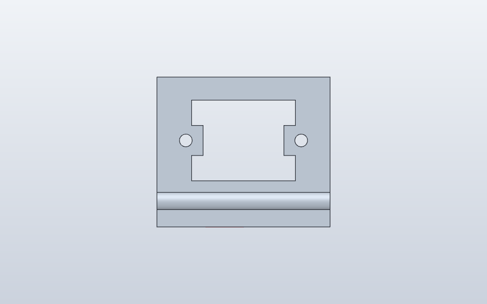
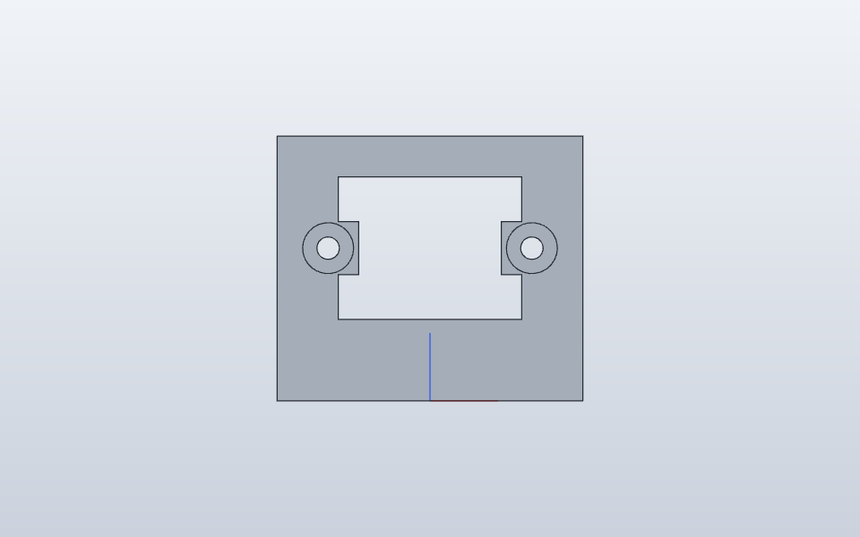
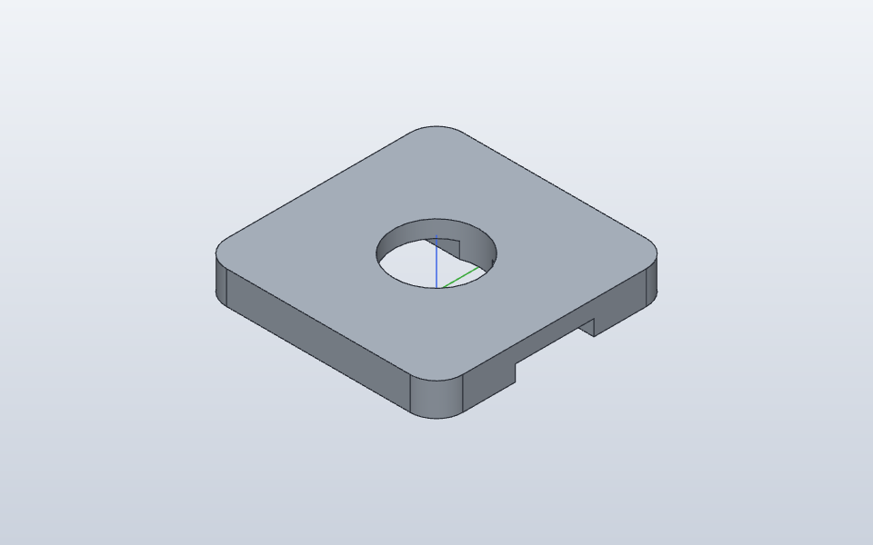
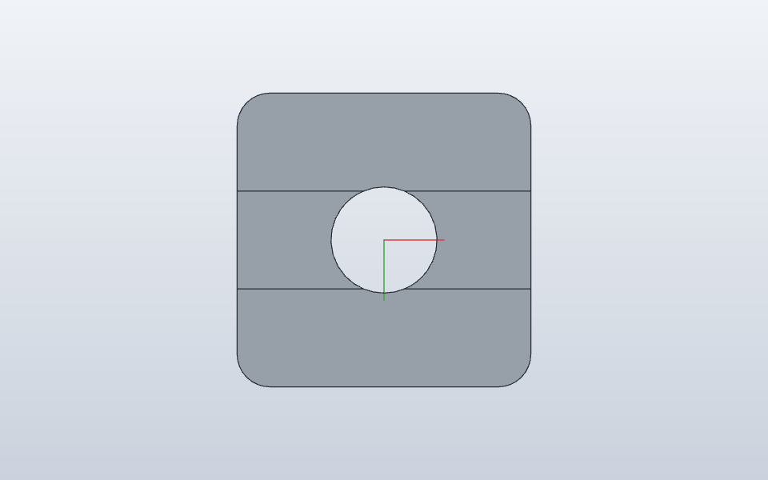

# Piezas para imprimir

## Soporte trasero del VL53L0X / VL53L1X (9 nov 2026)

Escuadra a 90° para poner el sensor láser ToF atrás del coche, mirando hacia atrás (para aparcar).

- Archivos: `vl53-rear-bracket.stl` (imprimir), `.step` (CAD), `.sc` (SolidCraft, paramétrico).
- Base 30 × 20 × 3 mm con dos agujeros M3 (3,4 mm) a ±9 mm, o pegada con silicona.
- Pared 30 × 3 × 26 mm, con redondeo de 3 mm en el pliegue.
- Sensor: dos agujeros de 2,2 mm (M2) separados 20 mm, a 15 mm de la base de la pieza, con separadores de 5 × 3 mm
  para que las soldaduras del conector no toquen la pared.
- La separación de los agujeros del sensor es de 20 mm (confirmada por el usuario el 9 nov 2026)
  (parámetro `S` en el `.sc`; `Zc` es la altura y `hd` el diámetro).
- Ventana en la pared, entre los dos separadores, centrada a la altura `Zc`: 14 × 14 mm en el centro (`pw`, `ph`)
  y 18 mm de ancho (`pwb`) por encima y por debajo de los separadores (desde `gb` = 2,6 mm de la línea de agujeros).
  Los pines soldados al sensor chocaban con la pared de la primera versión; ahora la atraviesan y los cables se
  enchufan por el otro lado.
- Medidas de la placa tomadas de un CAD de la comunidad, no del fabricante ni de nuestra placa
  ([usini_kicad_sensors](https://github.com/usini/usini_kicad_sensors), `module_vl53l0x.kicad_mod` y `vl53l0x.stp`):
  6 pines a 2,54 mm (12,7 mm entre los extremos; la tira de plástico mide 15,24 mm), centrados entre los agujeros
  y a 4,06 mm de la línea de agujeros; agujeros a 20,15 mm; placa de unos 25 × 11 mm. La tira queda a
  `Zc` ± 4,06 mm según cómo se monte el sensor; las franjas de 18 mm cubren los dos casos y dejan pasar un
  conector Dupont de 6. Falta comprobarlo con la placa real.
- Imprimir tumbada sobre la base, sin soportes (el dintel de la ventana es un puente de 18 mm).

 

## Soporte del pulsador sobre la tapa de la Raspberry (9 nov 2026)

Plaquita para pegar con silicona encima de la tapa y sujetar el pulsador redondo de 6,2 mm (GPIO 16, nodo
`gpio_button`).

- Archivos: `top-button-holder.stl` (imprimir), `.step` (CAD), `.sc` (SolidCraft, paramétrico).
- Placa 18 × 18 × 2,5 mm (`T`) con las esquinas redondeadas (2 mm). El pulsador mide 3,5 mm de alto (medido por
  el usuario, 9 nov 2026): apoyado en la tapa, la tecla sobresale 1 mm.
- Agujero pasante de 6,5 mm (parámetro `bd`) para el cuerpo del pulsador: 0,3 mm de holgura sobre los 6,2 mm.
- Canal por debajo de 6 × 1,2 mm (`cw`, `cd`) de lado a lado: el pulsador tiene una pata a cada lado (foto del
  usuario); salen dobladas hacia fuera, con los cables soldados. El techo del canal (1,3 mm) sujeta las patas y el
  pulsador no se sale hacia arriba.
- **No se midió** a qué altura salen las patas del cuerpo ni su grosor: el canal supone que salen a menos de
  1,2 mm de la base.
- Imprimir con la cara lisa (la de arriba) sobre la cama, sin soportes.

 
