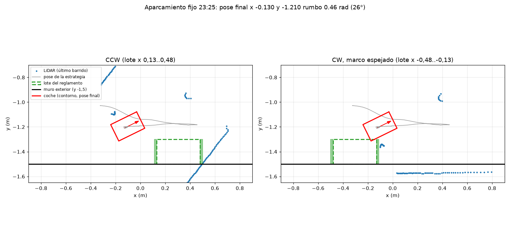

# Obstacle v3 en el coche real, 8 nov 2026

Configuración común:

- **Estrategia:** el v3 de robotek-learn.
- **Cámara:** IMX708 Wide, con `obstacle_v3_car_picam.yaml`.
- **Motor:** en M1, tipo 2, con `motor_max_rps:=2.5`.
- **Freno:** reinicio de la placa al final.

Las rondas se miran con `../20261104/tools/read.py <bag>`. Las bolsas se quedaron en el Mac (`/tmp/obsrun/`) y en
el Pi (`~/runs/`); aquí solo van `launch.log` y `metadata.yaml`.

No hay juez ni pose real. Ninguna ronda pasó la primera esquina, así que la puntuación es 0 en las dos.

## Motor (dato del usuario y prueba en el aire)

**El motor.** Es un **JGA27-310R 20:1**, de 7,4 V y 450 rpm sin carga: ~0,72 m/s de máximo con la transmisión
2:1 a las ruedas.

**Por qué no va despacio.** Según la documentación de Hiwonder, el control de velocidad de la placa pone el PWM a
0 por debajo del 25 %. Con este motor, ese mínimo equivale a ~0,18 m/s sin carga, así que no puede mantener las
velocidades del v3 (0,15–0,30 m/s).

**El tipo de motor.** El LanderPi Ackermann de Hiwonder lleva el mismo motor y la misma RRC Lite (CH9102
1a86:55d4, el mismo protocolo). Manda el **tipo 2**, como nosotros, y además `set_battery_level(6900)`, que
nosotros no mandábamos.

**Prueba en el aire.** Se compararon A (solo el tipo 2) y B (tipo 2 + batería a 6900 mV), con 0,5 / 0,75 / 1,0
/ 1,5 / 0 / −0,75 / 0 rps durante 3–4 s cada paso.

- La placa aceptó las dos fases.
- Después de las dos el motor **siguió girando con el 0**, y solo se paró al reiniciar la placa.
- Faltan las observaciones del usuario para comparar A y B.
- El nivel de batería queda en el driver como `battery_level_mv`, desactivado por defecto (robotek-learn, sin
  commit todavía).

## Ronda 1 (`20261108-122326-obstacle-v3`): no arrancó

Con el botón. La v3 pasó a RUN enseguida y pidió 0,20 m/s con todo el giro a la izquierda (~1 rps de la placa).

- **0–30 s:** el coche no se movió; el LiDAR marcó 1,57 m delante todo el rato.
- **~30 s:** avanzó a tirones pegado a la pared izquierda (0,13 m).
- **~80 s:** la placa se reinició sola (2,5 s sin datos).
- **Final:** se paró con el botón a los ~83 s.

## Ronda 2 (`20261108-125215-obstacle-v3`): con `motor_min_rps:=1.5`, esquivó y dio media vuelta

Sin botón. `base_adapter` manda ahora al menos 1,5 rps mientras la v3 pide moverse (robotek-learn `c10abb5`).

1. **Arranque:** arrancó al instante.
2. **Pilar verde:** estaba a 0,71 m y lo esquivó.
3. **Primera esquina (t ≈ 3,4–4,8 s):** el giroscopio marca **−2,0 a −2,2 rad/s con todo el giro**.
   - Eso es **~0,6–0,75 m/s**: la v3 pedía 0,20–0,35 y la placa recibía 1,5–1,7 rps.
   - Según la pose del LiDAR, recorrió 0,69 m en 1,2 s (0,57 m/s).
4. **Media vuelta:** la v3 mantuvo todo el giro y el coche giró **184°** en lugar de 90° (en el marco espejado,
   de 8° a 150°). Quedó mirando hacia atrás, contra la pared, con todo el giro y 0,35 m/s pedidos.
5. **A los 17 s:** la placa se reinició sola, con el coche atascado empujando.
6. **Final:** se paró con el botón a los 24 s.

## Conclusión

Con este motor y esta placa, el coche no tiene una zona de velocidad baja estable:

- con ~1–1,4 rps no arranca (8 nov y 4 nov);
- con 1,5 rps se embala a ~0,6–0,75 m/s.

La v3 no puede funcionar así: ajustar la estrategia o el suelo de rps no lo arregla. Hace falta un motor más lento
(p. ej. JGA27-310R 1:30–1:35) o un firmware sin el corte del 25 %.

Los reinicios solos de la placa (4 nov, 3 veces; 8 nov, 2 veces) ocurrieron con el coche atascado o con todo el
giro mucho tiempo. Encaja con la sospecha de una caída de tensión por el motor o el servo bloqueados.

## Engranajes 30:54 y velocidad en el suelo (13:55)

**Los engranajes.** Hasta hoy, del motor al eje iban 54:30: el grande en el motor, ×1,8, ~2,6 m/s sin carga. El
usuario los cambió a **30:54**, que dan 250 rpm en las ruedas y 0,80 m/s sin carga.

**La prueba.** `20261108-135515-speed-test/` (`speed_test.py`):
- `car.launch.py teleop:=true`; cada empujón manda los rps directamente a `/rrc/set_motor`, puerto 1;
- el LiDAR mide la velocidad con la pared de delante, en el 60 % final de cada empujón de 3 s;
- después, reinicio de la placa y marcha atrás al punto de salida.

| rps de la placa | 0,3 | 0,5 | 0,75 | 1 | 2 | 3 | 4 | 6 | 10 |
|---|---|---|---|---|---|---|---|---|---|
| m/s estables | 0,41 | 0,41 | 0,37 | 0,38 | 0,38 | 0,38 | 0,36 | 0,39 | 0,34 |

**La placa no controla la velocidad: el motor va siempre igual**, ~0,38 m/s, que es lo que da a tope en el suelo
con estos engranajes.

Encaja con un **encoder que no llega a la placa**. El control de velocidad (un PID incremental) entonces:
- ve 0 rps con cualquier consigna y sube la potencia al máximo;
- con la consigna a 0, el error es 0 y mantiene la última potencia: por eso **el motor no para con 0** y solo
  frena al reiniciar la placa.

**Con los engranajes anteriores pasaba lo mismo:**
- las rondas del Open iban a ~0,85 m/s pidiendo 2,5 rps;
- con 4–6 rps, ~0,65–0,8 m/s;
- el Obstacle se embalaba con 1,5 rps.

Lo de "1 rps = 0,209 m/s, repetible" es del 1 nov, con el motor anterior, que se quemó. El 310 nuevo es del 3 nov.

**Siguiente:** revisar el cable del encoder del motor en M1.
- El motor 310 usa el orden motor+ / encoder+ / A / B / encoder− / motor−. Comprobar que coincide con el puerto de
  la placa (compararlo con el cable de un LanderPi).
- Medir si llega tensión al encoder, y si salen pulsos en A y B al girar la rueda a mano.

## Firmware de la RRC Lite: el tipo 2 es nuestro motor, con ganancias negativas

Hiwonder publica el código del firmware (`RosRobotControllerLite_ros_250814.zip`, carpeta Drive de la RRC Lite →
Appendix → Source Code). En `Hiwonder/Portings/motors_param.h`:

| Tipo | Motor | Pulsos por vuelta de salida | PID kp / ki / kd | Tope de rps |
|---|---|---|---|---|
| 0 | JGB520 (11 × 4 × 90) | 3960 | 63 / 2,6 / 2,4 | 1,5 |
| 1 | JGB37 (11 × 4 × 45) | 1980 | 40 / 2 / 2 | 3 |
| **2** | **JGA27 (13 × 4 × 20)**: nuestro 310 20:1 | **1040** | **−36 / −1 / −1** | 6 |
| 3 | JGB528 (11 × 4 × 131) | 5764 | 300 / 2 / 12 | 1,1 |

Lo que dice el código:
- El tipo 2 es el correcto para nuestro motor. Además, el firmware de 2025 lo usa por defecto en los cuatro puertos.
- Las ganancias del JGA27 son **negativas**: en el motor de Hiwonder, con su cableado, el encoder cuenta al revés
  que el PWM.
- Si en nuestro coche el encoder cuenta en el mismo sentido que el PWM (fase A/B o cables del motor cambiados en el
  conector), la realimentación pasa a ser positiva:
  - con cualquier consigna, el PWM se va al ±100 % y se queda ahí: siempre ~0,38 m/s;
  - con la consigna a 0, la velocidad medida lo empuja más allá, así que no para: solo para con el reset;
  - es exactamente lo que se ve.
- El control (`encoder_motor.c`) es incremental: `pulse = current_pulse + pid.output`, limitado a ±1000; por debajo
  de |250| no sale PWM.
- La orden de velocidad no aplica el tope de rps.
- Error del firmware, sin importancia aquí: en `motors_init` el encoder de M4 nunca arranca, porque inicia `htim4`
  dos veces y nunca `htim3`.

**Prueba propuesta:** intercambiar los cables A y B del encoder (pines 3 y 4 del conector PH2.0 del motor:
motor+ / encoder+ / A / B / encoder− / motor−) y repetir `speed_test.py`. Si el coche va a la velocidad pedida y para
con 0, era eso. Intercambiar los cables del motor (pines 1 y 6) también invierte la realimentación, pero entonces
hay que cambiar el signo de `rrc_motor_sign`.

## Mismo motor en M2 (14:17)

Como en el MentorPi (M2 y M4; `coach/ros2_hiwonder`), con `PORT=2 speed_test.py`. Medidas en
`20261108-141712-speed-test-m2/speed.log`.

Por ventanas de 0,25 s (el final de cada empujón no vale: el LiDAR deja de ver la misma pared y salta):

| rps de la placa | 0,5 | 1 | 2 | 3 |
|---|---|---|---|---|
| m/s | 0,25–0,3 | ~0,24 | ~0,21 | 0,2–0,3 |

En M2 también va igual con cualquier consigna (~0,25 m/s): **no es el puerto**. La realimentación del encoder no
funciona en ninguno de los dos. Queda revisar el encoder: tensión, pulsos e intercambio de A y B.

## Con el SDK de ros2_hiwonder y SIN el tipo de motor: la placa controla la velocidad (14:21)

Prueba hecha así:
- `20261108-142116-speed-sdk/` (`speed_sdk.py`): el SDK de `coach/ros2_hiwonder` directo sobre la placa;
- sin `rrc_driver`, sin `base_adapter` y sin el factor 0,75;
- solo el LiDAR en ROS (`car.launch.py controller:=false teleop:=true camera:=false`);
- se mató también un `ros2 topic echo /rrc/set_motor` que quedaba vivo;
- motor en M2, velocidad por ventanas de 0,25 s.

| Tipo mandado | 0,5 rps | 1 rps | 2 rps | 3 rps | 5 rps |
|---|---|---|---|---|---|
| **ninguno** (lo que la placa trae al arrancar) | 0,03 m/s | 0,07 | 0,12 | 0,52 | 0,65 |
| **2** (JGA27, el que mandábamos siempre) | 0 y hacia atrás (−0,3) | 0 | hacia atrás (−0,12) | | |

- Sin tipo, la velocidad sigue a la consigna y **para con un 0 normal**: 8–10 cm después del 0 desde 0,5–0,65 m/s,
  y se queda quieto, sin reiniciar la placa.
- Con el tipo 2 va al revés de lo pedido o se queda parado. Es la realimentación invertida: el firmware tiene
  ganancias negativas para el JGA27 y nuestro encoder cuenta al revés que el de Hiwonder.
- El tipo por defecto de la placa al arrancar no se puede leer. Por cómo se comporta, tiene ganancias positivas
  (¿JGB520, el firmware anterior al de 2025?).

**Así que el problema de todo este tiempo era mandar `motor_type: 2`.** El MentorPi no lo manda. Hay que dejar de
mandarlo (`motor_type: -1`), recalibrar los rps por m/s y el signo, y quitar el freno por reset.

Ojo: si la placa se reinicia sola, vuelve a su tipo por defecto. Eso ya es lo correcto, así que no hay que reenviar
nada.

## Configuración nueva en robotek-learn y calibración por el adaptador (14:26–14:30)

Cambios:
- `motor_type: -1`: no se manda el tipo;
- `rrc_motor_port: 2` y `rrc_motor_sign: -1`;
- freno apagado: un 0 normal;
- `rrc_driver` recarga los offsets del servo tras un reinicio de la placa, aunque no haya tipo.

Prueba `speed_cmd.py`: `/cmd_vel_raw` → `base_adapter` → placa. Medidas en `speed_cmd.log`.

| m/s pedidos | 0,10 | 0,15 | 0,25 | 0,40 |
|---|---|---|---|---|
| reales con `motor_rps_per_mps` 8 | 0,057 | 0,090 | 0,150 | 0,269 |

Con eso, **`motor_rps_per_mps` 13**. Comprobación:
- 0,15 m/s pedidos → **0,150 reales**;
- 0,30 y 0,50 dan ~0,25 y ~0,37, pero con la pared de delante mal vista (saltos del LiDAR). Hay que repetirlas en
  una recta limpia.

**Parada con 0:** se desliza 1–12 cm y se queda quieto. Además, `motor_max_rps` 10 ≈ 0,77 m/s.

**Pendiente:**
- El arranque automático del coche tiene `motor_max_rps:=2.5` en `~/.config/robotek/autostart-args`. Con 13 rps por
  m/s, eso son 0,19 m/s: el Open iría muy lento.
- El Open v5 se ajustó con el coche que iba a ~0,85 m/s. Ahora el coche irá a la velocidad pedida (hasta el tope), así
  que hay que volver a probarlo y quizá ajustarlo.
- El Obstacle v3 debería poder ir ya a 0,15–0,30 m/s.

## Adelante y atrás a 1, 2 y 3 rps durante 1 s (54:30, 15:28)

Prueba hecha así (`20261108-152755-fwd-back/`):
- el SDK de robotek-learn directo sobre la placa, que es lo que manda `base_adapter` (×0,75 dentro);
- M2, sin tipo de motor;
- 1 s de consigna y luego 1 s de 0;
- solo el LiDAR en ROS, que mide con la pared de delante: no hay lectura hacia atrás.

| rps | adelante: en 1 s + lo que sigue tras el 0 | atrás: en 1 s + tras el 0 |
|---|---|---|
| 1 | 0,11 + 0,12 m | 0,09 + 0,13 m |
| 2 | 0,16 + 0,14 m | 0,20 + 0,14 m |
| 3 | 0,23 + 0,13 m | 0,19 + 0,16 m |

**Resultado:**
- La placa obedece el sentido en todas las órdenes.
- La velocidad sube con los rps, pero la respuesta tarda: tras el 0 el coche sigue 0,12–0,16 m, y en 1 s no llega
  a la velocidad estable.
- En régimen estable serían 0,23 / 0,45 / 0,68 m/s (4,4 rps por m/s): en 1 s solo alcanza una parte.

## 0,1 a 1,0 rps, adelante y atrás, con la misma distancia en cada paso (54:30, 15:30–15:40)

Prueba en `20261108-153034-fwd-back-slow/`: cada consigna dura 1/rps s (10 s a 0,1 rps, 1 s a 1 rps). La velocidad
estable se mide en la segunda mitad.

| rps | 0,1 | 0,2 | 0,3 | 0,4 | 0,5 | 0,6 | 0,7 | 0,8 | 0,9 | 1,0 |
|---|---|---|---|---|---|---|---|---|---|---|
| adelante (m/s) | 0,014 | 0,039 | 0,061 | 0,072 | 0,09–0,12 | 0,153 | 0,146 | 0,169 | 0,171 | 0,215 |
| atrás (m/s) | 0,017 | 0,054 | 0,073 | 0,089 | 0,13–0,14 | 0,179 | 0,208 | 0,217 | 0,198 | 0,197 |
| con 4,4 rps por m/s | 0,023 | 0,045 | 0,068 | 0,091 | 0,114 | 0,136 | 0,159 | 0,182 | 0,205 | 0,227 |

**Resultado:**
- Desde 0,1 rps el coche avanza, en los dos sentidos, y la velocidad sigue la consigna con la calibración de 4,4
  (±20 %).
- Hacia atrás va un poco más rápido.
- Tras el 0 sigue 0–12 cm.
- **Un fallo, sin reproducirse después:** en la primera pasada, tras 0,1 rps adelante durante 10 s, la placa dejó de
  mover el motor con cualquier consigna (0,1–1 rps y 2 rps adelante); 2 rps atrás sí lo movió.
  - Seguía respondiendo: mandaba la batería.
  - Volvió a funcionar tras reiniciarla (RTS). Después, la misma secuencia (incluido 0,1 rps 10 s) fue bien.
  - Puede ser el estado del control incremental de la placa (`current_pulse`, que guarda su valor aunque esté dentro
    de la zona muerta de ±250).

## Primera ronda completa del Obstacle v3 en el coche (15:57)

La lanzó el usuario a mano, sin bag:

```bash
ros2 launch robotek_course car.launch.py strategy:=robotek_obstacle_v3 camera_driver:=picam motor_max_rps:=4 \
    strategy_params:=$HOME/.config/robotek/obstacle_v3_car_picam.yaml button:=false
```

Es el comando exacto del historial del Pi: tope de 4 rps, sin botón (arranca a los 12 s).

Configuración:
- **Motor:** M2 sin tipo, 54:30, 4,4 rps por m/s.
- **Freno de pared** de `base_adapter` **apagado** (`wall_stop_m: 0`, robotek-learn `02adf41`).

Una ronda anterior con el freno de pared encendido esquivaba los pilares, pero bajaba la velocidad hasta pararse.

**Resultado:**
- Start → RUN en 0,4 s → **DONE a los 118,7 s** del Start (tres vueltas y parada).
- El usuario: «funcionó perfecto».
- Ningún reinicio de la placa.
- Cuatro pausas cortas esperando sensores (`WAIT_SENSOR`, 0,03–0,19 s).

Sin juez ni bag: no hay puntuación medida, posición de salida, contactos ni lados de cada señal. Es la primera ronda
del v3 que termina en el coche real.

## Modelo del lab con estas medidas

El perfil `real_v3` del lab (`src/robotek_evaluation/config/real_car_v3.yaml`) usa estas medidas: tabla de velocidad
con 4,4 rps por m/s, 0,10 s + 0,30 s de retraso y 1,0 m/s² ajustados a los pulsos de `fwd-back` y `fwd-back-slow`
(`lab-fit/fit_motor.py`), sin resets. Los scripts del ajuste y de las comprobaciones están en [lab-fit/](lab-fit/);
resultados en [../../../obstacle-estado.md](../../../obstacle-estado.md).

## Rondas con aparcamiento de la tarde (17:50–19:23)

Todas con 54:30, `motor_max_rps:=4`, sin botón (`button:=false start_delay:=20`; con menos de ~15 s el Start llega
antes de que la estrategia esté lista y se queda en WAIT_START) y el archivo de aparcamiento
(`obstacle_v3_car_picam_park.yaml`: `parking: true`). Bolsas en el Pi (`~/runs/`) y en el Mac (`/tmp/obsrun/`). Sin juez:
no hay puntuación medida.

| Ronda | Configuración | Qué pasó |
|---|---|---|
| `175044-obstacle-park` | aparcamiento | Pide 0,20 m/s (~0,9 rps) con todo el giro a la derecha desde t = 0 y no se mueve en 40 s. |
| (sin carpeta) | + `motor_min_rps:=1.3` | Tampoco se mueve; el adaptador mandaba 0 en una muestra; luego WAIT_SENSOR. Sin explicar. |
| `181726-obstacle-v3` | sin aparcamiento | Misma salida, misma orden y mismos −0,88 rps: se mueve a los 0,9 s. DONE a ~138 s del Start. |
| `182800-obstacle-park` | + `lot_laps: 0` (25bcc0d) | Sale desde más atrás (progreso 0,08 frente a 0,58), a 0,28 m/s con todo el giro: choca de frente a ~0,45 m (base del aparcamiento o pilar). La placa se reinicia empujando. |
| `184017-obstacle-park` | igual, salida a ~1,57 m de la pared | **Tres vueltas en ~90 s** y PARK por primera vez. Maniobras a 0,06 m/s (0,26 rps): no se mueve; FAULT a ~142 s. |
| `190152-obstacle-park` | + arranque 2 rps 0,2 s y pulsos 0,66 rps (7eb6ac9, 6fc8646) | A los 25 s pide todo el giro a la derecha y el giroscopio marca ~0: sigue recto y choca con la pared. Es el fallo intermitente de la dirección del Open. |
| (lanzada por el usuario, sin bolsa) | + `steer_limit: 0.3054` (17,5°) | Chocó; no se sabe dónde. |
| `191115-obstacle-park` | sin arranque, pulsos 0,66 rps | **Tres vueltas en 115 s**, PARK; primera maniobra a 0,06 m/s con todo el giro: no se mueve en 64 s, FAULT. |
| `191658-obstacle-park-only` | solo aparcar (`park_after: 0`), pulsos 1 rps cada 2 s | No se mueve: con todo el giro, ~0,6 s a 1 rps no lo arrancan (la placa tarda ~0,5 s en dar fuerza). |
| `191940-obstacle-park-only` | `motor_min_rps:=1.3`, sin pulsos | Hace las maniobras de avance (giroscopio ±0,5–0,7 rad/s) y retrocede ~0,4 m; luego se atasca marcha atrás: tocó un tope por detrás (usuario). |
| `192330-obstacle-park-only` | `motor_min_rps:=1.1`, `park_margin: 0.03` | Igual: roza delante a la izquierda a 1,5–2 s y se atasca marcha atrás en el mismo punto (x 0,0, y −1,18). |

Conclusiones:

- **La configuración de aparcamiento no impedía arrancar:** la estrategia mandó lo mismo con y sin ella (175044 frente a
  181726). El no moverse fue de la placa o físico; no se repitió tras relanzar.
- **La salida depende de dónde se coloque el coche.** Con un pilar en la recta, el v3 sale con todo el giro. Desde
  ~1,55–1,60 m a la pared de delante y centrado salió bien; desde 0,4–0,5 m más atrás va más rápido y choca. Es el
  salto lateral sin rampa del 4 nov (`start_ramp`, apagado, en 1c561b3).
- **Las vueltas con aparcamiento ya salen** (90 y 115 s) con `lot_laps: 0`.
- **El aparcamiento planificado no funciona en este coche:** a 0,06 m/s no hay fuerza con todo el giro, ni con pulsos
  de 0,66–1 rps. Con un mínimo de 1,1–1,3 rps se mueve, pero se pasa en sus ~14 movimientos cortos y toca un tope
  por detrás. Como para dos veces en el mismo punto, puede que el lote del campo no sea el del reglamento que usa el v3
  (0,35 × 0,20 m, límite lejano a 0,48 m del centro de la recta): **falta medirlo**.
- De aquí sale el aparcamiento fijo de la sección siguiente.

## Aparcamiento fijo (`park_mode: 1`): prueba propuesta

El aparcamiento planificado no funciona en este coche (sección anterior). El fijo
(diseño y lab en [../../../obstacle-aparcamiento-fijo.md](../../../obstacle-aparcamiento-fijo.md)) aparca 195/200 en el
lab `real_v3` frente a 35/200, pero **con el piso de 0,25 m/s no aparca ninguno de los dos**. Se propone ir despacio con
el arranque y los pulsos de `base_adapter`, no con `motor_min_rps`.

**Antes:**
- En el Pi, traer robotek-learn con `park_fixed.py` y compilar: `colcon build --packages-select robotek_obstacle_v3`.
  Los commits de robotek-learn no están subidos: hay que hacer push desde el Mac o copiarlos.
- Medir el lote del campo: largo entre las caras interiores de los límites, fondo y posición del límite lejano a lo
  largo de la recta de salida, desde la línea de sección en CCW. Ponerlo en `park_lot_length`, `park_lot_depth` y
  `park_lot_end`. 1 cm de error cuesta 10–65 de 200 rondas en el lab.

**Archivo de parámetros:** se sacan del de solo aparcar (`parking: true`, `lot_laps: 0`, `steer_limit: 0.3054`,
`park_after: 0`, `park_margin: 0.03`) con `park_mode: 1`:

```bash
python3 - <<'PY'
import os, yaml
d = os.path.expanduser('~/.config/robotek/')
cfg = yaml.safe_load(open(d + 'obstacle_v3_car_picam_park_only.yaml'))
p = next(iter(cfg.values()))['ros__parameters']
p.update(park_mode=1.0)   # y, medido: park_lot_length=..., park_lot_depth=..., park_lot_end=...
yaml.safe_dump(cfg, open(d + 'obstacle_v3_car_picam_park_fixed.yaml', 'w'), sort_keys=False)
PY
```

**Ronda con bolsa** (mismos temas que las del 8 nov; arranca sola a los 20 s):

```bash
~/robotek-learn/tools/car-clean.sh
source ~/robotek-learn/install/setup.bash
RUN=~/runs/$(date +%Y%m%d-%H%M%S)-obstacle-park-fixed; mkdir -p $RUN
ros2 bag record --max-bag-duration 5 -o $RUN/bag --topics /rosout /robotek/stop /start /robotek/imu /robotek/scan \
    /rrc/acker_servo/set_state /rrc/battery /rrc/set_motor /cmd_vel_raw /robotek/state /obstacle/pose > $RUN/bag.log 2>&1 &
ros2 launch robotek_course car.launch.py strategy:=robotek_obstacle_v3 camera_driver:=picam motor_max_rps:=4 \
    motor_min_rps:=0 motor_kick_rps:=2 motor_kick_s:=0.2 motor_pulse_rps:=0.66 \
    strategy_params:=$HOME/.config/robotek/obstacle_v3_car_picam_park_fixed.yaml button:=false start_delay:=20 \
    2>&1 | tee $RUN/launch.log
kill %1
```

- **Velocidad:** arranque de 2 rps durante 0,2 s y pulsos de 0,66 rps (`7eb6ac9`, en el suelo: 0,046 / 0,108 m/s con
  0,06 / 0,10 pedidos), en recto. **Con todo el giro, los pulsos de 0,66 y 1 rps no lo movieron** (`191115`, `191658`).
  Si no se mueve, subir `motor_pulse_rps`.
- **Qué esperar:** en el lab el fijo solo aparca si el coche va de verdad a ≤ ~0,06–0,10 m/s con todo el giro. Con
  cualquier piso de 0,12 m/s o más, 0/200 (también el planificado). Si el coche solo se mueve con `motor_min_rps` ≥ 1,1,
  esta prueba sirve para ver los pasos y medir el rodado, no para aparcar: el arreglo es del motor.
- **Variante con el comando base** (`motor_min_rps:=1.1`, sin `motor_kick_rps`/`motor_pulse_rps`): añadir
  `park_fixed_roll: 0.08` al archivo. El lab predice roces: sirve para medir cuánto rueda.
- **Qué mirar en la bolsa:** los estados `PARK_*` en `/robotek/state` y la pose `/obstacle/pose` al final de cada paso.
  Después, el rodado tras cada 0, comparado con `park_fixed_roll` y con el que mide el coche.

## Prueba del aparcamiento fijo en el coche (21:37–22:00): el motor no movió el coche en el suelo

- **Pi actualizado** a robotek-learn `3e2e0a2` (estaba en `8768b95`) y compilado. Sus cambios locales, copias viejas de
  lo que ya está en el repo, quedaron en un `git stash`. `pi_camera_publisher.py`, idéntico al del repo, está en
  `~/park-fixed-backup/`.
- **Archivos de parámetros:** `obstacle_v3_car_picam_park_fixed.yaml` (el de solo aparcar con `park_mode: 1`) y
  `obstacle_v3_car_picam_park_fixed_floor.yaml` (además `park_fixed_roll: 0.08`).
- **`213708-obstacle-park-fixed`:** arranque 2 rps y pulsos 0,66 rps. La estrategia pide 0,06 m/s en la aproximación y
  la pose no cambia en 3 min (x −0,17, y −1,06, −20°); acaba en `FAULT` a los 180 s.
  - Un primer lanzamiento sin Cyclone ni dominio 1 se paró a mano.
  - La bolsa del Mac solo descubrió 3 temas por Wi‑Fi; la útil es la del Pi, que empieza 40 s tarde.
- **`214206-obstacle-park-fixed-floor`:** `motor_min_rps:=1.1`. La placa recibe −1,1 rps (adelante) durante ~70 s y el
  coche no se mueve: la misma pose al milímetro. La batería estaba a 7,0–7,1 V.
- **Reinicio de la placa por ROS** (`/rrc/reset`, RTS): «Board set up again». Con el coche en el aire, 1,5 s a
  0,25 m/s (−1,1 rps en `/rrc/set_motor`): **las ruedas no giraron** (usuario).
- **Segunda prueba en el aire, 3 s a −1,1 rps: las ruedas sí giraron** (usuario; en la primera no estaba seguro).
- **`215447-obstacle-park-fixed-floor13`:** `motor_min_rps:=1.3`, coche recolocado (x −0,04, y −1,13, rumbo 0,01).
  - La aproximación pide 0,06 m/s con todo el giro (0,161 rad/s: va hacia la línea, 5,6 cm más cerca de la pared).
  - La placa recibe −1,3 rps durante 180 s y la pose no cambia; acaba en `FAULT` a los 180 s.
- **Conclusión:** el motor gira en el aire, pero en el suelo no mueve el coche con 1,1–1,3 rps. En la ronda de 1,1 rps
  las ruedas estaban casi rectas (~5°); en la de 1,3, a tope. El 8 nov a las 19:19, 1,3 rps sí lo movió. Falta fuerza
  a baja velocidad en el suelo, y el aparcamiento fijo sigue sin probarse en el coche.
- **Para la estrategia:** la aproximación del aparcamiento gira a tope cuando el coche está lejos de su línea. Con este
  motor es justo cuando menos fuerza hay.
- **Bolsas:** `/tmp/obsrun/20261108-213708-obstacle-park-fixed/pi/`, `/tmp/obsrun/20261108-214206-obstacle-park-fixed-floor/` y
  `/tmp/obsrun/20261108-215447-obstacle-park-fixed-floor13/` (solo en el Mac).

## Aparcamiento fijo, 22:29 (`20261108-222903-obstacle-park-fixed`): se movió y luego se quedó en WAIT_SENSOR

Solo aparcar (`park_after: 0`) con el lote del reglamento, `motor_min_rps:=0`, arranque de 2 rps durante 0,2 s y pulsos de
0,66 rps. Era el primer lanzamiento tras reiniciar el Pi (sin red durante varios minutos).

- **0,5–12 s, aproximación hacia delante:** **el coche sí se movió**. Con los pulsos (0,66 rps 0,2 s de cada 0,5 s) y la
  dirección casi recta, la pose fue de x 0,30 a 1,03 m. Es la primera vez que esta maniobra se mueve en el coche.
- **12–15 s, marcha atrás con todo el giro** (−0,06 m/s, pulsos de +0,66 rps): giró ~0,2 rad (de −0,15 a +0,05) y
  retrocedió ~7 cm.
- **15–23 s:** seguía con los mismos pulsos y no se movía: la pose y el giroscopio quietos. El LiDAR daba 0,37 m a la
  derecha; detrás no ve. Puede que tocara algo por detrás o que le faltara fuerza con todo el giro.
- **Desde 22,9 s, `WAIT_SENSOR` hasta pararlo (~4 min):**
  - Fuera del nodo, todo llegaba fresco: LiDAR a 10 Hz (0–6 ms de edad), IMU a 48 Hz (≤16 ms) y cámara a 20 fps
    (7–86 ms).
  - En la bolsa no hay saltos atrás en los sellos del LiDAR ni cortes del IMU.
  - `drive` seguía a 50 Hz y al 33 % de CPU.
  - Así que algún sello de la `Strategy` dejó de avanzar, seguramente la cámara (`signs_stamp`: `on_signs` en cada
    imagen). Es lo mismo que la ronda de las 17:5x con `motor_min_rps:=1.3`, que también se quedó en `WAIT_SENSOR` con
    la cámara funcionando.
  - **Sin explicar.** Haría falta que el nodo diga qué sensor está viejo.
- **Bolsa:** `/tmp/obsrun/20261108-222903-obstacle-park-fixed/` (Mac y Pi).

## Aparcamiento fijo, 22:44 (`20261108-224430-obstacle-park-fixed`): llegó a la marcha atrás recta y se atascó

Igual que la de las 22:29, ya con `8deda2a` en el Pi (sin la cámara al aparcar y con el log del sensor viejo). Sin
`WAIT_SENSOR` en toda la prueba.

- **0,5–12 s, aproximación:** de x 0,34 a 1,03 m con pulsos de 0,66 rps.
- **12–15 s, marcha atrás con todo el giro:** el rumbo pasa de −0,15 a +0,07 rad.
- **15–20 s, marcha atrás recta:** x de 0,96 a 0,665 m, y de −1,135 a −1,193 m.
- **Desde 20 s, quieto:** seguía pidiendo marcha atrás a −0,06 m/s con pulsos de +0,66 rps, pero la pose y el giroscopio
  no cambiaban. El usuario dijo «se paró» y lo paré a ~70 s.
  - La estrategia no veía ningún tope detrás: no habría seguido pidiendo marcha atrás.
  - Con el lote del reglamento (límite lejano en x 0,48), la trasera del coche estaba en ~0,55 m y todavía fuera del
    lote en y. Ahí no debería tocar nada.
  - Si tocó algo, el lote del campo no está donde lo pone el v3: hay que medirlo.
- **Bolsa:** `/tmp/obsrun/20261108-224430-obstacle-park-fixed/`.

## Aparcamiento fijo, 22:48 (`20261108-224755-obstacle-park-fixed-p1`): pulsos de 1 rps cada 1 s, peor

Igual que la de las 22:44, con `motor_pulse_rps:=1.0 motor_pulse_period_s:=1.0`: ~0,26 s a 1 rps por segundo.

- **0,5–7 s:** se movió en la aproximación, de x 0,31 a 0,62 m. Giró primero a la derecha hasta un rumbo de −0,43 rad y
  enderezaba.
- **Desde 7 s:** quieto en x 0,62 con el rumbo a −0,31 rad. Seguía recibiendo los pulsos de 1 rps cada segundo hasta
  que lo paré.
- **Comparación:** con 0,66 rps cada 0,5 s (0,2 s encendido, el 40 % del tiempo), la aproximación entera salía. Con
  1 rps cada 1 s (el 26 %) no.
  - Cuenta más el tiempo encendido que los rps del pulso: la placa tarda en dar fuerza.
  - Con 54:30 los pulsos no bastan para toda la maniobra. Las salidas que quedan: 30:54, o un mínimo continuo
    (`motor_min_rps`) con una estrategia que tolere ir a ~0,25 m/s.
- **Bolsa:** `/tmp/obsrun/20261108-224755-obstacle-park-fixed-p1/`.

## Cuánto rueda tras el 0, y con un contragolpe (22:53, `20261108-225351-speed-sdk`)

Pedido por el usuario: ir más rápido y frenar en seco, en lugar de pulsos lentos. Prueba en el suelo con
[lab-fit/brake_test.py](lab-fit/brake_test.py):
- el SDK directo sobre la placa (M2) y solo el LiDAR en ROS;
- 1,2 rps (~0,27 m/s estable) durante 1,2 s;
- luego tres paradas: un 0, o un contragolpe de 1 o 2 rps durante 0,15 s y después 0;
- en recto se mide con el LiDAR de delante, y con todo el giro (servo 1753 µs) con el giroscopio (sesgo en reposo
  restado, 0,027 rad/s).

Log: [lab-fit/brake_test_20261108-225351.log](lab-fit/brake_test_20261108-225351.log).

| Parada | Recto adelante | Recto atrás | Todo el giro adelante | Todo el giro atrás |
|---|---|---|---|---|
| 0 | 0,139 m | 0,129 m | 0,177 rad (~6,5 cm de arco) | 0,219 rad (~8,1 cm) |
| contragolpe 1 rps 0,15 s | 0,107 m | 0,081 m | 0,127 rad (~4,7 cm) | 0,173 rad (~6,4 cm) |
| contragolpe 2 rps 0,15 s | 0,103 m | 0,107 m | 0,045 rad (~1,7 cm) | 0,135 rad (~5,0 cm) |

- **Tras un 0 rueda mucho:** 13–14 cm en recto, más de la mitad de lo que avanzó en 1,2 s (0,22–0,28 m). La placa sigue
  empujando ~0,5 s después del 0 (su respuesta lenta), no es solo inercia.
- **El contragolpe de 2 rps** recorta un 20–25 % en recto y hasta el 75 % con todo el giro hacia delante. Hacia atrás
  ayuda menos. Habría que probar contragolpes más largos (0,3 s).
- **La rodadura es repetible** (±1–2 cm en recto). Así que se puede descontar parando antes: `park_fixed_roll` ~0,10–0,13
  m en recto a esta velocidad, y ~0,15–0,2 rad de margen en los giros con el giroscopio.

## Ronda sin aparcamiento a 17,5° (23:08, `20261108-230848-obstacle-v3`): DONE a los 85,0 s

La configuración de la ronda buena de las 18:17 con el límite de giro de 17,5° (pedido por el usuario):

```bash
ros2 launch robotek_course car.launch.py strategy:=robotek_obstacle_v3 camera_driver:=picam motor_max_rps:=4 \
    strategy_params:=$HOME/.config/robotek/obstacle_v3_car_picam.yaml button:=false start_delay:=20
```

- **Archivo de parámetros:** `obstacle_v3_car_picam.yaml`, con la cámara y `steer_limit: 0.3054`.
- **Motor:** sin mínimo de rps, ni arranque ni pulsos.
- **Pi:** robotek-learn `3e2e0a2` más `8deda2a` copiado (sin la cámara al aparcar, que aquí no se usa, y el log del
  sensor viejo).
- **Resultado:** RUN a los 0,47 s del Start y **DONE a los 85,0 s**: tres vueltas y la parada. Es la más rápida del coche
  (118,7 s a las 15:57 y ~138 s a las 18:17).
  - Sin `WAIT_SENSOR` y sin reinicios de la placa.
  - Batería a 7,18–7,26 V.
- Sin juez: no hay puntuación medida. Sentido y colocación, los que puso el usuario.
- **Bolsa:** `/tmp/obsrun/20261108-230848-obstacle-v3/` (Mac y Pi).

## Ronda con los valores por defecto (23:16, `20261108-231627-obstacle-v3-default`): DONE a los 93,4 s

La primera ronda con los valores por defecto nuevos de robotek-learn (`ffd8381`), sin pasar nada más que esto:

```bash
ros2 launch robotek_course car.launch.py strategy:=robotek_obstacle_v3 camera_driver:=picam button:=false
```

El launch puso 4 rps, `config/car_picam.yaml` (17,5°) y 20 s.

- **Resultado:** RUN a los 0,43 s del Start y **DONE a los 93,4 s**: tres vueltas y la parada.
  - Sin `WAIT_SENSOR` ni reinicios de la placa.
  - Es la segunda ronda completa seguida con esta configuración: 85,0 s y 93,4 s.
- Sin juez. Sentido y colocación, los que puso el usuario.
- **Bolsa:** `/tmp/obsrun/20261108-231627-obstacle-v3-default/` (Mac y Pi).

## Aparcamiento fijo rápido, 23:23 (`20261108-232254-obstacle-park-fixed-fast`): se mueve, pero se pasa y no aparca

Con el mejor ajuste del lab a ~0,3 m/s (WRO `2c7aa79`, portado en robotek-learn `b518729`, sin subir):
- `motor_min_rps:=1.1`;
- contragolpe `brake_rps:=2 brake_s:=0.15 brake_hz:=3`, un pulso de 2 rps al revés en cada parada;
- `park_fixed_roll: 0.13` y `park_fixed_roll_arc: 0.04`.

Solo aparcar, con el lote del reglamento. En el lab este ajuste aparca 97 de 200 veces, con 73 roces.

- **Ahora sí se mueve en todos los pasos,** también marcha atrás con todo el giro. El contragolpe actúa (−2 rps tras
  cada 0).
- **Pero se pasa mucho:**
  - 1–4 s: el primer arco marcha atrás llevó el coche de x 0,40 a −0,01.
  - 4–8 s: siguió hasta x −0,53, más allá del lote.
  - 8–12 s: volvió a la aproximación (x 0,38).
  - 12–18 s: repitió la entrada hasta x −0,53.
  - 18–24 s: volvió otra vez.

  Son reintentos de la maniobra: las marchas atrás de ~0,9 m se pasan del lote.
- **27–30 s:** cerca del lote (x 0,0, y −1,25 a −1,36), el giroscopio marca un pico de 2,2 rad/s y el rumbo salta a
  −1,2 rad. Choque o el coche movido a mano: sin confirmar. Después siguió maniobrando hasta que lo paré a ~36 s. No
  aparcó.
- **Una pausa de 60 ms** (`WAIT_SENSOR: stale scan 0.36 s`, el log nuevo), sin más.
- **Bolsa:** `/tmp/obsrun/20261108-232254-obstacle-park-fixed-fast/`.

## Aparcamiento fijo rápido, 23:25 (`20261108-232503-obstacle-park-fixed-fast`): lo dio por terminado torcido y fuera del lote

Mismo ajuste que a las 23:23. El usuario recolocó el coche, porque antes estaba mal puesto.

- **0,5–5 s, aproximación:** de x −0,32 a 0,39, con y de −1,03 a −1,19.
- **5–7 s, marcha atrás recta:** de x 0,39 a −0,01, y paró.
- **9–11 s, arco marcha atrás con todo el giro:** el rumbo pasa de 0 a +0,46 rad y x a −0,13. Ahí paró del todo.
- **13,8 s:** `DONE`, que en la v3 es `PARKED` o `PARK_FAIL`; el log no dice cuál. La pose final de la estrategia es x −0,13,
  y −1,21, rumbo 0,46 rad (26°).
  - Con el lote del reglamento (y −1,30 a −1,50), el coche está fuera y torcido, así que lo más probable es
    `PARK_FAIL`.
  - Falta que el usuario confirme cómo quedó.
- La v3 debería escribir el veredicto del aparcamiento en el log.
- **Bolsa:** `/tmp/obsrun/20261108-232503-obstacle-park-fixed-fast/`.

**Gráfico de la pose final con el último barrido del LiDAR** ([park-fixed-fast-2325.png](park-fixed-fast-2325.png),
hecho con [lab-fit/park_plot_extract.py](lab-fit/park_plot_extract.py) y [lab-fit/park_plot.py](lab-fit/park_plot.py)):



- **El usuario:** quedó medio dentro.
- **Sentido CW.** En el marco espejado (panel derecho), el muro exterior sale recto.
- **El muro sale en y ≈ −1,57**, no en −1,50: la pose de la estrategia está ~7 cm desplazada respecto al muro. También
  puede que el muro del campo no esté a 1,50 m del centro.
- **Un límite del lote** aparece en x ≈ −0,10, y −1,34 (su cara), donde el v3 lo pone en −0,13. Son ~3 cm.
- **Pose final:** x −0,13, y −1,21, rumbo 26°. La esquina trasera del contorno llega a y −1,31, el borde del lote. Con el
  error de ~7 cm, el coche real estaría algo más fuera o algo más dentro según de dónde venga el error. Encaja con
  «medio dentro».
- **Lo que falta:** medir el lote y la posición del muro en el campo (`park_lot_length`, `park_lot_depth`,
  `park_lot_end`), y que la v3 escriba si terminó en `PARKED` o en `PARK_FAIL`.

## Aparcamiento fijo rápido, 23:37 (`20261108-233743-obstacle-park-fixed-fast`): paredes arregladas, no se movió

El usuario corrigió las paredes del campo. Mismo ajuste que a las 23:23.

- **No se movió:** 20 s pidiendo el primer paso, adelante con todo el giro (0,12 m/s, −1,1 rps), y la pose quieta en x −0,33,
  y −1,02.
- **Batería a 6,91–6,94 V,** casi en el aviso de 6,8 V. A las 23:25 estaba más alta y el mismo paso sí se movió. Con la
  batería baja, 1,1 rps con todo el giro desde parado no basta.
- **Paredes:** en el último barrido ([park-fixed-fast-2337.png](park-fixed-fast-2337.png), marco CW) el muro exterior sale
  en y ≈ −1,52, frente a −1,57 antes del arreglo. Queda ~2 cm.
- **Un límite del lote** se ve en x ≈ −0,29, y −1,32. Puede ser la cara o el canto del límite, o un objeto dentro del
  lote del reglamento (x −0,48 a −0,13): sin confirmar.
- **Bolsa:** `/tmp/obsrun/20261108-233743-obstacle-park-fixed-fast/`.

## Aparcamiento fijo rápido, 23:43 (`20261108-234326-obstacle-park-fixed-fast`): batería nueva, chocó con el límite de entrada

Batería cambiada (7,63–7,67 V); mismo ajuste y paredes ya corregidas. El usuario: «se chocó».

- **0,4–4 s, aproximación:** de x −0,29 a 0,39 m.
- **4–6,5 s, marcha atrás recta:** de x 0,39 a ~0,01, unos 0,38 m.
- **7–10 s, arco marcha atrás con todo el giro:** rumbo hasta +0,31 rad. La pose salta de x −0,25 a −0,16 entre 10 y 11 s, que
  es el golpe.
- **14,3 s:** `DONE`, seguramente `PARK_FAIL`. Pose final x −0,12, y −1,23, rumbo 16° ([park-fixed-fast-2343.png](park-fixed-fast-2343.png)).
  La esquina trasera del contorno cae sobre el límite del lote del lado de la entrada (x −0,13 en CW): ahí chocó.
- **Muro exterior** en el barrido: y ≈ −1,55 en el marco CW. No llega a −1,50 aunque se arreglaron las paredes, así que
  queda un error de pose o una distancia del campo distinta.
- **Lectura:** el arco de entrada empezó demasiado cerca del límite de entrada. La marcha atrás recta tenía que parar
  antes, y a ~0,25 m/s el coche rueda más de lo que la estrategia descuenta. Con el lote situado por el mapa (y no por lo
  que ve el LiDAR), unos centímetros bastan para chocar.
- **Bolsa:** `/tmp/obsrun/20261108-234326-obstacle-park-fixed-fast/`.

## Aparcamiento fijo rápido con el lote 3 cm movido, 23:49 (`20261108-234918-obstacle-park-fixed-fast45`)

El usuario pidió probarlo ya, en 3 minutos. En vez del cambio con el LiDAR, que sigue en la sesión del aparcamiento fijo,
se movió el lote 3 cm con un parámetro (`park_lot_end: 0.45`) para que el límite de la entrada quede donde lo vio el LiDAR
(x −0,10 en CW).

- **Aproximación:** hasta x 0,49.
- **Marcha atrás recta:** hasta x 0,02, igual que a las 23:43.
- **Arco marcha atrás con todo el giro:** rumbo hasta 0,60 rad, x −0,14.
- **11 s:** `DONE`, seguramente `PARK_FAIL`.
- **Resultado:** igual que antes. El arco empieza en el mismo sitio y termina torcido y fuera del lote
  ([park-fixed-fast45-2349.png](park-fixed-fast45-2349.png)). Mover el lote con un parámetro no basta: hace falta el cambio
  con el LiDAR.

## Dos pruebas rápidas más, 23:50 y 23:52

**23:50 (`…-fast-a18`):** a petición del usuario, más distancia antes del arco (`park_fixed_ahead: 0.18`) y la
aproximación más pegada al muro (`GAP` 0,04 → 0,02, editado solo en el Pi y luego restaurado).
- Avanzó hasta x 0,41 y retrocedió hasta x ~0,05. El arco solo llegó a 0,12 rad: chocó otra vez. Al final retrocedió
  recto hasta x −0,38 por fuera del lote.
- **El hallazgo** ([park-fixed-fast-a18-2350.png](park-fixed-fast-a18-2350.png), marco CW): el LiDAR ve un límite del lote
  de pie en x ≈ −0,32, de y −1,31 a −1,50. A las 23:37 también salía uno en x ≈ −0,29.
  - El v3 tiene ese límite en x −0,48 (`park_lot_end` 0,48), así que **el lote del campo está ~17 cm más hacia el centro de la
    recta**.
  - Por eso el arco siempre cae sobre el límite de la entrada.

**23:52 (`…-fast31`):** el lote donde lo ve el LiDAR (`park_lot_end: 0.31`) y `GAP` restaurado a 0,04.
- El usuario colocó el coche en otro sitio: la pose empieza en x 0,72, y −0,88. La maniobra fue y vino varias veces entre
  x 0,05 y 0,83 y acabó en x 0,51, y −1,25, fuera del lote ([park-fixed-fast31-2352.png](park-fixed-fast31-2352.png)).
- No sirve para validar el cambio de lote: salió desde otra posición y el último barrido no ve el lote.
- **Falta** medir en el campo dónde está el límite lejano a lo largo de la recta, desde su centro, y repetir con el coche
  colocado como en las anteriores.

**23:53 (`20261108-235350-obstacle-park-fixed-fast31`):** lo mismo, con el coche bien colocado (el usuario).
- **El lote ahora cuadra con el LiDAR** ([park-fixed-fast31-2353.png](park-fixed-fast31-2353.png), marco CW). El límite
  lejano que ve está en x ≈ −0,30, junto al −0,31 de `park_lot_end: 0.31`. El muro, en y ≈ −1,52.
- **La maniobra no entra:**
  - Aproximación hasta x 0,53 y marcha atrás recta hasta x 0,12.
  - Un avance corto, y el arco con todo el giro solo hasta 0,26 rad (en x ~0,10), sin llegar a los 0,76 de la entrada.
  - Otro avance y una marcha atrás recta hasta x −0,25 por fuera del lote (y −1,15).
  - `DONE`, seguramente `PARK_FAIL`.
- El arco empieza demasiado pegado al límite de la entrada (x +0,04) y la guarda lo corta, así que no llega a entrar.
  Habría que alejar el inicio del arco (`park_fixed_ahead`) para este lote, o el cambio con el LiDAR de la otra sesión.

**23:56 (`20261108-235620-obstacle-park-fixed-fast31a20`):** `park_lot_end: 0.31` y `park_fixed_ahead: 0.20`.
- **No se movió en 95 s:** el primer paso pide avanzar con todo el giro desde parado (0,12 m/s, −1,1 rps) y la pose quedó
  quieta.
- La batería estaba bien (7,51–7,54 V). Como a las 23:37, 1,1 rps con todo el giro desde parado queda en el límite de la
  fuerza: unas veces arranca y otras no.
- **Siguiente:** añadir el arranque de `base_adapter` (`motor_kick_rps:=2`, solo tras ≥0,5 s parado) o subir el mínimo a
  1,3 rps.

**23:59 (`20261108-235946-obstacle-park-fixed-fast31a20k`):** lo mismo, más el arranque `motor_kick_rps:=2 motor_kick_s:=0.2`.
- **Ahora arranca desde parado** con todo el giro: el arranque resuelve lo de las 23:37 y las 23:56.
- **La maniobra sigue sin entrar:**
  - Aproximación hasta x 0,58 y marcha atrás recta hasta x −0,08, pasándose.
  - Vuelve a la aproximación y retrocede hasta x 0,24.
  - El arco con todo el giro se corta otra vez en ~0,33 rad, en x 0,14.
  - Unos avances y retrocesos más.
- **Desde los ~20 s** la pose recorre de x −0,1 a −1,4 con el motor a 0: el coche se movió a mano o la localización saltó.
  `DONE` a los ~27 s. No aparcó.
- **Bolsa:** `/tmp/obsrun/20261108-235946-obstacle-park-fixed-fast31a20k/`. Gráfico:
  [park-fixed-fast31a20k-2359.png](park-fixed-fast31a20k-2359.png).
- **Resumen de la noche:**
  - Con el lote donde lo ve el LiDAR y el arranque, el coche hace todos los pasos.
  - Pero el arco de entrada se corta a ~0,3 rad: la guarda ve el límite de la entrada demasiado cerca. A ~0,25 m/s las
    marchas atrás rectas se pasan o se quedan cortas varios centímetros.
  - Hace falta el aparcamiento referido a lo que ve el LiDAR (en curso en la otra sesión) o más fuerza a poca velocidad
    (engranajes 30:54).

## Prueba propuesta: aparcamiento fijo con el lote desde el LiDAR (`park_fixed_sense: 1`)

El código está en robotek-learn `bd38c9d` (sin subir): `park_fixed.py`, `settings.py`, `mission.py` y `drive.py`.
`drive` ahora escribe en el log cada subestado del aparcamiento con la pose, la corrección del LiDAR y el veredicto:
`park verdict PARKED` o `park verdict PARK_FAIL: ...` con el porqué.

Diseño y números del lab: [../../../obstacle-aparcamiento-fijo.md](../../../obstacle-aparcamiento-fijo.md), sección «El
lote desde el LiDAR».
- Con la pared y el lote desplazados 2–6 cm aparca 45–143/200 en vez de 0.
- Con el piso de 0,25 m/s sigue sin aparcar: corrige dónde está el lote, no lo que rueda el coche.

**En el Pi.** Los archivos llegan por scp (el Pi está en `ffd8381` + copias de `b518729`), y luego hay que compilar:

```bash
cd ~/Projects/robotek-learn/src/robotek_obstacle_v3/robotek_obstacle_v3
scp park_fixed.py settings.py mission.py drive.py user@192.168.0.10:robotek-learn/src/robotek_obstacle_v3/robotek_obstacle_v3/
ssh user@192.168.0.10 'cd ~/robotek-learn && bash -c "source /opt/ros/jazzy/setup.bash && colcon build --symlink-install --packages-select robotek_obstacle_v3"'
```

**Archivo de parámetros:** el rápido, con `park_fixed_sense: 1`, en el Pi:

```bash
python3 - <<'PY'
import os, yaml
d = os.path.expanduser('~/.config/robotek/')
cfg = yaml.safe_load(open(d + 'obstacle_v3_car_picam_park_fixed_fast.yaml'))
next(iter(cfg.values()))['ros__parameters'].update(park_fixed_sense=1.0, park_lot_length=0.3675)
yaml.safe_dump(cfg, open(d + 'obstacle_v3_car_picam_park_fixed_sense.yaml', 'w'), sort_keys=False)
PY
```

**Ronda:** `~/start_park_fixed_fast.sh` con ese archivo en `strategy_params`. Es decir, `motor_min_rps:=1.1
brake_rps:=2 brake_s:=0.15 brake_hz:=3`, sin botón, 20 s de espera, con la bolsa. En `launch.log`, buscar las líneas
`park event` (el valor de `fix`: cuánto corrige x, y y el rumbo) y `park verdict`.

**9 nov: largo del lote del coche real.** El coche real mide 24,5 cm de largo, así que su lote mide
1,5 × 0,245 = 0,3675 m, no los 0,3495 m de `park_lot_length`. El 0,3495 sale de `vehicle.LENGTH` 0,233, que se tomó
del STEP. No se sabe entre qué extremos se midieron los 24,5 cm (seguramente desde la pestaña del LiDAR hasta la
trasera, más lo que sobresale en el coche real).
- **En el Pi:** se añadió `park_lot_length: 0.3675` a todos los `~/.config/robotek/*park_fixed*.yaml`. Las copias
  anteriores están en `~/park-fixed-backup/cfg-20261109/`.
- **En la simulación** sigue 0,233 / 0,3495 mientras no se cambie `vehicle.py`.
- **Sin medir en el lab:** el lote más largo, con el mismo `park_lot_end`, empieza 1,8 cm antes.
