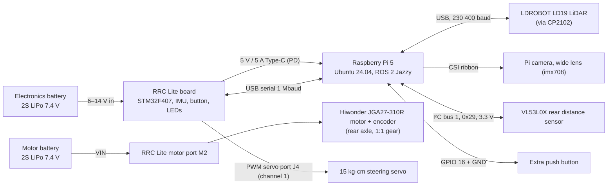

# 02 · Power and sensor architecture

*Rubric criterion 2.* Power layout, current reasoning, sensor choice and placement, calibration methods, wiring and failure points. All numbers marked *measured* come from logs kept in this repository or in our test records; numbers marked *rated* are datasheet maxima.

## 1. Block diagram (power and data)

Two batteries, one for the electronics and one for the drive motor, so that the motor current cannot pull the Raspberry Pi down.

## 2. Why two batteries: measured evidence

On 8 Oct 2026, with a **single** battery feeding both motor and Pi, we logged the 5 V rail of the Pi (`vcgencmd pmic_read_adc EXT5V_V`, about 75 Hz) together with the battery voltage the board reports and the Pi's throttling flags:

| Situation (measured, 8 Oct 2026) | Pi 5 V input | Battery | Under-voltage |
| --- | --- | --- | --- |
| Idle | 5.00–5.03 V | – | no |
| Servo ±10° and ±25° | minimum 4.835 V (when the nodes start, not from the servo) | 7.84–7.86 V | no |
| Motor pulses at 50 / 100 / 100 % | drop ≤ 83 mV, minimum 4.914 V | 7.57–7.69 V | no |

The Pi stays well above its under-voltage threshold (about 4.63 V), so the shared battery was electrically acceptable. Even so, on 9 Oct the team separated the motor battery: a full-power motor stall draws far more than these test pulses and the Pi must never reboot in the middle of a round. The electronics battery now feeds only the board, the Pi and the sensors. `battery_guard` reads `/rrc/battery` (about 1 Hz) and, after 5 consecutive readings under **6.8 V** (3.4 V per cell), blinks both board LEDs red. It deliberately does not stop the car (team decision, 9 Oct).

## 3. Power budget

| Consumer | Rail | Rated / measured | Note |
| --- | --- | --- | --- |
| Raspberry Pi 5 | 5 V | rated up to 5 A (25 W); negotiated source: 5 A | dominant electronics load; 4 cores busy during rounds |
| LDROBOT LD19 | 5 V USB | 100 mA reported on the USB bus (measured, 9 Oct) | motor rotates continuously |
| RRC Lite board | 5 V USB data + battery input | 136 mA reported on the USB bus (measured) | IMU, LEDs, button, servo and motor control |
| Pi camera (imx708) | 3.3 V via CSI | from the Pi rail | small |
| VL53L0X | 3.3 V | from the Pi rail | a few mA |
| Steering servo | board servo rail (5 V or battery, jumper) | stall current from the servo datasheet | brief peaks only |
| Drive motor | motor battery 7.4 V | not on the electronics battery | stall current is the risk, see section 6 |

The electronics budget is therefore bounded by the Pi: at 5 V / 5 A the 5 A PD rail of the RRC Lite is chosen so that the sum of the Pi and the USB sensors never exceeds the rail. We did **not** yet record the Pi's typical current during a complete Obstacle round with a clamp meter; that measurement is the first item of the test plan in [05](05-reproducibility-build-and-test.md#test-plan-before-the-final), and the table above will be updated with it.

## 4. Sensors: selection and placement

| Sensor | Why this one | Placement and why there |
| --- | --- | --- |
| LDROBOT LD19 LiDAR (STL-19P) | 360° ranging at 10–12 Hz, 0.03–12 m, ±45 mm. One sensor gives the walls, the lane position, the signs (as 5 cm clusters) and the lot limits | At the front, on a printed tab, **lowered** from our earlier height: higher it looked over the 100 mm walls and missed the boundaries. Its zero points backwards, so `scan_adapter` rotates it by π and keeps only ±110°, because the chassis blocks the rest. Returns nearer than about 0.12 m are dropped by the sensor |
| Pi camera, wide lens (imx708) | Colour of the signs (red = pass on the right, green = on the left); the wide lens (HFOV 1.78 rad, about 102°) keeps a sign in view while the car turns | Behind the LiDAR, 142 mm above the floor, tilted down about 8° (pitch 0.14 rad) so that a 100 mm sign is seen from about 1.5 m to 0.3 m; yaw 0.054 rad toward the left of the LiDAR axis, measured with a sign on each side |
| IMU of the RRC Lite (MPU6050) | Heading from the integrated gyro z: LiDAR scans are too slow (10 Hz) to hold heading inside a corner | On the board; axes remapped by `imu_adapter` (x forward, y left, z up) and checked with `imu_axes` |
| VL53L0X rear distance sensor | The LiDAR is blind behind the car; reversing out of the lot and parking need the distance to the lot limit | Rear of the car, on I²C bus 1 (address 0x29). Wiring: VIN to 3.3 V (pin 1), SDA pin 3, SCL pin 5, GND |
| Board button K1 | The rules require a single Start action | The first press publishes `/start`, the second `/robotek/stop` |

**Camera against LiDAR.** The camera alone gives colour but poor distance; the LiDAR gives distance but no colour. We **pair** each coloured blob with the LiDAR cluster at the same bearing (and, when the blob's foot is visible, at the same ground position) so that a sign behind another one on the same bearing is not mixed up. See [03](03-software-architecture-and-obstacle-strategy.md#perception).

**Sensor trade-offs we decided with data**
* *USB camera (640×480, 66° HFOV) → Pi camera (1024×576, 102° HFOV).* The USB camera delivered 6–16 fps depending on the light, and its 66° field of view did not show an inner sign just after a corner before the car had to commit to a side.
* *Raw frames → JPEG.* With the Pi's 3 cores busy, only 0.2 of 27.6 raw frames per second (691 KB each) reached the strategy; the camera's own JPEG at quality 90 (82 KB) delivers all of them (12 Nov 2026).

## 5. USB topology (measured on 9 Oct 2026)

| Device | Controller / port | Rate | Priority |
| --- | --- | --- | --- |
| RRC Lite (USB 1a86:55d4) | second controller | 12 Mbit/s, 136 mA | 1, the most critical: servo, button, IMU |
| LD19 (CP2102, 10c4:ea60) | first controller, black port | 12 Mbit/s, 100 mA, < 0.3 Mbit/s of traffic | 2 |
| Camera (USB model used then) | first controller, blue port | 480 Mbit/s | 3, the only one with real bandwidth |

In a stress test the LiDAR did not lose a single message. Stable names for each device come from udev rules (`tools/99-robotek.rules`) so a different port order cannot swap the board and the LiDAR.

## 6. Calibration methods

| What | Method | Where it is stored |
| --- | --- | --- |
| Gyro bias | Measured **after Start**, 0.3 s in the Open and 1.0 s in the Obstacle: the rules forbid calibrating before Start (9.9) and require the car to wait for the button only | `mission.py` (`CALIBRATE_SECONDS`) |
| Wheel angle against servo µs | Circles on the floor (`tools/steer_calibration.py`): radius gives the real wheel angle for each servo angle | `wheel_table_*` in `robot.yaml` |
| Speed against board rps | Runs along the wall measured with the LiDAR | `motor_rps_per_mps` in `robot.yaml` |
| Camera yaw, pitch, height | A sign on each side of the car and the LiDAR clusters (8 Oct); height from the STEP model (26 Oct) | `car.py` and `car_picam*.yaml` |
| Sign colours | HSV bands tuned on the real field: red 170–6, green 40–85; the orange field lines are excluded with a minimum value | `red_hsv`, `green_hsv` in the profile |
| Rear distance sensor | Readings against a ruler from the wall: raw 10, 20, 30, 40, 50, 85, 170, 420 mm read 70, 75, 77, 83, 96, 138, 231, 476 mm. The node maps raw to mm by interpolation; between 1 and 4 cm it is good to ±1 cm, from 5 cm to about ±5 mm | `rear_range.py` |
| LiDAR mounting offsets | STEP model and caliper | `car.py` |

## 7. Failure points and mitigations

| Failure | What we saw | Mitigation |
| --- | --- | --- |
| USB hub disabled by electromagnetic noise | The board node died mid-run (4 Nov 2026, "disabled by hub (EMI?)") | Stable udev names, motor on its own battery, relaunch procedure, board node retries every 3 s |
| Camera frames late | 0.35–0.43 s late 48 times in one run (9 Nov) = 48 stops | Camera age limit 0.8 s; the round continues with remembered colours if the camera is lost for 1.5 s (`CAMERA_LOST`) |
| Camera stopped at 14.5 s and never came back (12 Nov 01:05) | The car waited 18 s | Same `CAMERA_LOST` rule |
| Servo that does not follow the command | Full lock with almost no turn (11 Nov, corner 6; 18 Nov) | `steer_watch.py` stops the car for 0.6 s with the wheels centred, and the mounting was corrected |
| Motor stall | Full push into a wall stalled and overheated the motor | `motor_max_rps`, short recover moves, rear and front distance checks |
| Close returns missing | LiDAR drops returns under 0.12 m | The strategy treats "no returns on the side" as "close wall" with the nominal gap in the lot exit |
| Light on the field | Room lights changed the colours (version 11) | Ring of 16 WS2812 LEDs for steady lighting; HSV bands with a minimum value |

## 8. Bill of materials

| Component | Qty | Function |
| --- | --- | --- |
| Raspberry Pi 5 | 1 | Main computer: ROS 2 nodes, vision, planning |
| Hiwonder RRC Lite controller (v1.0 board) | 1 | Motor closed loop, servo, IMU, button, LEDs, battery monitoring |
| LDROBOT STL-19P (LD19) LiDAR and adapter board | 1 | Ranging |
| Pi camera, wide lens | 1 | Colour of the signs |
| VL53L0X distance sensor | 1 | Rear distance |
| 15 kg·cm digital servo | 1 | Steering |
| Hiwonder JGA27-310R encoder motor (20:1 gearbox, 450 rpm) | 1 | Drive |
| 2S LiPo 7.4 V batteries (electronics, motor) | 2 | Power; the electronics battery listed with 5000 mAh 20C in the earlier BOM |
| 16-LED WS2812 ring | 1 | Steady lighting for colour detection |
| 3D-printed base, housings and wheels; silicone tyres | – | See [01](01-mobility-and-mechanical-design.md) |
| Push button (GPIO 16) | 1 | Spare input |

## 9. Wiring diagrams

* Connections of each sensor to the Raspberry Pi USB controllers: section 5 above and the diagram in section 1.
* The pictures in [`schemes`](../schemes) (`Electrical Wiring Diagram.png`, `Visual Wiring Diagram.png`, `Power Distribution Diagram.png`) were drawn for the earlier motor driver (TB6612FNG on the Pi GPIO). They are kept as history; the **diagram in section 1 is the one that matches the current car**.
