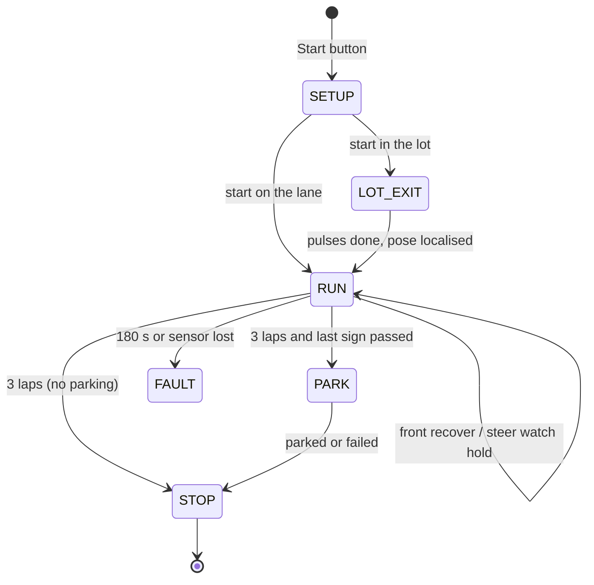

# 03 · Software architecture and obstacle strategy

*Rubric criterion 3.* How the code is organised, the state machine of the Obstacle Challenge, how the car follows the lane and obeys the signs, why each algorithm was chosen, which edge cases are handled and how we tested and measured it.

## 1. Code structure

The car runs **ROS 2 Jazzy** on Ubuntu 24.04 (Raspberry Pi 5). The workspace is in [`src`](../src):

| Package | Role |
| --- | --- |
| `robotek_obstacle_v3` | **The Obstacle Challenge strategy** (mission, planning, perception glue, lot exit, parking, ROS node `drive.py`) |
| `robotek_open` | The Open Challenge strategy (v5): wall following with a LiDAR corner detector |
| `robotek_hardware` | Nodes between the strategies and the hardware: `base_adapter` (m/s and wheel angle to motor rps and servo µs), `scan_adapter`, `imu_adapter`, `start_button`, `rear_range`, `status_leds`, `battery_guard`, camera publisher |
| `rrc_lite_driver`, `rrc_lite_msgs` | Driver of the Hiwonder RRC Lite board (IMU, button, servo, motor) with our patches |
| `ldlidar_stl_ros2` | LiDAR driver (LDROBOT, MIT licence) |
| `robotek_course` | Launch files (`car.launch.py`), shared perception (`obstacle_vision.py`), base classes |
| `robotek_common` | Vehicle measurements shared by everything |
| `robotek_description`, `robotek_gazebo`, `robotek_evaluation` | URDF, simulator and the judge/lab tools used to test without the car |

Inside `robotek_obstacle_v3/robotek_obstacle_v3` each file has one job:

| File | Job |
| --- | --- |
| `drive.py` | ROS node: subscribes to the scan, IMU, camera and rear sensor; publishes `/cmd_vel_raw`; records every round |
| `strategy.py` | Wires the sensors to the mission; stops the mission while a sensor is stale (`WAIT_SENSOR`) and ends the round at 180 s |
| `mission.py` | **The state machine** and all decisions |
| `scene.py`, `field.py` | The known lane geometry in *track units* and helpers to map a LiDAR point to the lane |
| `localizer.py` | Pose from the walls (LiDAR odometry) with the gyro for heading |
| `perception.py` | LiDAR clusters the size of a sign |
| `corner.py`, `corner_table.py` | Planner of the line through each corner |
| `lot_exit.py`, `park.py`, `park_fixed.py`, `parking_search.py` | Leaving and entering the parking lot |
| `steer_watch.py` | Detects a servo that does not follow |
| `settings.py` | All tunable parameters in one dataclass |
| `recording.py` | Telemetry, events and LiDAR scans of every round |

## 2. State machine

* **SETUP**: gyro bias is measured *after* Start (rules 9.9), and the direction is decided from the walls (the wall nearer to the car is the outer one) or, in the lot, from the free side.
* **LOT_EXIT** (rounds starting in the lot): the car cannot drive straight out of a lot only 1.5 car lengths long, so it executes a hard-coded K-turn of pulses (`L+0.25 R-0.3 L+0.25 R-0.3 L+0.25 R-0.3 C-0.2`: forward at full left lock 0.25 s, back at full right lock 0.3 s, …) at 0.2 m/s with the rear sensor stopping reverses. Pulses and their rationale are the coach's, validated on the car on 12 Nov (heading grows about 10° per pair).
* **RUN**: the lane following described below, with 3 laps.
* **PARK**: after the last sign on the start straight is passed, a fixed manoeuvre (entry arc by gyro, straight, hard-coded finishing pulses, rear sensor to stop reverses).
* **WAIT_SENSOR** (in `strategy.py`): any of LiDAR, gyroscope or camera older than 0.35 s (camera 0.8 s) holds the car at speed 0 until fresh.

## 3. Perception

1. **LiDAR clusters.** Short isolated groups of returns of 1.5–12 cm diameter, closer than 2.5 m, are signs; walls are long and are excluded.
2. **Colour blobs.** HSV thresholds find red and green upright blobs in the camera frame (taller than wide); each gets a bearing.
3. **Pairing.** A blob is paired with the cluster at the same bearing (±0.12 rad) and, when its foot is visible, at the same ground position. A cluster claimed by both colours is dropped. The camera runs 4 frames per second and every frame for 3 s after a new cluster appears ahead (`camera_gate` in later versions; in this version every frame).
4. **Memory by seat.** Signs sit on the straights at three seats (start, middle, end of each straight) and 0.4 m or 0.6 m from the inner wall. Every cluster is filed under its seat; each seat keeps its colour votes for the whole round, so a colour seen once survives when the sign leaves the camera's view. A seat counts as a sign after 2 sightings.

## 4. Lane following and obedience to the signs

**Reference line.** The planner keeps a *side offset* along the lane (progress, offset). Each sign ahead with a known colour holds the offset on its side (red: right, green: left, with `pillar_clearance` 0.18 m from the sign box to the car's side) for 0.15 track units before and after it, with ramps in between. Unknown colour: pass **away** from the sign until it is known.

**Corners.** Each corner is replaced by a straight–arc–straight line chosen by `corner.py` among candidates that were scored by *driving them in a kinematic simulation* of the car (`corner_table.py`), keeping clearance from the signs at both ends of the corner.

**Steering law.** For the point of the line at the car:

`steer = atan(wheelbase · curvature) − 6 · lateral_error − 1.5 · heading_error − 0.2 · gyro`

a feed-forward term for the curvature of the line plus feedback on the lateral error, the heading (integrated gyro) and the yaw rate. Steering is limited to 17.6° (the real wheel angle limit).

**Speed.** 0.28 m/s on a clear lane, 0.30 m/s near a sign, 0.20 m/s with something close ahead, 0.15 m/s on the last metres. The speed is limited by what the motor can do at low speed (see [01](01-mobility-and-mechanical-design.md)).

**Why this and not X.**
* *Wall-following PID only (D1−D2) like our Open v1–v4:* fine without signs, but it cannot hold a side offset around a sign or plan a corner with signs on both ends. We kept it for the Open Challenge (`robotek_open`), where there are no signs, and used a planned line for the Obstacle.
* *Beam search over many manoeuvres:* the earlier Obstacle versions searched; the v3 mission fixes each sign's side as soon as its colour is known and holds it, which made the car's path predictable and testable.

## 5. Edge cases handled

| Case | Behaviour |
| --- | --- |
| Colour not yet known near a sign | Pass away from it; wait up to a limit at the start to read the first signs |
| Colour read at a seat that cannot exist (rules figure 8c: only certain combinations per straight) | The layout rules keep the combination with most evidence; others wait in `_shadow` |
| About to touch a sign or a wall | `guard_gap`: back off on the opposite lock, then continue |
| Obstacle directly in front | **Front recover**: stop dead, reverse at full lock toward the inside of the lane (the coach's rule), or on the other lock when the nose already points more than 40° to the inside (a three-point turn), then retry; each repeat near the same spot adds 0.6 s of reverse. It fires only if full lock away from the obstacle still hits (after the servo lag of 0.3 s) |
| Servo does not follow | `steer_watch`: full lock with less than 30 % of the expected gyro turn for 0.5 s stops the car 0.6 s with the wheels centred |
| Sensor stale | `WAIT_SENSOR` hold; camera lost for 1.5 s: continue with remembered colours |
| Direction (CW or CCW) | Detected from the walls; CW rounds are mirrored so the strategy only ever runs counter-clockwise |
| Round limit | `FAULT` at 180 s after Start |

## 6. Testing and tuning process, with metrics

* **Unit tests** per package (`pytest`): the strategy checks, `steer_watch`, the lot exit, the parking planner and the corner planner. 45 tests in `robotek_obstacle_v3` pass at this version.
* **Honest simulation.** Rounds in Gazebo and in a fast kinematic **lab** use only what the real car has: LiDAR, gyroscope and camera, with noise. No odometry, no pose of the pillars. The true pose is recorded only to audit. The judge module scores a round with the rules (sections, laps, signs, parking), flagging what is estimated.
* **Metrics.** Estimated points, total round time from Start (laps as partial times), contacts, faults. Comparison rule: points first, then time. Every round on the car and in simulation writes `round.json`, `events.jsonl`, telemetry and scans, see [05](05-reproducibility-build-and-test.md).
* **Tuning evidence.** The steering faults and corner crashes of 11 Nov (`23:56`, `23:59`) led to `steer_watch`; the camera stalls led to `CAMERA_MAX_AGE` / `CAMERA_LOST`; the lot exit pulses were tuned until the heading grew about 10° per pair of pulses. Details in [04](04-systems-thinking-and-engineering-decisions.md) and the [journal](engineering-journal.md).
* **Simulation result (3 Nov 2026, not the car).** Gazebo standard set with parking: 7 of 10 rounds valid, 46.5 estimated points mean; the later fixes were validated round by round on the car.

## 7. Open Challenge

`robotek_open` (v5): three laps by wall following with a LiDAR corner detector; the corner turn is made at full lock until the heading change is within 0.3 rad of the target, then the controller takes over. The same hardware adapters and recording are used.
