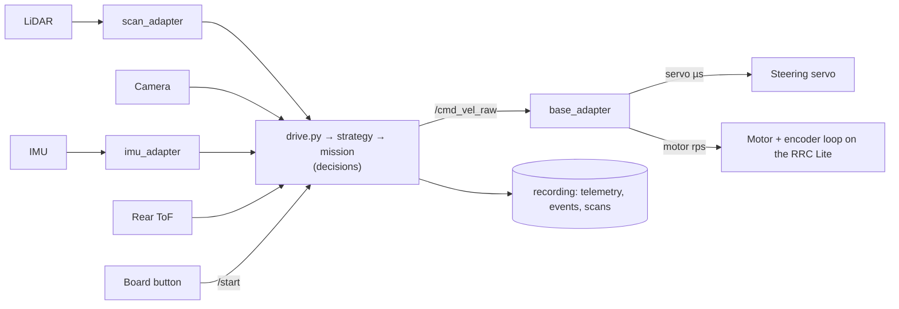

# 04 · Systems thinking and engineering decisions

*Rubric criterion 4.* How the subsystems work together, the constraints we worked under, the trade-offs we decided with data ("we chose X instead of Y because…"), the iteration cycles and the risks.

## 1. How the subsystems interact

* The strategy never talks to hardware; it publishes a speed and a wheel angle. `base_adapter` is the **only** place that knows the servo table, the motor scale and the acceleration limits. That is why the same strategy ran in Gazebo, in the lab and on the car.
* One loop at 50 Hz (`drive.py`); the camera (about 9–10 fps) and the LiDAR (10 Hz) are slower than the control loop, so the mission works from the **newest** data and refuses to step when any of them is stale.
* Timing is the shared constraint: the single Raspberry Pi runs the LiDAR driver, camera, board driver, adapters, the strategy and the recorder. When the CPU was busy the camera frames arrived late, which is why frame size, JPEG and the age limits were tuned (section 3).

## 2. Constraints

| Constraint | Source | Consequence |
| --- | --- | --- |
| 180 s per round, 3 laps | rules 9.2 | Speed cannot be only "safe"; the limit is enforced in the strategy (`FAULT` at 180 s) |
| ≤ 300 × 200 mm, ≤ 1.5 kg, one driven axle | rules 11 | Compact two-level layout; one motor |
| Calibration only after Start | rules 9.9 | Gyro bias measured in the first 0.3 s / 1.0 s |
| No inputs to choose direction or mode | rules 9.9 | The direction is detected from the walls |
| No Wi-Fi/Bluetooth during the round | rules 11.10 | Used only for development; see [rules compliance](rules-compliance.md) |
| Motor cannot hold speeds below about 0.25 m/s | measured | Minimum command; the Obstacle runs at 0.28–0.30 m/s |
| Lot only 1.5 car lengths long | rules, Figure 4 | Exit and parking by hard-coded pulses closed on sensors |
| Pi CPU shared by all nodes | measured | JPEG frames, age limits, light recorder |

## 3. Decisions with data ("we chose X instead of Y because…")

| # | Decision | Alternative | Evidence |
| --- | --- | --- | --- |
| 1 | Drive speed by the **RRC Lite closed loop** | TB6612FNG PWM on the Pi GPIO | With PWM the speed per percent depends on the battery voltage, and on 8 Oct the motor moved the car "only sometimes" (a standby pin never raised and a PWM write ignored by `lgpio`); the board holds the commanded speed with the motor encoder |
| 2 | **1:1 gearing**, `motor_rps_per_mps` 7.0–8.0 | 54:30 reduction (4.4) | The coach chose 1:1 after rounds with several ratios on 11–12 Nov; the complete rounds of 12 Nov took 107.1 s and 105.9 s from Start |
| 3 | **Separate motor battery** | One battery for everything | Measured 8 Oct: the Pi rail dipped to 4.835 V at node start and to 4.914 V under motor pulses (threshold 4.63 V); a stall draws more, so the Pi was isolated |
| 4 | **Pi camera, 102° HFOV, JPEG at quality 90** | USB camera 66°, raw frames | Raw frames: 0.2 of 27.6 frames/s reached the strategy with the Pi busy; JPEG delivered all. The wide lens keeps the sign in view through the corner |
| 5 | **Camera age limit 0.8 s** and "camera lost" after 1.5 s | Stop whenever a frame is late | The camera was 0.35–0.43 s late 48 times in one round (each a stop); on 12 Nov the camera stopped at 14.5 s and the car waited 18 s |
| 6 | **Planned line with a side offset per sign** (Obstacle) | Wall-following PID (Open) | A PID cannot hold a side offset or plan a corner with signs at both ends |
| 7 | **Corner lines scored by driving them in simulation** | Fixed geometry | The car's real minimum radius (about 0.38 m) and the signs at both ends change which line is feasible |
| 8 | **Honest simulation** (LiDAR + gyro + camera only, with noise) | Simulation with exact odometry and sign poses | The real car does not use its encoder or know the pose of the signs; a strategy that used them would be validated on information the car does not have |
| 9 | **Hard-coded pulses closed on sensors** for lot exit and parking | Fully automatic parking search | The automatic planned parking did not reproduce the real result in our lab; the coach's pulses left the car parallel in the lot on 12 Nov (parking-only test, CCW) |
| 10 | **Steering watch** | Trust the commanded angle | 11 Nov 23:56 and 23:59: full lock with almost no turn caused two crashes in corner 6; replayed offline, the watch trips 3 s before the wall |
| 11 | **Rear distance sensor** | Reverse by time only | Reverses by time overshoot differently each time; the sensor stops them 20 mm from the lot limit |
| 12 | **Keep the 12 Nov version for the final** | The later experimental branch (planned line from the car, new vision) | The later changes were not validated in complete rounds on the track; the 12 Nov version has complete validated rounds. The later work is kept in a separate branch for after the final |

## 4. Iteration cycles

* **Steering:** stepper + rack → Hiwonder linkage → servo horizontal → servo vertical → servo re-mounted (18 Nov) with `steer_watch` as the safety net.
* **Drive:** L298N → TB6612FNG → RRC Lite closed loop; gears 54:30 → 1:1.
* **Sensors:** LiDAR high → LiDAR low; USB camera → Pi camera; raw → JPEG; lighting ring added.
* **Strategy:** wall following → planned line; beam search → fixed side per sign; manual pulses → parking pulses with a rear sensor.
* Each cycle is recorded with the run folder (`events.jsonl`, `params.yaml`, telemetry) so the change and its effect can be traced, see the [journal](engineering-journal.md).

## 5. Risk table

| Risk | Likelihood | Impact | Mitigation | Residual |
| --- | --- | --- | --- | --- |
| Servo does not follow | seen (11 Nov, 18 Nov) | crash / stuck | `steer_watch`, re-mounting, check before each round | medium |
| Sign colour misread under different light | seen | wrong side = fault | HSV bands with minimum value, lighting ring | medium: re-tune HSV at the venue |
| Camera or LiDAR stale | seen | stop | Age limits, `CAMERA_LOST` | low |
| Wi-Fi left on | possible | disqualification (11.10) | Checklist item, see [rules compliance](rules-compliance.md) | low |
| USB drop from EMI | seen once (4 Nov) | round lost | separate motor battery, udev names | low |
| CW parking not reliable (pose 20–30 cm off along the straight) | seen | no parking points in CW | The CCW pulses are validated; CW is mirrored and stays untested | **high** for CW |
| Battery low at the final | possible | slow motor, brown-out | `battery_guard` warning at 6.8 V, charged spare | low |
| Surprise rule | announced for 2026 | unknown | Software parameters are all in one file (`settings.py`) so a rule change is a parameter or a small planner change | unknown |
