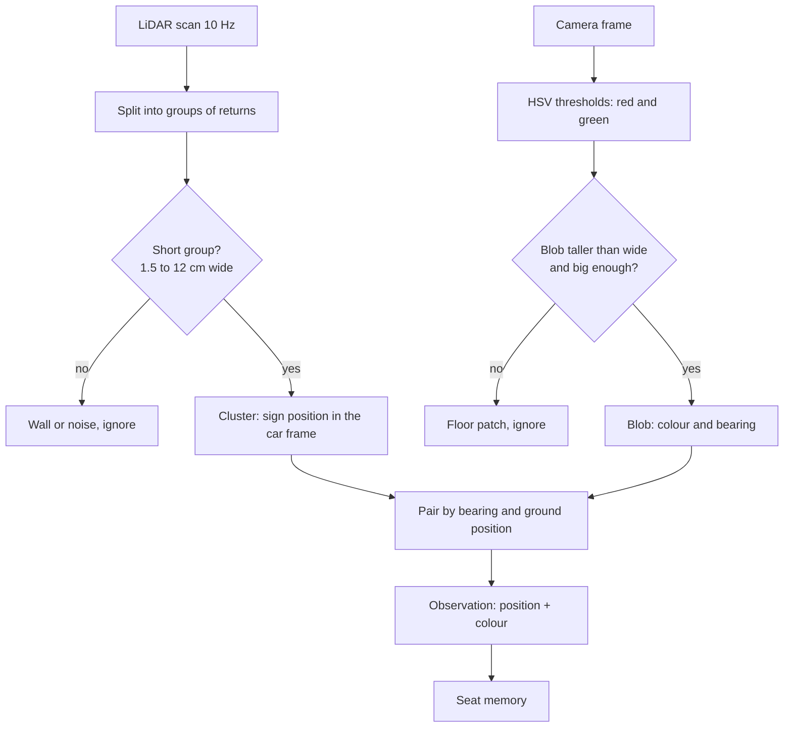
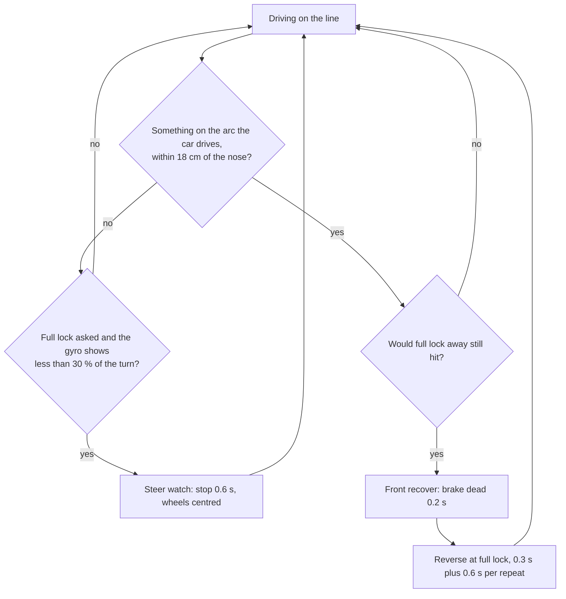

# 06 · Obstacle detection and avoidance

This page explains how the car finds the red and green signs, remembers them, decides on which side to pass each one and keeps itself out of trouble when something goes wrong. It is the long version of the Obstacle part of [03](03-software-architecture-and-obstacle-strategy.md). The code lives in `src/robotek_obstacle_v3/robotek_obstacle_v3/` and we point to the file for every step.

## The problem in one paragraph

The track is a rounded square: four 1 m straights joined by quarter circles of 0.5 m radius, with the lane running between an inner island and the outer walls. On every straight there can be up to three signs, 5 × 5 cm and 10 cm tall, red or green. Red must be passed on the **right**, green on the **left**. The car has to do three laps in under 180 s without touching a sign, and it must do it from a start where it has seen nothing yet. The signs change position and colour in every round.

Two facts shaped the whole design:

* The LiDAR sees a sign from 2 m away but cannot tell its colour.
* The camera tells the colour but not how far the sign is, and in practice it only gives a reliable colour once the sign is closer than about 1.5 m.

So we need both sensors, and we need a memory, because the colour often arrives late and from a bad angle.

## 1. Finding signs

**LiDAR clusters** (`perception.py`). We walk through the scan in order and start a new group whenever two neighbouring returns are more than 7 cm apart. A group of at least two returns and between 1.5 cm and 12 cm across, closer than 2.5 m, is a candidate. Walls never pass this test because they are long. The LiDAR sees the face of the sign that looks at the car, so we move the point 2.5 cm along the ray to land on the centre of the 5 cm sign.

**Colour blobs** (`robotek_course/obstacle_vision.py`). The frame is converted to HSV and thresholded once for red and once for green (red wraps around the hue circle, so it has two bands). A blob counts only if its area is at least 30 pixels, it is at least 8 pixels tall and it is taller than wide: signs are upright, the orange line on the mat and reflections on the floor are not. From the pixel position and the camera's tilt we compute the **bearing** of the blob, and, when its lower edge is visible, the **ground position** where the sign stands.

Two measured details matter here. The red band starts at hue 170 and the green band is 40–85, tuned on the real mat under our room lights; and we leave out dark pixels (value below 80 for red) because the orange line of the mat is dark when seen at a low angle and would otherwise look red.

**Pairing** (`associate` in `obstacle_vision.py`). A blob and a cluster belong together if they lie at the same bearing, within 0.12 rad. When the blob also has a ground position we require the cluster to be close to it (0.20 m plus 0.12 m for every metre of range), which fixes the case of two signs on the same line of sight: the far one is not given the colour of the near one. If a cluster is claimed by blobs of both colours we throw it away rather than guess. What leaves this step is a list of observations, each one a position in the car frame and a colour.

## 2. Remembering signs: the seat map

A colour is often seen once, from a corner exit, and then the sign leaves the picture while the car is still 40 cm from it. If the planner only used the current frame it would forget. So the mission files every cluster under a **seat** (`Mission._remember`).

The rules of the competition say what the signs can look like: they stand at three places on each straight (start, middle, end), in an inner row 0.4 m from the island wall or an outer row 0.6 m from it, so their lateral offset from the lane centre is about ±0.1 m. We turn each cluster into track coordinates, `progress` along the lane (one unit per straight or per corner, eight per lap) and `lateral` across it. If the cluster is within 0.2 m of the lane centre and within 0.15 units of a seat, it belongs to that seat.

* A seat becomes a **sign** after two sightings (`SEAT_HITS`). One stray return never creates a sign.
* Each seat keeps **colour votes** for the whole round, counted at most once per camera frame. Whichever colour has more votes wins. In a clockwise round the world is mirrored so that the car always drives counter-clockwise, and the colours are swapped with it; the rest of the code never has to think about direction.
* The **layout rules** are enforced (`_enforce_layout`): per straight there can be one sign at the start, in the middle or at the end, or two at the start and the end, never three, and never the middle together with another. If the evidence disagrees, the combination with more sightings wins, and the other one waits in a "shadow" list and can come back if it overtakes. This removed a phantom sign in the middle of a straight that a colour had been wrongly given to.
* A sign that was moved a few centimetres (for example touched by the car) is followed: the seat's lateral offset drifts to where the LiDAR sees it, in 2 cm steps.

## 3. Deciding the side

For every remembered sign ahead the planner computes the lateral offset the car must have next to it (`Mission._side_offset`):

* **Red:** offset = sign's lateral − (0.18 m clearance + half the car's width)
* **Green:** offset = sign's lateral + (0.18 m clearance + half the car's width)
* clamped to ±0.36 m so the car never plans through a wall.

In the lane frame, positive lateral means toward the island. Green is passed on the left (island side) and red on the right (wall side), which is exactly what these two lines say. The same lines work for both directions because a clockwise round is mirrored before the mission sees it.

**Colour not known yet.** The car keeps to the middle of the lane (`unknown_offset` is 0 in the validated version; another version used 0.12 m away from the sign). From the middle it can still go to either side, and the camera has the whole approach to resolve the colour. The middle is not a safe place: the car is 14.8 cm wide and the inner row of signs is 10 cm from the lane centre, so the gap to a sign is about a millimetre. If the colour never arrives, the car brushes or touches the sign, which is why the peek and the lookout below exist.

## 4. The planned line

The mission builds a list of knots `(progress, offset)` for everything within three units ahead (`Mission._plan`):

1. Each known sign puts its offset on the line from 0.15 units before the sign to 0.15 units after it (`HOLD`), long enough for the car to be parallel to the sign while the wheels pass it.
2. Between two signs the line is a straight ramp. It cannot be steeper than the car can steer, so the corner planner and the clearance checks keep the line drivable.
3. For an **unknown colour** near a corner, we add a *lookout* knot that moves the car 0.15 m toward the island, so the camera sees an inner sign earlier (`_lookouts`).
4. **Corners** are replaced by a line straight–arc–straight chosen by `corner.py`: it tries arcs of 0.5, 0.6 and 0.75 m radius and many offsets before and after the corner, and keeps the one with the largest clearance to the island, the outer wall, the sign at each end and, near the start, the limits of the parking lot. The clearance is not computed on the ideal line but on the path a simulated car actually drives with our steering law, including the servo's delay and rate. A line that is clear on paper but needs 10 1/m of curvature touches in the real round, because the car can only do about 2.7 1/m.

## 5. Following the line

At every control step (50 Hz) `Mission._steer` computes

`steer = atan(wheelbase · curvature) − 6 · lateral error − 1.5 · heading error − 0.2 · gyro`

The first term turns the curvature of the line, taken 10 cm ahead of the car to cover the lag of servo and motor, into the steering angle that would follow it exactly. The other three terms correct what the car did wrong: how far it is off the line (6 rad of steering per metre), how far its heading is off the line's heading (1.5) and how fast it is turning (0.2, damping). The command is clamped to the real wheel limit of 17.6°.

**Speed** (`Mission._speed`): 0.28 m/s on a free lane, 0.30 m/s near a sign or changing lane, 0.20 m/s with something close ahead and 0.15 m/s in the last metres. The motor floor of about 0.25 m/s is why these numbers are so close to each other (see [01](01-mobility-and-mechanical-design.md)).

## 6. When the colour is still unknown

Two behaviours exist for the case where the next sign is close and the colour has not arrived:

* **At Start** the car stands still for 0.25 s, and for up to 1.0 s if the first sign is very close and still without colour, so the first signs can be filed before moving. If the first sign is closer than the car needs to change side, it backs up straight (at most 0.5 m).
* **Peek** (`Mission._look`). If the next sign has no colour and is between 0.6 and 1.4 units away, the car stops and reverses at full lock until its nose has turned 15° toward the sign, then waits 0.5 s for a frame. This gets a sign that is too far to the side for the camera into its field of view. It happens once per sign.

## 7. When something goes wrong

* **Contact guard** (`_guard`): an optional extra that compares the outline of the car, 6 cm ahead on the current arc, with every remembered sign, the island and the outer wall and backs off for 0.8 s if it gets closer than `guard_gap`. It is **switched off** (`guard_gap` 0) in the validated rounds; the front recover below handled the contacts we had.
* **Front recover** (`_front_recovery`): the check looks only at the arc the car is driving and only at the nose (5 cm), because a fixed corridor in front of the car fired on every close dodge. It also waits for the servo lag of 0.3 s: if turning away at full lock still hits, then it brakes dead (the node sends `/robotek/estop`, so the motor does not ramp down), reverses at full lock toward the inside of the lane, or on the other lock if the nose already points more than 40° inward, and tries again. If it triggers again within 0.3 m and 8 s of the last time, each repeat adds 0.6 s to the reverse (at most three), so the line gets room instead of looping on the same sign.
* **Steer watch** (`steer_watch.py`): when the command has been at full lock for 0.35 s plus a 0.5 s window and the gyro shows less than 30 % of the turn that the wheels should give, the servo is not following. The car stops 0.6 s with the wheels centred and then carries on. See the servo failures in [02](02-power-and-sensor-architecture.md#7-failure-points-and-mitigations).
* **Stale sensors** (`strategy.py`): the car stops until the LiDAR, camera and gyro are all fresh again.

## 8. What we validated

On 12 Nov 2026 the car passed 19 of 19 signs on the correct side in the 01:22 round and made a complete round in 107.1 s from Start with no recover move at all (laps 36.2 / 33.1 / 33.8 s). The five front recovers in the 01:22 round all happened on the north straight. In the lab, 195 of 200 rounds without parking were valid (see [05](05-reproducibility-build-and-test.md)). Points are estimated until a judge validates a round.

## 9. Known limits

* The colour of a sign far to the side of a corner exit can arrive too late for the car to cross the lane, and the car then passes on the safe side, which may be the wrong one. The peek and the lookout reduce this but do not remove it.
* A sign whose colour changes with the light (glare) can get a wrong vote; the votes make this rare but not impossible, and the HSV bands should be checked at the venue.
