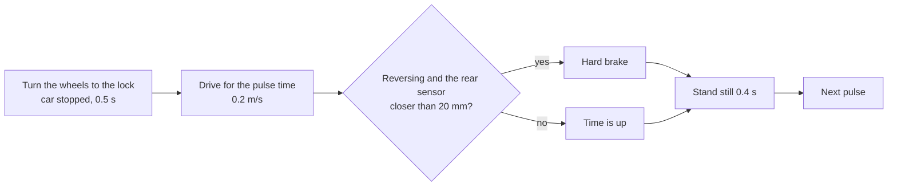
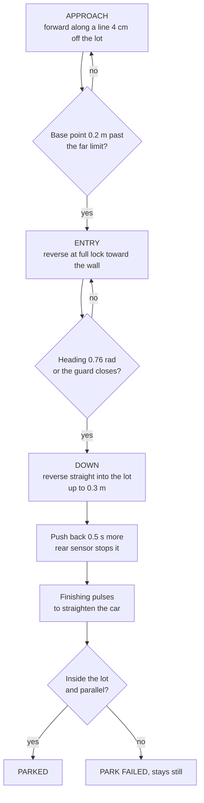

# 07 · Leaving the parking lot and parking in parallel

The Obstacle Challenge starts with the car inside the parking lot and ends with the car parked in it. Both movements happen in a space that is only 1.5 car lengths long and 20 cm deep, between two magenta limits 2 cm thick, so they get their own page. The code is in `lot_exit.py`, `park_fixed.py` and, for the older planned park, `park.py` and `parking_search.py`.

## The space we have

* The lot is on the start straight, against the outer wall. Its **depth** is always 20 cm. Its **length** is 1.5 × the length of the robot. We measured the car with its LiDAR tab as 0.245 m long, so our team field uses a lot **0.3675 m** long, with the far limit 0.31 m along the start straight (`park_lot_length`, `park_lot_end` in `config/car_picam_park_round.yaml`).
* The car is about 0.233 m long in the planners' outline and 0.148 m wide. Inside the lot there are about 12 cm of room along the car and only about 2.6 cm on each side across it. Everything below follows from those numbers.
* The LiDAR cannot see anything closer than about 12 cm, so the limits and the wall next to the car are invisible to it most of the time. That is why a rear distance sensor was added and why most steps end on the gyroscope heading rather than on the LiDAR.

## 1. Leaving the lot

### Which way do we drive?

Nobody tells the car the direction, and the rules do not allow a switch for it. At the start the car sits parallel to the outer wall, about 1 cm from the rear limit and 1 cm from the wall, facing the driving direction. So **the wall that is close is the outer wall**: wall on the right means counter-clockwise, wall on the left means clockwise (`direction_in_lot`). We take the median distance in a 12° window around each side. Because the LiDAR drops returns under 12 cm, a side with no returns at all counts as "the near one", at its nominal distance (1 cm gap plus half the car).

### Why a sequence of pulses

A forward arc at full lock from the starting position hits the far limit after about 11 cm, at about 17° of heading. The car has to go out, back, out again. We tried to have the software plan this and it never reproduced the movement that works on the real car, so the coach recorded a **sequence of pulses** and we execute it exactly (`lot_exit_steps`).

The sequence of the final profile is

`L+0.25  R-0.3  L+0.25  R-0.3  L+0.25  R-0.3  C-0.2`

Each word is one pulse: the first letter is the steering (L or R at full lock, C for wheels straight), the sign is forward (+) or reverse (−), and the number is the time in seconds. The letters are written for counter-clockwise; in a clockwise round they are mirrored, so L always means "away from the wall". Read in order: forward with the nose turning away from the wall for 0.25 s, back with the nose turning toward it for 0.3 s, and so on three times, and finally 0.2 s straight back with centred wheels.

### What a single pulse does

* The 0.5 s with the car stopped is there because the servo needs time to reach the lock; without it the first part of the pulse is driven with the wheels still straight. The command is a velocity plus an angle, and an angle cannot be expressed at zero speed, so the car is sent a tiny forward or backward speed (3 mm/s) under the motor's dead band.
* The pulse speed is 0.2 m/s; the motor floor turns this into about 0.25 m/s on the floor.
* A reverse ends early with a hard brake if the rear sensor reads under 20 mm.
* After the pulse the car stands 0.4 s so the heading we read is the final one.

### Knowing where we are afterwards

During the pulses nothing sees the walls well, so the exit estimates its own position (`LotExit.pose`): the lot from the parameters, x from the rear sensor and y from the wall gap at the start, and then each pulse as a full-lock arc whose length is the one that turns the gyroscope heading by the amount we measured. When the pulses end, the estimate is given to the localizer (`Localizer.initialize`) as a first guess, and the LiDAR fitted to the known walls corrects it. The estimate and the LiDAR fit differ by up to 0.2 m, which is why the estimate is only used as a starting point.

### What it looks like on the car

The heading grows by about 10 to 14° per pair of pulses: roughly 1°, 14°, 23°, 37°, 47°, 62° and 69° after the seven pulses (measured on the car, rear distance 50 to 170 mm during the sequence). The car leaves the lot pointing about 70° into the lane, and the lane following takes over from there: the first thing it does is a gentle turn back toward the lane direction.

### What the exit does not do

It does not check by itself that the pulses worked: it trusts the gyroscope heading and the rear sensor. If a pulse does not turn the car (a wedged car, a servo that does not follow), the sequence keeps going. The steer watch of [06](06-obstacle-detection-and-avoidance.md) is what catches a servo that stops answering, and the lab and the car rounds are what we used to check that the sequence produces the same heading every time.

## 2. Parking in parallel

At the end of the third lap, once the last sign on the start straight has been passed, the mission switches from RUN to PARK (`Mission._park`) and starts `FixedParking` (`park_mode: 1`).

The idea is "no plan, only steps that each end on a sensor". An earlier planner drove 14 short moves at 0.06 m/s; the real car does not move at that speed with full lock and, with the motor floor of about 0.25 m/s, it rolls 3–12 cm after every stop, past the target of a short move. So each step of the fixed manoeuvre uses all the room it has and stops on the gyroscope heading or on the LiDAR pose against the lot, and it anticipates the roll after the stop (the roll is measured and fed back).

1. **APPROACH.** The car drives forward along a line 4 cm off the lot, at up to 0.3 m/s, until the reference point is 0.2 m past the far limit (`park_fixed_ahead`), measured on the LiDAR pose and aligned with the line. If it overshoots, it backs along the line.
2. **ENTRY.** It reverses at full lock toward the wall until the gyro heading reaches 0.76 rad (about 43.5°, `park_fixed_entry`) or until the guard says that the outline, plus the expected roll, is closer than 1.2 cm to a limit or the wall.
3. **DOWN.** It reverses straight into the lot, up to 0.3 m, until the guard stops it, near the wall or near the near limit.
4. **Push.** `park_partial_back` gives 0.5 s more of straight reverse; the rear sensor stops it before it touches the limit. This is the "half a second more" the coach asked for after watching the car stop a little short.
5. **Finishing pulses.** The car is now inside the lot but at an angle. The pulses straighten it:

   `C+0.20  R-0.40  L-0.50  R+0.05  L-0.15  R+0.1  L-0.1`

   They use the same executor as the lot exit (`LotExit`), at 0.1 m/s that the motor floor raises to about 0.25 m/s, and the same rear distance stop. The sequence is the one that left the car parallel in the lot in the parking-only test of 12 Nov 02:39 (20.3 s).
6. **Check.** At the end the car compares its own pose with the lot (`Lot.parked`): inside, parallel. PARKED or PARK_FAIL; in both cases it stays still.

### `park_fixed_sense`: placing the lot from the LiDAR

On the car the outer wall showed at y of −1.52 to −1.57 instead of −1.50, and one limit stood about 3 cm from where the map put it. With 2.6 cm of room per side, that is the whole margin. `park_fixed_sense` (0 off, 1 wall and plates, 2 the two plates as a pair in a wide window) fits a line to the wall's returns and finds the limit plates near their expected x, and applies a small, low-pass-filtered correction to the pose. It is available but it is **not part of** the command validated on 12 Nov, so the validated parking runs without it.

## 3. What is validated and what is not

| Movement | Direction | State |
| --- | --- | --- |
| Lot exit | CCW | Validated on the car, several rounds |
| Lot exit | CW | Mirrored from the CCW sequence; not validated on the car yet |
| Parking, partial park (approach, entry, straight in) | CCW | Validated in rounds (29° at the end of the partial park, 12 Nov 01:22) |
| Parking, finishing pulses | CCW | Parallel in the lot in the parking-only test (20.3 s, 12 Nov 02:39) |
| Parking | CW | **Not reliable**: the pose along the straight was 20 to 30 cm off in two attempts, one ending 20 cm past the lot and one starting too early and hitting the left limit |

For the final we will run the parking pulses in CW again with `park_fixed_sense: 2` and decide, from those rounds, whether to trust CW parking or to document it as a limit.
