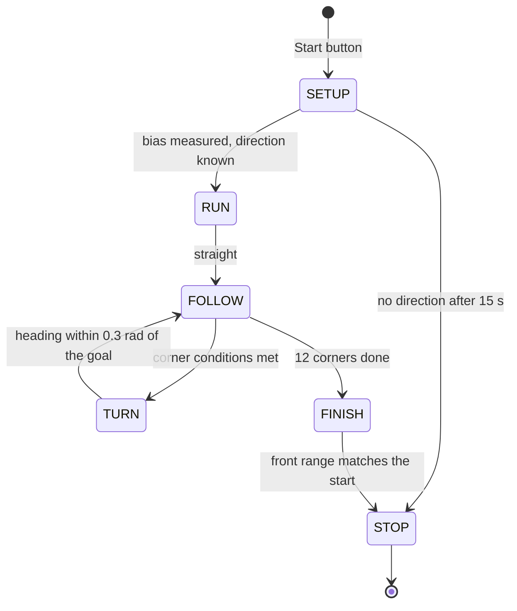

# 08 · Open Challenge

The Open Challenge asks for three laps of a field where the inner walls change from round to round, and where the starting direction is not given. There are no signs, so the strategy can be much simpler than the Obstacle one: we use the **fewest states and the least code** that finishes the three laps reliably. The code is the package `src/robotek_open` (`robotek_open/v5/`), which shares the hardware adapters, the recording and the launch file with the Obstacle.

## What it uses

* The **LiDAR** for the walls and the island.
* The **gyroscope** for the heading.
* The **camera**, only once at the start, to decide the direction from the blue and the orange lines painted on the mat.

No odometry and no encoder: the distance driven on a straight is measured by how much nearer the front wall got.

## States

In the telemetry the states appear as WAIT_START, CALIBRATE, DETECT_DIRECTION, FOLLOW, TURN, FINISH and DONE.

### SETUP

For 0.3 s after Start the car stands still and measures two things: the **gyro bias** (the average gyro reading, which we subtract afterwards) and the **front range at the start**, which is used later to know where to stop. Calibrating after Start, and not before it, is what the rules require.

Then the camera votes for the direction. The detector (`open_vision.py`) measures how much blue line and how much orange line it sees on the mat, with a confidence, and from that infers the direction of the first turn. It needs several consistent frames before it accepts (3 in the car's settings), so one glare frame cannot decide. If the camera cannot decide within 1.0 s, a parameter can say which direction to assume and let the LiDAR correct it. After 15 s without any direction the car stops, which is better than guessing.

**The LiDAR can overrule the camera.** On 4 Nov 2026 glare hid the blue line and the camera chose clockwise on a counter-clockwise track; the car drove toward a wall waiting for an island end that opened on the other side. Before the first corner, the mission now watches the side away from the island: if it is open (more than 1.2 m) in three consecutive scans while the island is still close beside the car, the direction is flipped (`_check_direction`).

### FOLLOW (straights)

The car drives at a **heading law**. The goal heading is a multiple of 90° (it changes by ±90° at every corner), and the steering is

`steer = 0.8 · (goal heading + bias − heading) − 0.1 · yaw rate`

limited to the real wheel limit of 17.6°. The `bias` term moves the goal heading by up to 0.4 rad so that the car keeps **0.25 m from the island wall**: it is 0.3 rad of heading per metre of error, i.e. a gentle correction.

The gyro integrates a small error each lap, and the LiDAR corrects it: on a straight, the island wall shows the real heading of the car, and the yaw is pulled toward it once per scan. This fixed a drift we saw on 4 Nov (after two laps the car pointed 35–40° off while the mission thought it was straight), because our gyro reads about 6 % short in the corners.

**Speed.** Cruise speed is 1.28 m/s on straights. The car slows to 1.0 m/s on approach to a corner: when the front wall is closer than the turn distance plus a braking margin, the speed above the corner speed falls with the gap (2 per second per metre).

### TURN (corners)

Three conditions must hold at the same time (`turn_checks`):

1. At least 0.25 m driven since the last corner (so that the end of the island seen right after a corner is not taken for the next one).
2. The front wall is closer than **1.19 m** along the track axis.
3. The island has ended: either the side that was the island now reads open (farther than 1.0 m) or the end of the island wall has been seen ahead in two consecutive scans, closer than 0.35 m (shorter in a narrow lane).

When all three are true the goal heading changes by 90° in the driving direction and the car turns at **full lock** at 1.0 m/s. The arc ends when the heading is within 0.3 rad of the goal; at that moment the straight-line law, which is on from the first moment, finishes the turn and returns the car to 25 cm from the island. We tested a ramped steering reference and it gave the same results in the lab, so the full-lock arc stayed because it is simpler.

### FINISH and STOP

After 12 corners the car is back in the starting section. It drives at 0.15 m/s with the wheels straight until the front range matches the one measured at Start (within 8 cm) and the heading is within 0.1 rad of straight, then brakes and waits 0.9 s at rest before reporting DONE. It brakes only when it is straight again: braking with the wheels still turned left the car rolling into the island in some lab rounds.

## Crash detector

`crash_watch.py` keeps the last five seconds of the round and says when the car has hit something, from two signals: the LiDAR going blind against a wall (fewer than 120 valid rays of 504 for 0.4 s while the car is told to move), or a jump of the yaw rate bigger than any corner gives within 0.1 s. On a crash the car stops, the board is reset and the window is saved. It is off by default and can be turned on at launch.

## Why this design

Our first Open version was a wall-following PID that kept the car centred (distance to one wall minus distance to the other; see [vehicle-history.md](vehicle-history.md) and the first README). The v5 uses only what the track guarantees: straights are straight, corners are 90° and the island is a closed shape. With that we could remove states and parameters until the rounds were repeatable in the lab. The list of choices and their data is in [04](04-systems-thinking-and-engineering-decisions.md).
