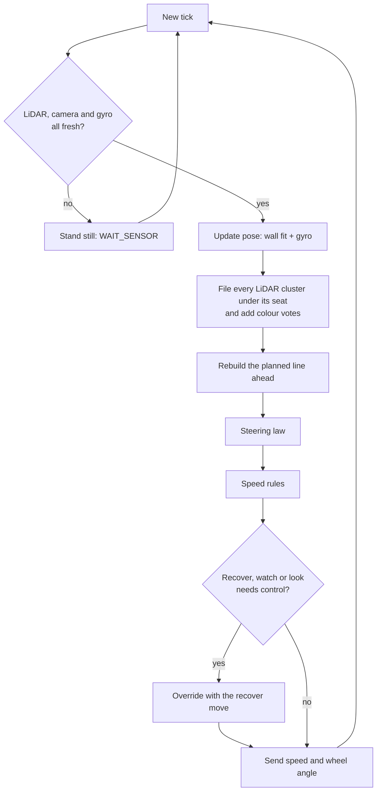
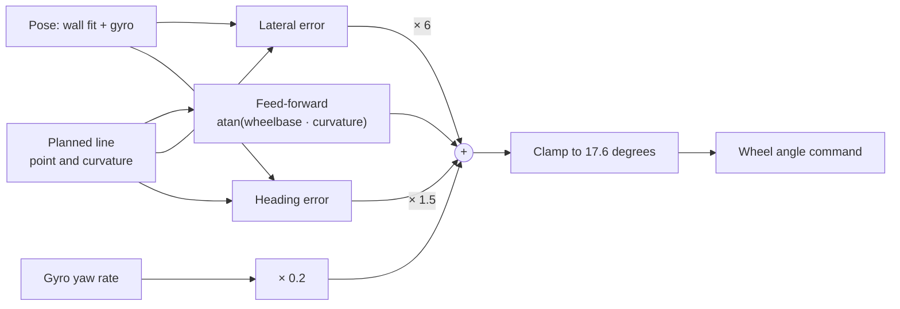
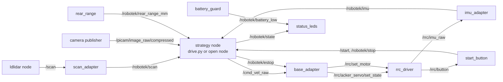
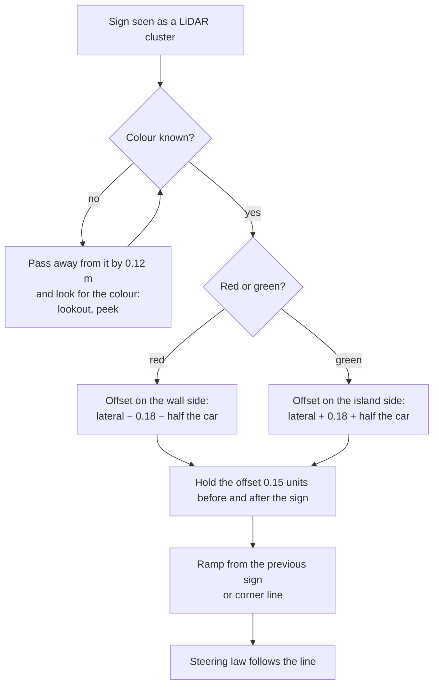

# Diagrams

Every diagram of the project in one place. Most are drawn as text (Mermaid), which GitHub renders and which lives next to the code, so it stays up to date with it. The table says where each one is, and the last section lists what still has to be drawn by hand.

| # | Diagram | Type | Where |
| --- | --- | --- | --- |
| 1 | Power and data block diagram of the car | Block diagram | [02](02-power-and-sensor-architecture.md#1-block-diagram-power-and-data) |
| 2 | Subsystem interaction (sensors → decisions → actuators) | Block diagram | [04](04-systems-thinking-and-engineering-decisions.md#1-how-the-subsystems-interact) |
| 3 | Obstacle state machine | State diagram | [03](03-software-architecture-and-obstacle-strategy.md#2-state-machine) |
| 4 | Finding signs: LiDAR clusters, colour blobs, pairing | Flowchart | [06](06-obstacle-detection-and-avoidance.md#1-finding-signs) |
| 5 | Recovery from contacts and servo faults | Flowchart | [06](06-obstacle-detection-and-avoidance.md#7-when-something-goes-wrong) |
| 6 | One pulse of the lot exit | Flowchart | [07](07-lot-exit-and-parallel-parking.md#what-a-single-pulse-does) |
| 7 | Parallel parking sequence | Flowchart | [07](07-lot-exit-and-parallel-parking.md#2-parking-in-parallel) |
| 8 | Open Challenge state machine | State diagram | [08](08-open-challenge.md#states) |
| 9 | Control loop of the Obstacle (below) | Flowchart | this page |
| 10 | Steering law (below) | Block diagram | this page |
| 11 | ROS 2 nodes and topics of the car (below) | Graph | this page |
| 12 | Decision flow of an Obstacle sign (below) | Flowchart | this page |

## 9. Control loop of the Obstacle (50 Hz)

## 10. Steering law

## 11. ROS 2 nodes and topics of the car

## 12. Decision flow for one sign

## Still to be produced as images

These cannot be generated from the code and need either a CAD program, a photo session or a schematic editor. They are listed in [the checklist](../README.md#what-is-still-missing-before-the-final).

1. **Wiring diagram of the current car** (schematic with the real connectors: RRC Lite J4 for the servo, M2 for the motor, power inputs, Pi USB ports, I²C of the VL53L0X). The picture in the diagram 1 is a block diagram, not a wiring schematic.
2. **Dimensioned drawing** of the car (top, side and front views with the measures used in the rules check).
3. **Exploded view** of the mechanical assembly.
4. **Ackermann geometry drawing** with the measured wheel angles.
5. **Test setups** (photo or sketch): the circle test for the wheel angle and the lot with its limits and the car.
6. **Field map with the track units** (the lane, the seats and the corner numbering used by the software).
